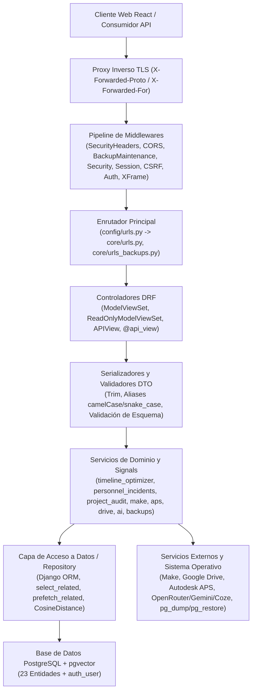
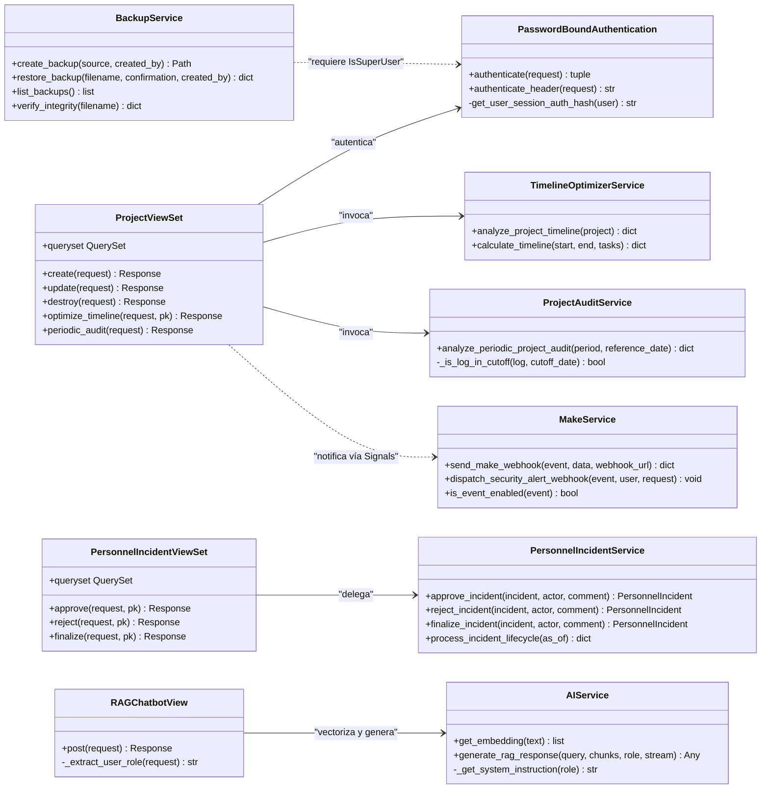
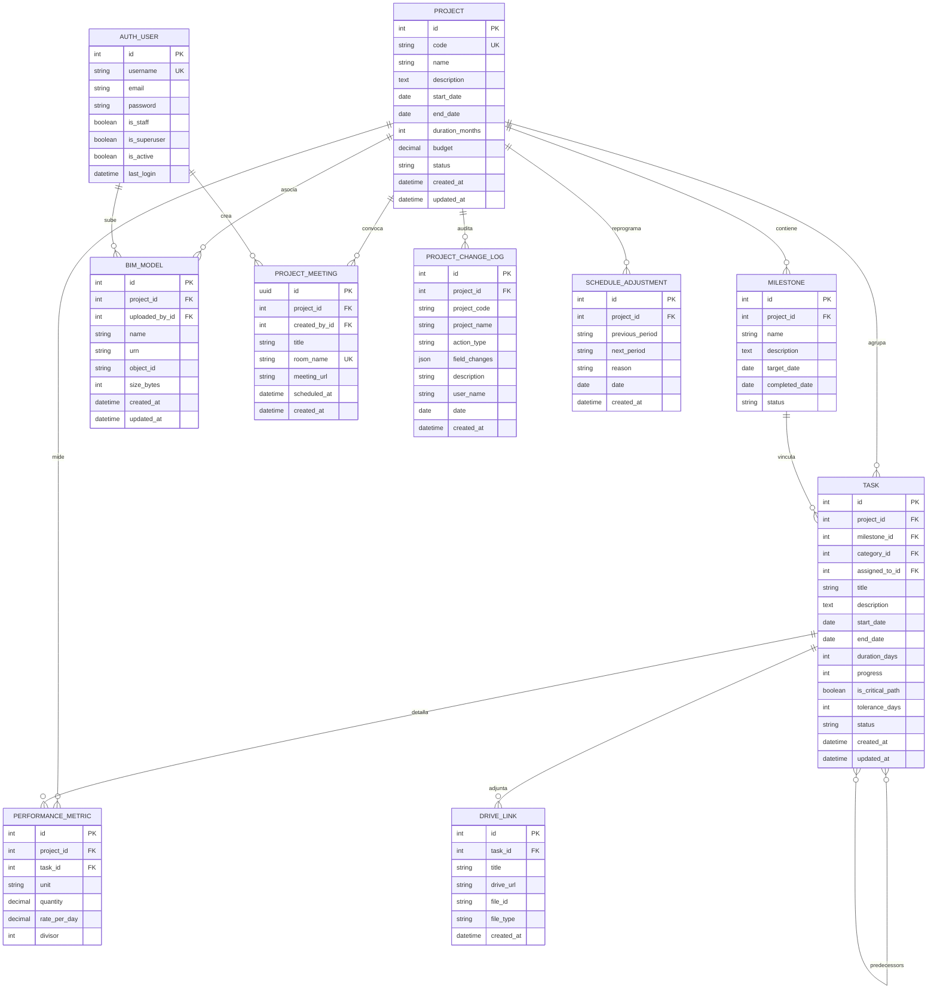
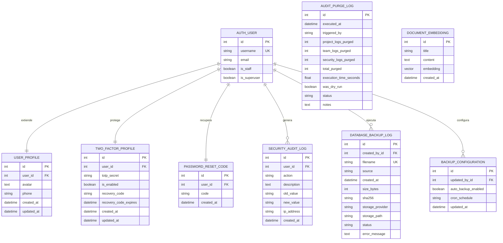
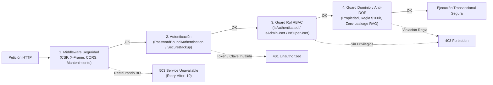

# Documento de Diseño de Software: Capa de Lógica, Servicios y Persistencia (Backend)
## Estándar IEEE 1016-2009 / ISO/IEC/IEEE 42010

| Metadato                 | Detalle                                                                         |
| :----------------------- | :------------------------------------------------------------------------------ |
| **Proyecto**             | Project Planner — Sistema de Planificación, Optimización y Gestión de Proyectos |
| **Documento**            | SDD-BE: Software Design Description – Backend                                   |
| **Versión**              | 1.0.0                                                                           |
| **Fecha**                | Noviembre 2026                                                                  |
| **Enlace del Repositorio** | `https://github.com/tu-organizacion/project-planner`                           |

---

## 1. Introducción

### 1.1. Propósito del Documento
El presente documento describe el diseño arquitectónico y detallado de la capa de servidor (lógica de negocio, servicios de dominio, contratos de API REST, persistencia relacional/vectorial y mecanismos de seguridad) del sistema **Project Planner**, en estricta conformidad con el estándar internacional **IEEE Std 1016-2009** (*Software Design Descriptions*) y la norma **ISO/IEC/IEEE 42010:2011**.

Este documento constituye la fuente canónica de diseño para el backend desarrollado sobre **Django 6.1** y **Django REST Framework (DRF)**, estableciendo los puntos de vista lógico, de interfaces, de información, de seguridad y de gestión de excepciones, así como la trazabilidad bidireccional hacia los requisitos funcionales conforme a **ISO/IEC/IEEE 29148:2018**.

### 1.2. Alcance del Sistema (Capa Backend)
El backend de **Project Planner** centraliza el procesamiento transaccional, la gobernanza corporativa, la validación de entradas, el control de acceso y la orquestación de integraciones externas a través de los siguientes subsistemas:

1. **Módulo de Autenticación, Sesiones, 2FA y Auditoría de Seguridad:** Validación de credenciales con hashing criptográfico, emisión de tokens HMAC vinculados a contraseña y correo (`PasswordBoundAuthentication`), autenticación de dos factores TOTP obligatoria para administradores, recuperación de acceso vía OTP de 6 dígitos y bitácora inmutable en `SecurityAuditLog`.
2. **Módulo de Portafolio, Gobernanza y Planificación Estratégica:** Gestión de proyectos (`Project`), hitos globales (`Milestone`), reglas de gobernanza presupuestaria ($100,000 USD), historial inmutable de cambios (`ProjectChangeLog`), reajustes de calendario maestro (`ScheduleAdjustment`) y auditoría periódica de salud y estado `STALE`.
3. **Motor Operativo y Optimización de Cronogramas:** Gestión de órdenes de trabajo (`Task`), dependencias predecesoras, métricas de rendimiento (`PerformanceMetric`), análisis heurístico de ruta crítica (CPM), holguras y asignación secuencial de recursos sin solapamiento (`timeline_optimizer.py`).
4. **Módulo de Recursos Humanos y Directorio Técnico:** Administración de áreas técnicas (`TechnicalArea`), roles (`Role`), estados (`TeamStatus`), integrantes (`TeamMember`), alta atómica conjunta de técnico y cuenta de usuario (`CreateTechnicianView`), flujo transaccional de incidencias/licencias (`PersonnelIncident`) con respaldo y restauración automática, e historial permanente (`TeamMemberChangeLog`).
5. **Módulo de Colaboración e Integraciones Externas:** Salas dinámicas de videoconferencia Jitsi (`ProjectMeeting`), gestión documental OAuth 2.0 con Google Drive (`DriveLink`), bóveda y visor 3D BIM en Autodesk Platform Services (`BIMModel`, `APSService`) y automatización bidireccional mediante webhooks con Make (`make_service.py`).
6. **Módulo de Continuidad Operativa y Respaldos PostgreSQL:** Exportación binaria `pg_dump` con integridad SHA-256, restauración transaccional `pg_restore --single-transaction` protegida por cerrojos de sistema operativo y middleware de mantenimiento (`BackupMaintenanceMiddleware`), e historial auditable (`DatabaseBackupLog`, `BackupConfiguration`).
7. **Módulo de Asistente de IA y Búsqueda Semántica (RAG):** Vectorización de 768 dimensiones mediante Google Gemini (`gemini-embedding-001`), recuperación por distancia coseno en PostgreSQL con `pgvector` (`DocumentEmbedding`), filtrado RBAC *Zero-Leakage* y generación en streaming SSE vía OpenRouter (o adaptador opcional Coze).

### 1.3. Definiciones, Acrónimos y Abreviaturas
* **SDD:** *Software Design Description* (Descripción del Diseño de Software).
* **API:** *Application Programming Interface* (Interfaz de Programación de Aplicaciones).
* **REST:** *Representational State Transfer*.
* **DRF:** *Django REST Framework*.
* **OAS:** *OpenAPI Specification* (Especificación OpenAPI 3.0.3).
* **RBAC:** *Role-Based Access Control* (Control de Acceso Basado en Roles).
* **ORM:** *Object-Relational Mapping* (Mapeo Objeto-Relacional de Django).
* **DTO:** *Data Transfer Object* (Materializado en DRF mediante `Serializer`).
* **CPM:** *Critical Path Method* (Método de Ruta Crítica).
* **TOTP:** *Time-Based One-Time Password* (RFC 6238).
* **OTP:** *One-Time Password* (Código temporal de un solo uso).
* **HMAC:** *Hash-based Message Authentication Code*.
* **RAG:** *Retrieval-Augmented Generation* (Generación Aumentada por Recuperación).
* **APS / OSS / SVF / URN:** *Autodesk Platform Services / Object Storage Service / Simple Vector Format / Uniform Resource Name*.
* **IDOR:** *Insecure Direct Object Reference* (Referencia Directa Insegura a Objetos).
* **CSP / CORS / CSRF:** *Content Security Policy / Cross-Origin Resource Sharing / Cross-Site Request Forgery*.

### 1.4. Referencias Normativas
* **IEEE Std 1016-2009:** *IEEE Standard for Information Technology — Systems Design — Software Design Descriptions*.
* **ISO/IEC/IEEE 42010:2011:** *Systems and software engineering — Architecture description*.
* **ISO/IEC/IEEE 29148:2018:** *Systems and software engineering — Life cycle processes — Requirements engineering*.
* **ISO/IEC 25010:2011 / 2023:** *Systems and software Quality Requirements and Evaluation (SQuaRE)*.
* **OpenAPI Specification (OAS 3.0.3):** Contrato formal generado en la especificación formal OpenAPI 3.0.3 del repositorio (`schema.yml`) mediante `drf-spectacular`.
* **OWASP Top 10 (2021) & OWASP WSTG:** Guía de mitigación de vulnerabilidades web críticas y pruebas de seguridad.
* **RFC 7807:** *Problem Details for HTTP APIs* (Marco de referencia para estandarización de respuestas de error HTTP).

---

## 2. Visión General de la Arquitectura del Servidor

### 2.1. Stack Tecnológico de Servidor
El servidor de **Project Planner** sigue una arquitectura monolítica modular en capas (*Layered Modular Architecture*), orientada a dominios cohesivos dentro de la aplicación `core` y configurada centralmente en `config`:

* **Lenguaje y Runtime:** Python 3.12+ (tipado gradual con *type hints* estándar).
* **Framework Web y API:** Django `6.1`, Django REST Framework `3.18.0`, `drf-spectacular >= 0.28.0` (OpenAPI 3.0.3, Swagger UI y Redoc).
* **Servidor WSGI / ASGI y Estáticos:** Gunicorn `23.0.0`, WhiteNoise `6.9.0` (`CompressedStaticFilesStorage`).
* **Persistencia Principal y Vectorial:** PostgreSQL 14+ (mediante `dj-database-url 2.3.0` y `psycopg2-binary 2.9.13`) con extensión `pgvector >= 0.5.1` (`VectorField(dimensions=768)`); SQLite 3 disponible exclusivamente como modo de respaldo local en desarrollo (`USE_SQLITE`).
* **Seguridad, 2FA y Criptografía:** `django-cors-headers 4.9.0`, `pyotp >= 2.9.0`, `qrcode >= 7.4.2`, `Pillow >= 10.0.0`, módulo nativo `django.core.signing` y `salted_hmac` (SHA-256).
* **Integraciones y Motor de IA:** `google-api-python-client`, `google-auth`, `google-auth-oauthlib`, `google-genai >= 1.0.0`, `openai >= 1.40.0` (cliente OpenRouter), `requests 2.31.0`.
* **Configuración y Despliegue:** `django-environ 0.14.0` (gestión de secretos vía `.env`), desplegable en contenedores Linux / Render (`SECURE_PROXY_SSL_HEADER`).

### 2.2. Diagrama de Arquitectura en Capas
La siguiente vista estructural describe el flujo de procesamiento de una petición HTTP desde su ingreso por el proxy inverso hasta la persistencia y servicios externos:



---

## 3. Preocupaciones de Diseño (*Design Concerns - IEEE 1016*)

1. **Seguridad de la Información (OWASP Top 10):**
   * **Prevención de Inyecciones (A03):** Todas las consultas a base de datos se canalizan mediante el ORM parametrizado de Django (`QuerySet`), sin concatenación de sentencias SQL. Las entradas de texto (correos, nombres de usuario, códigos OTP, carpetas y parámetros) se sanean con `.strip()`. El módulo de respaldos valida nombres de archivo con la expresión regular estricta `^project_planner_\d{8}_\d{6}_[0-9a-f]{8}\.dump$` y prohíbe enlaces simbólicos (*symlinks*) o *Path Traversal*. Las consultas hacia Google Drive escapan apóstrofes y barras invertidas mediante `_escape_drive_query_value()`. Los avatares en Base64 pasan validación de formato Data URI, tamaño máximo (`80 KB`) y verificación binaria de *magic bytes* (`JPEG`, `PNG`, `WEBP`).
   * **Protección contra Fuerza Bruta y Rate Limiting:** Todos los extractores de IP (`get_client_ip`, `_extract_client_ip`, `extract_client_request_metadata`) desacoplan la dirección IP de proxies inversos leyendo el primer salto de `HTTP_X_FORWARDED_FOR` con respaldo en `REMOTE_ADDR`. La arquitectura contempla límites por cuenta de usuario (correo/identificador) e IP real para evitar bloqueos colaterales en subredes corporativas compartidas. Los endpoints sensibles (`login_view`, `PasswordResetRequestView`, `SecureBackupAuthentication`) implementan respuestas anti-enumeración y códigos de error explícitos (`400`, `401`, `403`), nunca retornando `200 OK` ante bloqueos o fallos de autenticación; adicionalmente, la capa de IA captura y traduce límites de cuota `429 Too Many Requests` de OpenRouter, Gemini y Coze.
   * **Almacenamiento Criptográfico Seguro y Sesiones:** Las contraseñas de usuario utilizan el algoritmo **PBKDF2-SHA256** nativo de Django 6.1 (extensible a **Argon2id** mediante `PASSWORD_HASHERS`), sujeto a la política unificada `password_policy.py` (mínimo 12 caracteres, mayúsculas, minúsculas, dígitos, símbolos y cero espacios). Los tokens `Bearer` emitidos por `issue_session_token()` se firman con `django.core.signing` (duración máxima de 30 días) e incrustan un digest `salted_hmac` SHA-256 calculado sobre el hash de contraseña y el correo canónico del usuario; cualquier cambio de contraseña o correo invalida instantáneamente todas las sesiones previas y se verifica con `constant_time_compare`.
   * **Control de Acceso y Mitigación de IDOR (A01):** Endpoints sensibles derivan la identidad del actor directamente desde `request.user` autenticado (por ejemplo, `change_password_view` prohíbe modificar contraseñas por parámetros de cuerpo). Las vistas administrativas exigen `IsAdminUser` o `IsSuperUser`; `ProjectViewSet.update` impide a usuarios no administradores alterar `budget`, y `ProjectViewSet.destroy` exige `is_staff` o `is_superuser`. En el módulo RAG, la directiva *Zero-Leakage* excluye en tiempo de consulta los fragmentos marcados como `[Rol: Administrador]` para usuarios técnicos.

2. **Rendimiento y Escalabilidad:**
   * **Mitigación del Problema N+1:** Los ViewSets aplican carga anticipada sistemática mediante `select_related` (relaciones `ForeignKey`/`OneToOne`) y `prefetch_related` (relaciones inversas y `ManyToMany`), destacándose `ProjectViewSet`, `TaskViewSet`, `TeamMemberViewSet`, `PersonnelIncidentViewSet` y `project_audit_service.py`.
   * **Indexación de Alta Selectividad:** Las tablas de auditoría e incidencias incorporan índices explícitos en base de datos (`sec_audit_created_idx`, `sec_audit_user_created_idx`, `team_changelog_created_idx`, `proj_changelog_proj_created`, `sched_adj_proj_created_idx`, `db_backup_created_idx`, `db_backup_status_idx`) y políticas de depuración por lotes (`purge_old_logs`, lotes de 5,000 registros).
   * **Streaming y Despacho Asíncrono:** El asistente de IA utiliza `StreamingHttpResponse` (`text/event-stream`) para reducir el *Time-to-First-Byte* (TTFB). Los webhooks hacia Make se ejecutan en hilos *daemon* registrados sobre `transaction.on_commit()`, evitando bloquear transacciones HTTP de usuario ante latencias de red externas.
   * **Conexiones Cloud:** Configuración de `CONN_MAX_AGE = 0`, `conn_health_checks = True` y `DISABLE_SERVER_SIDE_CURSORS = True` en `config/settings.py` para compatibilidad con balanceadores *pooler* de PostgreSQL en la nube (p. ej. PgBouncer / Render).

3. **Integridad Transaccional y Validación de Datos:**
   * **Atomicidad y Bloqueo Pesimista:** Las operaciones críticas de RRHH (`approve_incident`, `reject_incident`, `finalize_incident`, `PersonnelIncidentSerializer.create`), alta conjunta de técnicos (`CreateTechnicianSerializer.create`), actualizaciones y bajas de personal (`TeamMemberViewSet`) operan dentro de `@transaction.atomic` utilizando `select_for_update()` para prevenir condiciones de carrera y solapamientos de cobertura.
   * **Restricciones en Motor Relacional:** Uso de `CheckConstraint` en `TeamMember` y `PersonnelIncident` para garantizar porcentajes `[0, 100]` y rangos cronológicos válidos (`end_date >= start_date`), además de `unique_together` y campos `unique=True`.
   * **Exclusión Mutua en Respaldos:** `database_backups.py` emplea cerrojos de archivo a nivel de sistema operativo (`fcntl.flock` en Linux / `msvcrt.locking` en Windows) sobre `.operation.lock` y `.restore.lock`, junto con `pg_restore --single-transaction` y respaldo preventivo automático `before_restore`.

4. **Mantenibilidad y Clean Architecture:**
   * **Separación de Capas:** Desacoplamiento claro entre enrutamiento (`urls.py`), capa de transporte HTTP (`views.py`, `views_backups.py`, `views_make.py`, `chatbot_views.py`), transformación y validación de contratos (`serializers.py`), reglas puras de dominio (`core/services/*.py`), eventos reactivos (`signals.py`) y persistencia (`models.py`).
   * **Contratos Desacoplados:** Documentación viva autogenerada con `drf-spectacular` en `/api/schema/`, `/api/docs/` y `/api/redoc/`.

---

## 4. Puntos de Vista de Diseño (*Design Viewpoints*)

### 4.1. Vista Lógica: Estructura de Controladores y Patrones de Diseño

#### 4.1.1. Catálogo de Controladores y Vistas
El enrutamiento en `core/urls.py` y `core/urls_backups.py` organiza los controladores por dominio funcional:

* **ViewSets CRUD y de Auditoría (`core/views.py`):**
  * `TechnicalAreaViewSet`, `RoleViewSet`, `TeamStatusViewSet`: Catálogos base de especialidades, cargos y estados operativos del personal.
  * `TeamMemberViewSet`: Directorio técnico con normalización de IDs prefijados (`tech-db-1`, `hr-db-1`), protección contra edición directa de estado durante incidencias activas, registro automático en `TeamMemberChangeLog` y soporte para baja lógica (`deactivate`) o eliminación física (`hard_delete`).
  * `PersonnelIncidentViewSet`: Gestión del ciclo de aprobación de licencias/ausencias con acciones personalizadas `@action`: `approve`, `reject` y `finalize`.
  * `TeamMemberChangeLogViewSet`: Consulta de solo lectura (`ReadOnlyModelViewSet`) de cambios históricos de personal.
  * `ProjectViewSet`: Gestión de portafolio con reglas de gobernanza ($100k y bloqueo de presupuesto a no-admins), auditoría de motivos de cambio de estado, y acciones `@action`: `optimize_timeline` (`/optimize/`) y `periodic_audit` (`/periodic-audit/`).
  * `MilestoneViewSet`, `TaskViewSet`, `PerformanceMetricViewSet`, `DriveLinkViewSet`: Gestión estratégica de hitos, tareas de ruta crítica con predecesores M2M, rendimientos y enlaces documentales.
  * `ProjectMeetingViewSet`: Gestión de salas Jitsi Meet con generación automática de `room_name` y `meeting_url` mediante UUID.
  * `ProjectChangeLogViewSet`, `ScheduleAdjustmentViewSet`: Vistas `ReadOnlyModelViewSet` que garantizan inmutabilidad vía API para trazabilidad de portafolio y calendario maestro.
* **Vistas de Autenticación, Perfil, 2FA y Recuperación (`core/views.py`):**
  * `login_view`, `logout_view`, `session_validate_view`, `change_password_view`, `user_profile_view`, `users_status_view`, `audit_logs_view`, `notifications_view`.
  * `Setup2FAView`, `Verify2FAView`, `Request2FAResetView`, `Verify2FAResetView`: Aprovisionamiento TOTP (QR Base64 + `otpauth://`), verificación de código de 6 dígitos (`valid_window=1`) y flujo de restablecimiento por extravío.
  * `PasswordResetRequestView`, `PasswordResetVerifyCodeView`, `PasswordResetConfirmView`: Emisión y verificación de códigos OTP de 6 dígitos con TTL de 15 minutos.
  * `CreateTechnicianView`: Alta atómica de `User` y `TeamMember`.
* **Vistas de Respaldos PostgreSQL (`core/views_backups.py`):**
  * `backup_history_view`, `toggle_auto_backup_view`, `export_database_view`, `restore_database_view`, `download_backup_view`.
* **Vistas de Integraciones Externas y Diagnóstico (`core/views.py`, `core/views_make.py`):**
  * Google Drive: `google_drive_connect_view`, `google_drive_callback_view`, `google_drive_status_view`, `google_drive_files_view`, `google_drive_create_folder_view`, `google_drive_upload_view`, `google_drive_file_detail_view`.
  * Autodesk APS (BIM 3D): `APSStatusView`, `BIMModelListView`, `BIMModelDetailView`, `APSUploadView`, `APSTokenView`, `APSDownloadView`.
  * Make (Integromat): `make_status_view`, `save_make_config_view`, `test_make_connection_view`, `trigger_make_event_view`, `make_incoming_webhook_view`.
  * Diagnóstico: `test_db_connection`.
* **Vistas del Asistente de IA / RAG (`core/chatbot_views.py`):**
  * `ChatbotView`: Respuesta conversacional en streaming SSE enriquecida con búsqueda semántica `pgvector`.
  * `RAGChatbotView`: Búsqueda semántica y generación RAG en modo síncrono JSON o streaming SSE.

#### 4.1.2. Patrones de Diseño Implementados
* **Repository (Acceso a Datos):** Encapsulado en los `Manager` y `QuerySet` del ORM de Django y métodos especializados como `BackupConfiguration.get_solo()`, desacoplando las consultas con `select_related`/`prefetch_related` y búsquedas vectoriales (`CosineDistance`) de los controladores.
* **Strategy / Dispatcher (Selección Dinámica de Comportamiento):**
  * En `ai_service.py`, `generate_rag_response()` selecciona dinámicamente la estrategia de generación (`_stream_rag_response` / `_sync_rag_response` vía OpenRouter o `stream_coze_response` / `get_coze_response` vía Coze) según `AI_CHAT_PROVIDER` y `COZE_ENABLED`.
  * En `make_service.py`, `get_configured_make_webhook_url()` y `_task_matches_event()` enrutan eventos específicos hacia el endpoint configurado por tarea o al webhook global.
* **Observer (Eventos de Dominio vía Django Signals):** Implementado en `core/signals.py` y registrado en `CoreConfig.ready()`. Observa `pre_save`, `post_save`, `pre_delete` y `post_delete` sobre `Project`, `TeamMember`, `Task`, `ProjectMeeting`, `Milestone` y `PersonnelIncident` para generar deltas inmutables en `ProjectChangeLog` y despachar webhooks asíncronos post-commit.
* **Policy / Governance Guard (Reglas Corporativas y Autorización):** Validación de presupuesto (> $100,000 USD requiere revisión de Comité Directivo), protección contra modificación de presupuestos o eliminación de proyectos por usuarios no administrativos en `ProjectViewSet`, `SecureBackupAuthentication`, `IsSuperUser` y filtrado *Zero-Leakage* en RAG.
* **Adapter (Integración de Proveedores Externos):** `APSService` (Autodesk OSS y Model Derivative), `google_drive.py` (Google Drive API v3 + OAuth 2.0), `coze_service.py` (normalización de eventos SSE de Coze v3), `make_service.py` (webhooks Make y API v2 de organizaciones) y `BackupService` (fachada sobre utilidades CLI `pg_dump` / `pg_restore`).

#### 4.1.3. Diagrama de Clases y Componentes Lógicos



---

### 4.2. Vista de Interfaces: Especificación OpenAPI / Contrato de Endpoints

La especificación formal OpenAPI 3.0.3 se expone dinámicamente en `/api/schema/`, con consolas interactivas en `/api/docs/` (Swagger UI) y `/api/redoc/` (Redoc), y se encuentra exportada en la especificación formal OpenAPI 3.0.3 del repositorio (`schema.yml`). Todas las rutas de negocio cuelgan del prefijo base `/api/`.

#### Módulo 1: Autenticación, Sesión, Perfil, 2FA y Recuperación OTP

| Método | Endpoint | Permisos | Payload / Parámetros | Códigos HTTP |
| :---: | :--- | :--- | :--- | :--- |
| `POST` | `/api/auth/login/` | Pública (`AllowAny`) | `{"email" / "username", "password", "role"}` | `200`, `400`, `401`, `403`, `429` |
| `POST` | `/api/auth/logout/` | Pública (`AllowAny`) | `{"username" / "email"}` | `200` |
| `GET` | `/api/auth/session/validate/` | `Bearer` (`IsAuthenticated`) | Cabecera `Authorization: Bearer <token>` | `200`, `401`, `403` |
| `POST` | `/api/auth/change-password/` | `Bearer` (`IsAuthenticated`) | `{"current_password", "new_password", "confirm_password"}` | `200`, `400`, `401`, `403` |
| `GET` | `/api/auth/profile/` | `Bearer` / `Session` | Query: `?user_id`, `?identifier`, `?email` | `200`, `404` |
| `PATCH`, `POST` | `/api/auth/profile/` | `Bearer` / `Session` | `{"avatar", "phone", "name", "email", "current_password"}` | `200`, `400`, `404` |
| `GET` | `/api/auth/audit-logs/` | Admin | Query: `?action`, `?user`, `?start`, `?end` (últimos 50) | `200` |
| `GET` | `/api/auth/users-status/` | `Bearer` / `Session` | Sin cuerpo (lista técnicos y presencia `isOnline`) | `200` |
| `PATCH` | `/api/auth/users-status/` | `is_superuser` | `{"id" / "db_id", "isSubAdmin": boolean}` | `200`, `400`, `401`, `403`, `404` |
| `POST` | `/api/auth/setup-2fa/` | Admin (`is_staff`/`is_superuser`) | Genera secreto TOTP Base32 y código QR | `200`, `403` |
| `POST` | `/api/auth/verify-2fa/` | Pública | `{"user_id", "code"}` | `200`, `400`, `404`, `429` |
| `POST` | `/api/auth/request-2fa-reset/` | Pública (valida Admin) | `{"user_id"}` | `200`, `400`, `404`, `429` |
| `POST` | `/api/auth/verify-2fa-reset/` | Pública | `{"user_id", "recovery_code"}` | `200`, `400`, `404` |
| `POST` | `/api/auth/password-reset/request/` | Pública | `{"email": "usuario@dominio.com"}` | `200`, `400`, `429` |
| `POST` | `/api/auth/password-reset/verify-code/` | Pública | `{"email", "code": "123456"}` | `200`, `400`, `429` |
| `POST` | `/api/auth/password-reset/confirm/` | Pública | `{"email", "code", "new_password", "confirm_password"}` | `200`, `400` |

*Ejemplo de Contrato Request/Response (`POST /api/auth/login/`):*
```json
// Request
{
  "email": "admin@projectplanner.com",
  "password": "Str0ng#Password2026",
  "role": "admin"
}

// Response 200 OK (con 2FA habilitado para Admin)
{
  "requires_2fa": true,
  "user_id": 1,
  "is_2fa_setup": true,
  "status": "requires_2fa",
  "message": "Se requiere 2FA"
}
```

#### Módulo 2: Portafolio de Proyectos, Optimización y Auditoría

| Método | Endpoint | Permisos | Payload / Parámetros | Códigos HTTP |
| :---: | :--- | :--- | :--- | :--- |
| `GET` | `/api/projects/` | `Bearer` / `Session` | Query: `?status`, `?priority`, `?search` | `200` |
| `POST` | `/api/projects/` | `Bearer` / `Session` | `{"code", "name", "description", "start_date", "end_date", "budget"}` | `201`, `400` |
| `GET` | `/api/projects/{id}/` | `Bearer` / `Session` | Path `{id}` | `200`, `404` |
| `PUT`, `PATCH` | `/api/projects/{id}/` | `Bearer` / `Session` | Campos parciales (presupuesto solo Admin) + `status_change_reason` | `200`, `400`, `404` |
| `DELETE` | `/api/projects/{id}/` | `is_staff` / Admin | Path `{id}` (borrado con bitácora `ProjectChangeLog`) | `204`, `403`, `404` |
| `GET`, `POST` | `/api/projects/{id}/optimize/` | `Bearer` / `Session` | Path `{id}` (calcula CPM y holgura 7 días sin mutar) | `200`, `400`, `404` |
| `GET` | `/api/projects/periodic-audit/` | `Bearer` / `Session` | Query: `?period=monthly / quarterly / semiannual` | `200`, `500` |
| `GET` | `/api/project-change-logs/` | Lectura (`ReadOnlyModelViewSet`) | Query: `?project={id}` | `200` |
| `GET` | `/api/project-change-logs/{id}/` | Lectura (`ReadOnlyModelViewSet`) | Path `{id}` | `200`, `404` |
| `GET` | `/api/schedule-adjustments/` | Lectura (`ReadOnlyModelViewSet`) | Query: `?project={id}` | `200` |
| `GET` | `/api/schedule-adjustments/{id}/` | Lectura (`ReadOnlyModelViewSet`) | Path `{id}` | `200`, `404` |

#### Módulo 3: Hitos Estratégicos, Tareas Operativas y Reuniones Jitsi

| Método | Endpoint | Permisos | Payload / Parámetros | Códigos HTTP |
| :---: | :--- | :--- | :--- | :--- |
| `GET`, `POST` | `/api/milestones/` | `Bearer` / `Session` | Query: `?project={id}`<br>Body: `{"project", "name", "target_date", "status"}` | `200`, `201`, `400` |
| `CRUD` | `/api/milestones/{id}/` | `Bearer` / `Session` | Path `{id}` y campos de `MilestoneSerializer` | `200`, `204`, `400`, `404` |
| `GET`, `POST` | `/api/tasks/` | `Bearer` / `Session` | Query: `?project={id}&critical=true/false`<br>Body: `TaskSerializer` | `200`, `201`, `400` |
| `CRUD` | `/api/tasks/{id}/` | `Bearer` / `Session` | Path `{id}` y campos de `TaskSerializer` | `200`, `204`, `400`, `404` |
| `GET`, `POST` | `/api/meetings/` | `Bearer` (`IsAuthenticated`) | Query: `?project={id}`<br>Body: `{"project", "title", "scheduled_at"}` | `200`, `201`, `400` |
| `CRUD` | `/api/meetings/{id}/` | `Bearer` (`IsAuthenticated`) | Path `{id}` y campos de `ProjectMeetingSerializer` | `200`, `204`, `400`, `401`, `404` |

#### Módulo 4: Equipo Técnico, Áreas, Roles, Estados e Incidencias RRHH

| Método | Endpoint | Permisos | Payload / Parámetros | Códigos HTTP |
| :---: | :--- | :--- | :--- | :--- |
| `CRUD` | `/api/technical-areas/` y `/{id}/` | Estándar DRF | `{"name", "description"}` | `200`, `201`, `204`, `400`, `404` |
| `CRUD` | `/api/roles/` y `/{id}/` | Estándar DRF | Query: `?technical_area={id}`<br>Body: `RoleSerializer` | `200`, `201`, `204`, `400`, `404` |
| `CRUD` | `/api/team-statuses/` y `/{id}/` | Estándar DRF | `{"name", "description", "color_code"}` | `200`, `201`, `204`, `400`, `404` |
| `GET` | `/api/team-members/` y `/{id}/` | `AllowAny` en `GET` | Query: `?area={id}&status={id}&project={id}` | `200`, `404` |
| `POST`, `PUT`, `DELETE` | `/api/team-members/` y `/{id}/` | `Bearer` + `IsAdminUser` | `TeamMemberSerializer`<br>DELETE admite `?mode=deactivate / hard_delete` | `200`, `201`, `400`, `401`, `403`, `404` |
| `POST` | `/api/technicians/create/` | `Bearer` + `IsAdminUser` | `{"first_name", "last_name", "email", "password", "specialty", "area", "status"}` | `201`, `400`, `401`, `403` |
| `GET`, `POST` | `/api/personnel-incidents/` | `Bearer` + `IsAdminUser` | Query: `?member=&type=&status=`<br>Body: `PersonnelIncidentSerializer` | `200`, `201`, `400`, `401`, `403` |
| `CRUD` | `/api/personnel-incidents/{id}/` | `Bearer` + `IsAdminUser` | Path `{id}` (bloquea DELETE si `workflow_status == approved`) | `200`, `204`, `400`, `401`, `403`, `404` |
| `POST` | `/api/personnel-incidents/{id}/approve/` | `Bearer` + `IsAdminUser` | `{"comment": "opcional"}` | `200`, `400`, `401`, `403`, `404` |
| `POST` | `/api/personnel-incidents/{id}/reject/` | `Bearer` + `IsAdminUser` | `{"comment": "Motivo obligatorio"}` | `200`, `400`, `401`, `403`, `404` |
| `POST` | `/api/personnel-incidents/{id}/finalize/` | `Bearer` + `IsAdminUser` | `{"comment": "opcional"}` | `200`, `400`, `401`, `403`, `404` |
| `GET` | `/api/team-member-change-logs/` y `/{id}/` | `Bearer` + `IsAdminUser` | Query: `?member=&source=&action=&date_from=&date_to=` | `200`, `401`, `403`, `404` |

#### Módulo 5: Métricas de Rendimiento, Enlaces Drive y Notificaciones

| Método | Endpoint                               | Permisos         | Payload / Parámetros                                                       | Códigos HTTP                      |
| :----: | :------------------------------------- | :--------------- | :------------------------------------------------------------------------- | :-------------------------------- |
| `CRUD` | `/api/performance-metrics/` y `/{id}/` | Estándar DRF     | `{"project", "task", "unit", "quantity", "rate_per_day", "divisor"}`       | `200`, `201`, `204`, `400`, `404` |
| `CRUD` | `/api/drive-links/` y `/{id}/`         | Estándar DRF     | Query: `?task={id}&project={id}`<br>Body: `{"task", "title", "drive_url"}` | `200`, `201`, `204`, `400`, `404` |
| `GET`  | `/api/notifications/`                  | `Bearer` o Query | Query: `?username=&email=` (retorna alertas, hitos, asignaciones)          | `200`                             |

#### Módulo 6: Integraciones Externas (Google Drive, Autodesk APS BIM y Make)

| Método | Endpoint | Permisos | Payload / Parámetros | Códigos HTTP |
| :---: | :--- | :--- | :--- | :--- |
| `GET` | `/api/integrations/google-drive/status/` | `AllowAny` | Sin cuerpo (verifica token OAuth) | `200`, `400`, `500`, `502` |
| `GET` | `/api/integrations/google-drive/connect/` | `AllowAny` | Inicia flujo OAuth 2.0 y redirige a Google | `302`, `400`, `500` |
| `GET` | `/api/integrations/google-drive/callback/` | `AllowAny` | Query: `?code=...&state=...` | `302`, `400`, `500` |
| `GET` | `/api/integrations/google-drive/files/` | `AllowAny` | Query: `?folder_id=<id>` | `200`, `400`, `404`, `409`, `500`, `502` |
| `POST` | `/api/integrations/google-drive/folders/` | `AllowAny` | `{"name", "parent_id", "task"}` | `201`, `400`, `409`, `500`, `502` |
| `POST` | `/api/integrations/google-drive/upload/` | `AllowAny` | Multipart: `file` (máx. 100 MB), `folder_id`, `task` | `201`, `400`, `409`, `413`, `500`, `502` |
| `PATCH`, `DELETE` | `/api/integrations/google-drive/files/{file_id}/` | `AllowAny` | `{"name"}` en PATCH / vacío en DELETE | `200`, `204`, `400`, `403`, `404`, `409`, `500`, `502` |
| `GET` | `/api/integrations/aps/status/` | `AllowAny` | Sin cuerpo (credenciales 2-legged) | `200` |
| `GET` | `/api/integrations/aps/models/` | `AllowAny` | Sin cuerpo (lista URNs y estados SVF) | `200`, `500` |
| `PATCH`, `DELETE` | `/api/integrations/aps/models/{pk}/` | `AllowAny` | `{"name"}` en PATCH / ID en DELETE | `200`, `404`, `500` |
| `GET` | `/api/integrations/aps/models/{pk}/download/` | `Bearer` (`IsAuthenticated`) | Path `{pk}` (retorna URL firmada S3) | `200`, `401`, `404`, `500` |
| `POST` | `/api/integrations/aps/upload/` | `Bearer` (`IsAuthenticated`) | Multipart: `file` (`.rvt`, `.ifc`) | `200`, `400`, `401`, `500` |
| `GET` | `/api/integrations/aps/token/` | `AllowAny` | Sin cuerpo (token efímero `viewables:read`) | `200`, `500` |
| `GET` | `/api/integrations/make/status/` | `AllowAny` | Sin cuerpo (enmascara URL webhook) | `200` |
| `POST` | `/api/integrations/make/config/` | `AllowAny` | `{"webhook_url", "api_token", "frequency", "status"}` | `200`, `500` |
| `POST` | `/api/integrations/make/test/` | `AllowAny` | `{"webhook_url": "opcional"}` (evento ping) | `200`, `400` |
| `POST` | `/api/integrations/make/trigger/` | `AllowAny` | `{"event", "data": {...}, "webhook_url": "opcional"}` | `200`, `400`, `502` |
| `POST` | `/api/integrations/make/webhook/` | `AllowAny` | `{"action": "update_budget" / "ping", "project_id", "new_budget"}` | `200`, `400`, `404` |

#### Módulo 7: Respaldos y Restauración de PostgreSQL

| Método | Endpoint                            | Permisos      | Payload / Parámetros                           | Códigos HTTP                                           |
| :----: | :---------------------------------- | :------------ | :--------------------------------------------- | :----------------------------------------------------- |
| `GET`  | `/api/backups/`                     | `IsSuperUser` | Sin cuerpo (`Cache-Control: no-store`)         | `200`, `400`, `401`, `403`, `500`                      |
| `POST` | `/api/backups/toggle-auto/`         | `IsSuperUser` | `{"enabled": true / false}` (opcional)         | `200`, `401`, `403`, `500`                             |
| `POST` | `/api/backups/export/`              | `IsSuperUser` | Sin cuerpo (retorna binario `.dump`)           | `200`, `400`, `401`, `403`, `409`, `500`, `504`        |
| `POST` | `/api/backups/restore/`             | `IsSuperUser` | `{"filename", "confirm_database", "password"}` | `200`, `400`, `401`, `403`, `404`, `409`, `500`, `504` |
| `GET`  | `/api/backups/{filename}/download/` | `IsSuperUser` | Path `{filename}` (regex `.dump`)              | `200`, `400`, `401`, `403`, `404`, `500`               |

#### Módulo 8: Asistente de IA, Búsqueda Semántica RAG y Diagnóstico

| Método | Endpoint | Permisos | Payload / Parámetros | Códigos HTTP |
| :---: | :--- | :--- | :--- | :--- |
| `POST` | `/api/chatbot/` | `Bearer` (`IsAuthenticated`) | `{"message" / "prompt"}` (retorna `text/event-stream` SSE) | `200`, `400`, `401`, `429` |
| `POST` | `/api/chatbot/rag/` | `Bearer` (`IsAuthenticated`) | `{"message" / "query" / "prompt", "stream": true / false}` | `200`, `400`, `401`, `429`, `500` |
| `POST` | `/api/chatbot/search/` | `Bearer` (`IsAuthenticated`) | Query params / `{"query": string}` | `200`, `400`, `401`, `429`, `500` |
| `GET` | `/api/test-db/` | Pública (diagnóstico) | Sin cuerpo (ejecuta `SELECT 1` y mide latencia) | `200`, `500` |

### 4.3. Vista de Información: Modelo Físico de Base de Datos

El esquema físico relacional y vectorial definido en el módulo de modelos `core/models.py` comprende **23 entidades de dominio** integradas con la tabla nativa `auth_user` de Django. Para evitar cruces de líneas y mantener legibilidad de ingeniería, el modelo físico se presenta en tres diagramas ERD cohesivos por dominio seguidos del diccionario de datos completo.

#### 4.3.1. ERD Subsistema 1: Portafolio, Planificación, Operaciones y Colaboración



#### 4.3.2. ERD Subsistema 2: Equipo Técnico y Recursos Humanos

```mermaid
erDiagram
    TECHNICAL_AREA {
        int id PK
        string name UK
        text description
        datetime created_at
    }

    ROLE {
        int id PK
        int technical_area_id FK
        string name
        text description
        boolean can_manage_projects
        boolean can_manage_tasks
        boolean can_view_metrics
        datetime created_at
    }

    TEAM_STATUS {
        int id PK
        string name UK
        string description
        string color_code
    }

    TEAM_MEMBER {
        int id PK
        int role_id FK
        int technical_area_id FK
        int status_id FK
        int project_id FK
        string first_name
        string last_name
        string email UK
        int availability
        int allocation_percentage
        boolean is_active
        datetime created_at
        datetime updated_at
    }

    PERSONNEL_INCIDENT {
        int id PK
        int member_id FK
        int resulting_status_id FK
        int backup_member_id FK
        int previous_status_id FK
        int created_by_id FK
        int reviewed_by_id FK
        string incident_type
        date start_date
        date end_date
        int availability
        text reason
        string workflow_status
        string previous_status_name
        int previous_availability
        datetime applied_at
        datetime restored_at
        boolean restoration_skipped
        string restoration_note
        datetime reviewed_at
        text review_comment
        datetime created_at
        datetime updated_at
    }

    TEAM_MEMBER_CHANGE_LOG {
        int id PK
        int member_id FK
        int incident_id FK
        int previous_status_id FK
        int new_status_id FK
        int previous_project_id FK
        int new_project_id FK
        int changed_by_id FK
        string member_name
        string member_email
        string action
        string source
        string previous_status_name
        string new_status_name
        int previous_availability
        int new_availability
        string previous_project_name
        string new_project_name
        json field_changes
        text comment
        datetime created_at
    }

    TECHNICAL_AREA ||--o{ ROLE : "define"
    TECHNICAL_AREA ||--o{ TEAM_MEMBER : "pertenece"
    ROLE ||--o{ TEAM_MEMBER : "asigna"
    TEAM_STATUS ||--o{ TEAM_MEMBER : "estado_actual"
    TEAM_MEMBER ||--o{ PERSONNEL_INCIDENT : "solicita"
    TEAM_MEMBER ||--o{ PERSONNEL_INCIDENT : "respalda"
    TEAM_STATUS ||--o{ PERSONNEL_INCIDENT : "estado_resultante"
    TEAM_MEMBER ||--o{ TEAM_MEMBER_CHANGE_LOG : "registra"
    PERSONNEL_INCIDENT ||--o{ TEAM_MEMBER_CHANGE_LOG : "origina"
```



#### 4.3.3. ERD Subsistema 3: Seguridad, Auditoría, Respaldos e IA Vectorial



#### 4.3.4. Diccionario de Entidades, Restricciones e Índices Físicos (23 Entidades)

| # | Entidad (`core/models.py`) | Tabla BD | Propósito y Restricciones / Índices Clave |
| :---: | :--- | :--- | :--- |
| 1 | `TechnicalArea` | `core_technicalarea` | Especialidades técnicas (`name` único, máx. 100). Orden alfabético por `name`. |
| 2 | `Role` | `core_role` | Cargos por área (`unique_together: (technical_area, name)`). Banderas `can_manage_projects`, `can_manage_tasks`, `can_view_metrics`. |
| 3 | `TeamStatus` | `core_teamstatus` | Estados de disponibilidad (`name` único, `color_code` HEX). |
| 4 | `TeamMember` | `core_teammember` | Ficha técnica (`email` único). `CheckConstraint` `team_member_availability_0_100` y `team_member_allocation_0_100`. |
| 5 | `PersonnelIncident` | `core_personnelincident` | Licencias/incidencias con snapshot (`previous_status`, `previous_availability`). Índices en `(member, start_date, end_date)` y `(workflow_status, end_date)`. `CheckConstraint` `end_date >= start_date` y `availability` `[0, 100]`. |
| 6 | `TeamMemberChangeLog` | `core_teammemberchangelog` | Auditoría inmutable de RRHH (`on_delete=SET_NULL`, snapshots textuales y `field_changes` JSON). Índices `team_changelog_created_idx`, `(member, created_at)` y `(source, created_at)`. |
| 7 | `Project` | `core_project` | Entidad central de portafolio (`code` único, `budget` `Decimal(14,2)`, `status` en 6 estados oficiales). Orden `-created_at`. |
| 8 | `Milestone` | `core_milestone` | Hitos estratégicos vinculados a `Project` (`CASCADE`), estados `PENDING`, `IN_PROGRESS`, `COMPLETED`, `DELAYED`. |
| 9 | `Task` | `core_task` | Órdenes de trabajo con `predecessors` (`ManyToManyField('self', symmetrical=False)`), `is_critical_path`, `tolerance_days=7` y `progress` `[0, 100]`. |
| 10 | `PerformanceMetric` | `core_performancemetric` | Métricas de rendimiento diario (`quantity`, `rate_per_day`, `divisor=5`). |
| 11 | `DriveLink` | `core_drivelink` | Enlaces a entregables de Google Drive (`task`, `drive_url`, `file_id`, `file_type`). |
| 12 | `BIMModel` | `core_bimmodel` | Modelos Revit/BIM en Autodesk APS (`urn`, `object_id`, `size_bytes`, `uploaded_by`). |
| 13 | `UserProfile` | `core_userprofile` | Extensión `OneToOne` de `auth_user` para `avatar` (Base64) y `phone`. |
| 14 | `SecurityAuditLog` | `core_securityauditlog` | Bitácora forense (`email_change`, `password_change`, `profile_update`, `integration_update`, `backup_*`), `ip_address` `GenericIPAddressField`. Índices `sec_audit_created_idx` y `sec_audit_user_created_idx`. |
| 15 | `AuditPurgeLog` | `core_auditpurgelog` | Auditoría de ejecuciones del comando `purge_old_logs` (conteos purgados, tiempo en segundos, `was_dry_run`). |
| 16 | `PasswordResetCode` | `core_passwordresetcode` | OTP temporal de 6 dígitos (`OneToOne` con `auth_user`, `auto_now=True` en `created_at` para TTL de 15 min). |
| 17 | `ProjectMeeting` | `core_projectmeeting` | Salas Jitsi Meet (`UUIDField` PK, `room_name` único autogenerado, `meeting_url`). |
| 18 | `ProjectChangeLog` | `core_projectchangelog` | Bitácora inmutable de deltas de proyectos (`on_delete=SET_NULL` para preservar historial tras borrado). Índices `proj_changelog_proj_created` y `proj_changelog_created`. |
| 19 | `ScheduleAdjustment` | `core_scheduleadjustment` | Reajustes de calendario maestro (`previous_period`, `next_period`, `reason`). Índices `sched_adj_proj_created_idx` y `sched_adj_created_idx`. |
| 20 | `TwoFactorProfile` | `core_twofactorprofile` | Secreto TOTP Base32 y código de recuperación temporal (`recovery_code`, `recovery_code_expires`) exclusivo para Admins. |
| 21 | `DocumentEmbedding` | `core_documentembedding` | Fragmentos documentales para RAG con columna `VectorField(dimensions=768)` compatible con `pgvector`. |
| 22 | `DatabaseBackupLog` | `core_databasebackuplog` | Registro persistente de dumps PostgreSQL (`filename` único, `sha256` de 64 chars, `size_bytes`, `source`, `status`). Índices `db_backup_created_idx` y `db_backup_status_idx`. |
| 23 | `BackupConfiguration` | `core_backupconfiguration` | Singleton de configuración (`id=1` vía `get_solo()`) para programación `cron_schedule` y estado de respaldos automáticos. |

---

### 4.4. Vista de Seguridad y Control de Acceso

#### 4.4.1. Pipeline de Defensa en Profundidad
Toda petición entrante atraviesa capas secuenciales de validación antes de alcanzar la lógica de negocio:



#### 4.4.2. Mecanismos Criptográficos y Control de Acceso Implementados
1. **Autenticación Vinculada a Credenciales (`core/authentication.py`):**
   * `PasswordBoundAuthentication` valida el encabezado `Authorization: Bearer <token>`.
   * El token firmado (`signing.dumps`, `max_age = 30 días`) almacena `user_id` y `auth_hash`, derivado mediante `salted_hmac` SHA-256 sobre `user.get_session_auth_hash()` y el correo en minúsculas.
   * Si el usuario cambia su contraseña o su correo electrónico, `get_user_session_auth_hash(user)` cambia instantáneamente y todas las sesiones previas son rechazadas con `401 Unauthorized` mediante `constant_time_compare`.
2. **Doble Factor de Autenticación (2FA/TOTP) para Administradores:**
   * En `login_view`, si el usuario es `is_superuser` o `is_staff` (y `DISABLE_2FA=False`), la API detiene la emisión del token y retorna `requires_2fa: true`.
   * `Setup2FAView` genera el secreto Base32 con `pyotp.random_base32()`, URI `otpauth://` y QR Base64.
   * `Verify2FAView` verifica el TOTP de 6 dígitos con `valid_window=1` (±30 s) antes de actualizar `last_login` y emitir el `session_token`.
3. **Política Unificada de Contraseñas (`core/services/password_policy.py`):**
   * Exige longitud `>= 12` caracteres, al menos una mayúscula (`A-Z`), una minúscula (`a-z`), un dígito (`0-9`), un símbolo no alfanumérico, prohibición de espacios en blanco (`\s`), confirmación coincidente y distinción respecto a la clave actual.
4. **Control de Acceso en Respaldos (`SecureBackupAuthentication` + `IsSuperUser`):**
   * Exige HTTPS en producción (`is_secure_request` evaluando `X-Forwarded-Proto`) y rechaza peticiones no cifradas con `403 Forbidden`.
   * Valida que el usuario autenticado coincida con la sesión administrativa activa (`X-Current-User`) aplicando principios anti-enumeración OWASP.
5. **Inmutabilidad de Bitácoras de Auditoría:**
   * En `core/admin.py`, `TeamMemberChangeLogAdmin`, `ProjectChangeLogAdmin`, `SecurityAuditLogAdmin`, `ScheduleAdjustmentAdmin`, `AuditPurgeLogAdmin` y `DatabaseBackupLogAdmin` deshabilitan `has_add_permission`, `has_change_permission` y `has_delete_permission`.
   * Los ViewSets de historial (`ProjectChangeLogViewSet`, `ScheduleAdjustmentViewSet`, `TeamMemberChangeLogViewSet`) heredan de `ReadOnlyModelViewSet`, impidiendo mutaciones por API REST.
6. **Control de Intentos Fallidos y Desacoplamiento de Proxy:**
   * Las utilidades `get_client_ip()` y `extract_client_request_metadata()` extraen la IP real del primer elemento de `HTTP_X_FORWARDED_FOR` con respaldo en `REMOTE_ADDR`, permitiendo aplicar controles de tasa por cuenta de correo/usuario sin afectar a otros usuarios detrás de un mismo proxy corporativo.

---

### 4.5. Vista de Excepciones y Encapsulamiento de Errores

El backend aplica una estrategia defensiva para encapsular fallos internos y evitar la exposición de trazas o detalles sensibles del servidor:

1. **Cero Fuga de Trazas en Producción (`DEBUG=False`):**
   * Con `DEBUG=False` en `config/settings.py`, Django oculta los volcados de pila y variables internas.
   * En vistas con integración externa (`google_drive_connect_view`, `google_drive_callback_view`, `google_drive_status_view`, `_drive_error_response`), los campos técnicos `error_type` y `error_detail` se adjuntan **únicamente** cuando `settings.DEBUG` es `True`.
   * En `views_backups.py`, `error_response()` captura excepciones no tipadas registrándolas internamente con `logger.exception(...)` y retornando un mensaje genérico seguro (`500`) con `Cache-Control: no-store`.
2. **Excepciones de Dominio Tipadas:**
   * `BackupError(message, status, safety_backup)` en `database_backups.py`: Mapea errores de validación (`400`), ausencia de archivo (`404`), bloqueo concurrente (`409`), fallo de PostgreSQL (`500`) o timeout (`504`).
   * `TimelineError(ValueError)` en `timeline_optimizer.py`: Captura ciclos en grafo DAG, fechas invertidas o límites superados, traducidos por `ProjectViewSet.optimize_timeline` a `400 Bad Request`.
   * `GoogleDriveConfigurationError` / `GoogleDriveNotConnectedError`: Traducidos por `_drive_error_response` a `400 Bad Request` y `409 Conflict` respectivamente, y errores de red Google (`RefreshError`, `HttpError`) a `403`, `404` o `502 Bad Gateway`.
   * `CozeConfigurationError` / `CozeAPIError` en `coze_service.py` y `_format_error_message` en `ai_service.py`: Sanitizan errores `401`, `429` y timeouts de proveedores LLM externos en mensajes amigables para el usuario sin filtrar API Keys.
3. **Estandarización de Respuestas de Error (Alineación RFC 7807):**
   * Las respuestas de error de dominio utilizan estructuras JSON consistentes (`{"status": "error", "message": "..."}` o `{"detail": "..."}` según el esquema DRF), alineables al perfil **RFC 7807 (Problem Details)** mediante los campos de código HTTP, título/estado y detalle contextual seguro sin trazas internas.

---

## 5. Matriz de Trazabilidad de Requisitos (IEEE 29148)

La siguiente matriz vincula las Historias de Usuario documentadas en la especificación de requisitos (HU-01 a HU-21) de la documentación interna del repositorio (**HU-01** a **HU-12**) y las capacidades funcionales extendidas implementadas en el código fuente del backend (**HU-13** a **HU-21**) hacia sus controladores, tablas de base de datos y servicios de negocio:

| ID HU | Requisito Funcional | Controlador y Endpoint | Modelos BD | Servicio / Signal |
| :--- | :--- | :--- | :--- | :--- |
| **HU-01** | Autenticación segura, presencia en línea y cierre de sesión | `login_view` (`POST /api/auth/login/`)<br>`logout_view` (`POST /api/auth/logout/`)<br>`users_status_view` (`GET /api/auth/users-status/`) | `auth_user`<br>`UserProfile`<br>`TwoFactorProfile` | `PasswordBoundAuthentication`<br>`issue_session_token` |
| **HU-02** | Control de acceso RBAC, delegación SubAdmin y protección de rutas | `users_status_view` (`PATCH /api/auth/users-status/`)<br>`ProjectViewSet` (`update`, `destroy`) | `auth_user`<br>`Role` | `IsAdminUser`, `IsSuperUser`<br>`ProjectViewSet` guards |
| **HU-03** | Visualización de calendario maestro (Gantt) y reajustes con auditoría | `ProjectViewSet` (`GET/PATCH /api/projects/`)<br>`ScheduleAdjustmentViewSet` (`GET /api/schedule-adjustments/`) | `Project`<br>`ScheduleAdjustment` | `ProjectSerializer`<br>`signals.log_project_changes` |
| **HU-04** | Definición de hitos globales y regla de gobernanza ($100,000 USD) | `MilestoneViewSet` (`/api/milestones/`)<br>`ProjectViewSet` (`/api/projects/`) | `Milestone`<br>`Project` | `MilestoneSerializer`<br>`signals.handle_milestone_created` |
| **HU-05** | Repositorio central y creación/edición de proyectos en portafolio | `ProjectViewSet`<br>(`GET/POST/PUT/PATCH/DELETE /api/projects/`) | `Project`<br>`ProjectChangeLog`<br>`TeamMember` | `ProjectSerializer`<br>`signals.log_project_changes`<br>`signals.log_project_deletion` |
| **HU-06** | Disparo automático y recepción bidireccional de webhooks Make | `signals.py` (`post_save`/`post_delete`)<br>`views_make.py` (`/api/integrations/make/*`) | `Project`, `Task`<br>`Milestone`<br>`SecurityAuditLog` | `make_service.py`<br>(`send_make_webhook`, `_dispatch_async_webhook`) |
| **HU-07** | Emisión y control operativo de órdenes de trabajo y tareas | `TaskViewSet` (`/api/tasks/`)<br>`DriveLinkViewSet` (`/api/drive-links/`) | `Task`<br>`DriveLink`<br>`TechnicalArea` | `TaskSerializer`<br>`signals.handle_task_assigned` |
| **HU-08** | Motor de optimización de cronograma (CPM, dependencias y holgura) | `ProjectViewSet.optimize_timeline`<br>(`GET/POST /api/projects/{id}/optimize/`)<br>`PerformanceMetricViewSet` | `Project`, `Task`<br>`TeamMember`<br>`PerformanceMetric` | `timeline_optimizer.py`<br>(`analyze_project_timeline`, `calculate_timeline`) |
| **HU-09** | Alta conjunta atómica de especialistas técnicos y cuenta de acceso | `CreateTechnicianView`<br>(`POST /api/technicians/create/`) | `auth_user`<br>`TeamMember`<br>`TechnicalArea`<br>`Role`, `TeamStatus` | `CreateTechnicianSerializer`<br>`password_policy.py` |
| **HU-10** | Matriz de RRHH, estados de disponibilidad e incidencias con cálculo | `TeamMemberViewSet` (`/api/team-members/`)<br>`PersonnelIncidentViewSet` (`/api/personnel-incidents/*`)<br>`TeamMemberChangeLogViewSet` | `TeamMember`<br>`TeamStatus`<br>`PersonnelIncident`<br>`TeamMemberChangeLog` | `personnel_incidents.py`<br>(`approve`, `reject`, `finalize`, `lifecycle`) |
| **HU-11** | Conexión OAuth 2.0 y gestión documental en Google Drive | `google_drive_*_view`<br>(`/api/integrations/google-drive/*`)<br>`DriveLinkViewSet` | `DriveLink`<br>`Task`<br>`SecurityAuditLog` | `google_drive.py`<br>(`create_oauth_flow`, `upload_file`, `list_files`) |
| **HU-12** | Bóveda BIM y visor 3D de modelos Revit (Autodesk APS) | `APSStatusView`, `BIMModelListView`<br>`BIMModelDetailView`<br>`APSUploadView`, `APSTokenView` | `BIMModel`<br>`Project`<br>`SecurityAuditLog` | `APSService`<br>(`get_auth_token`, `upload_file`, `translate_model`, `download_url`) |
| **HU-13** *(Ext.)* | Videoconferencias Jitsi Meet vinculadas a proyectos | `ProjectMeetingViewSet` (`/api/meetings/`) | `ProjectMeeting`<br>`Project`<br>`auth_user` | `ProjectMeetingSerializer`<br>`signals.handle_meeting_created` |
| **HU-14** *(Ext.)* | Autenticación de dos factores (2FA/TOTP) y reseteo para Administradores | `Setup2FAView`, `Verify2FAView`<br>`Request2FAResetView`<br>`Verify2FAResetView` | `TwoFactorProfile`<br>`auth_user` | `pyotp`, `qrcode`<br>`issue_session_token` |
| **HU-15** *(Ext.)* | Recuperación de contraseña mediante código OTP de 6 dígitos (TTL 15 min) | `PasswordResetRequestView`<br>`PasswordResetVerifyCodeView`<br>`PasswordResetConfirmView` | `PasswordResetCode`<br>`auth_user` | `password_policy.py`<br>webhook `RECOVERY_WEBHOOK_URL` |
| **HU-16** *(Ext.)* | Bitácora forense de seguridad y retención/purga automática por lotes | `audit_logs_view`<br>(`GET /api/auth/audit-logs/`)<br>`ProjectChangeLogViewSet`<br>`purge_old_logs` | `SecurityAuditLog`<br>`AuditPurgeLog`<br>`ProjectChangeLog`<br>`TeamMemberChangeLog` | `purge_old_logs.py`<br>`dispatch_security_alert_webhook` |
| **HU-17** *(Ext.)* | Auditoría periódica de portafolio, ruta crítica y detección `STALE` | `ProjectViewSet.periodic_audit`<br>(`GET /api/projects/periodic-audit/`) | `Project`, `Task`<br>`Milestone`<br>`ProjectChangeLog` | `project_audit_service.py`<br>(`analyze_periodic_project_audit`) |
| **HU-18** *(Ext.)* | Respaldos `pg_dump` SHA-256 y restauración transaccional de PostgreSQL | `views_backups.py` (`/api/backups/*`)<br>`BackupMaintenanceMiddleware` | `DatabaseBackupLog`<br>`BackupConfiguration`<br>`SecurityAuditLog` | `database_backups.py`<br>(`BackupService`, `create_backup`, `restore_backup`) |
| **HU-19** *(Ext.)* | Asistente de IA conversacional y búsqueda semántica RAG con `pgvector` | `ChatbotView` (`/api/chatbot/`)<br>`RAGChatbotView`<br>(`/api/chatbot/rag/`, `/search/`) | `DocumentEmbedding` | `ai_service.py`<br>`coze_service.py`<br>`CosineDistance` |
| **HU-20** *(Ext.)* | Centro de notificaciones personalizadas y alertas de reincorporación | `notifications_view` (`GET /api/notifications/`) | `SecurityAuditLog`<br>`TeamMember`<br>`PersonnelIncident`<br>`Milestone` | `personnel_incidents.py`<br>(`process_incident_lifecycle`) |
| **HU-21** *(Ext.)* | Gestión de perfil, validación de sesión vinculada y cambio de contraseña | `session_validate_view`<br>`change_password_view`<br>`user_profile_view` | `auth_user`<br>`UserProfile`<br>`TeamMember`<br>`SecurityAuditLog` | `PasswordBoundAuthentication`<br>`password_policy.py` |