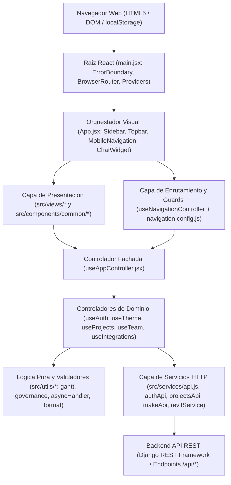
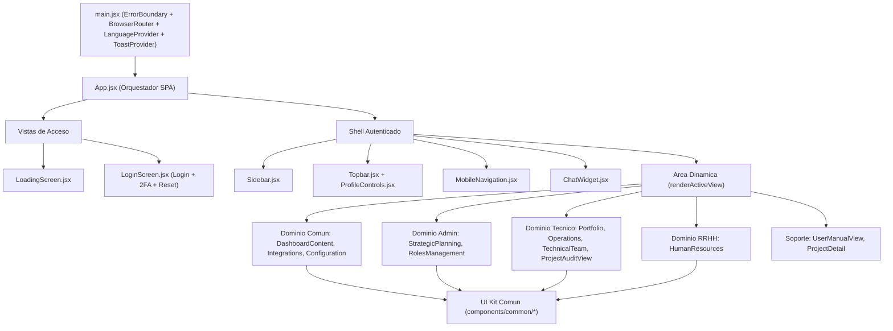
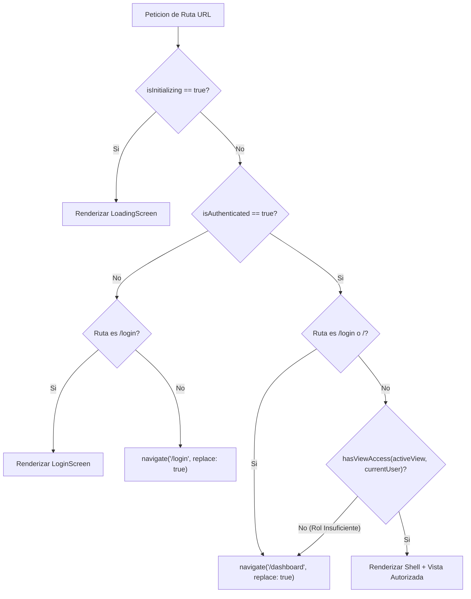

# Documento de Diseño de Software: Capa de Presentación y Cliente (Frontend)
## Estándar IEEE 1016-2009 / ISO/IEC/IEEE 42010

| Metadato      | Detalle                                                                         |
| ------------- | ------------------------------------------------------------------------------- |
| **Proyecto**  | Project Planner — Sistema de Planificación, Optimización y Gestión de Proyectos |
| **Documento** | SDD-FE: *Software Design Description – Frontend*                                |
| **Versión**   | 1.0.0                                                                           |
| **Fecha**     | Noviembre 2026                                                                  |

---

## 1. Introducción

### 1.1. Propósito del Documento
El presente documento describe el diseño detallado de la arquitectura de interfaz de usuario y la capa de presentación del sistema **Project Planner** (`project-planner/frontend`), elaborado conforme al estándar internacional **IEEE Std 1016-2009** (*Information Technology — Systems Design — Software Design Descriptions*) y alineado con los principios de descripción arquitectónica de **ISO/IEC/IEEE 42010:2011**.

Especifica la descomposición modular de vistas y componentes de interfaz, la orquestación de controladores mediante *custom hooks* de React, el mapa declarativo de enrutamiento y guardias de control de acceso basado en roles (RBAC), el contrato de integración con la API REST del backend, el sistema multitema e internacionalización, y el estado actual de cumplimiento de accesibilidad digital bajo **W3C WCAG 2.2 Nivel AA** y la **Ley N.º 29973**.

### 1.2. Alcance del Sistema (Capa Frontend)
La capa de cliente se implementa como una *Single Page Application* (SPA) desacoplada que cubre todos los flujos operativos, estratégicos, administrativos y de integración del sistema:

* **Autenticación, Recuperación y Seguridad de Acceso:** Inicio de sesión con selector de perfil, verificación de doble factor (2FA / TOTP con código QR), restablecimiento de 2FA, recuperación de contraseña en tres pasos y gestión de sesión multi-pestaña.
* **Panel de Control Ejecutivo (*Dashboard*):** Consolidación de métricas clave (KPIs), proyectos activos, hitos próximos y navegación rápida hacia módulos operativos.
* **Planificación Estratégica:** Calendario maestro anual en formato Gantt (`utils/gantt.js`), gestión de hitos globales, reajuste de cronogramas con bitácora de auditoría y reglas de gobernanza financiera (`> $100,000 USD`).
* **Portafolio y Auditoría de Proyectos:** Catálogo de proyectos con creación, edición, filtros reactivos, análisis de salud periódica (mensual, trimestral, semestral), exportación de reportes y salas de videoconferencia integradas.
* **Gestión Operativa:** Tablero de órdenes de trabajo, tareas en campo, monitoreo de ruta crítica (CPM) y optimización de cronogramas con holgura de seguridad de 7 días.
* **Equipo Técnico y Recursos Humanos:** Directorio de especialistas por área técnica, nómina de personal, gestión de incidencias/licencias con cálculo de días hábiles, historial de movimientos y exportación de libros de personal.
* **Integraciones Externas:** Panel de diagnóstico y operación para **Make (Integromat)**, **Google Drive API** y **Autodesk Platform Services (APS / Forge Viewer 3D)** para modelos Revit (`.rvt`).
* **Gobierno, Configuración y Ayuda:** Administración confidencial de roles (`Admin` / `SubAdministrador`), personalización multitema (`Light`, `Dark`, `Midnight`), escala tipográfica accesible (`85%`–`120%`), internacionalización (`es` / `en`), respaldos de base de datos, manual interactivo de usuario y asistente conversacional IA.

### 1.3. Definiciones, Acrónimos y Abreviaturas
* **SDD:** *Software Design Description* (Descripción del Diseño de Software).
* **SPA:** *Single Page Application* (Aplicación de Página Única).
* **UI/UX:** *User Interface / User Experience* (Interfaz y Experiencia de Usuario).
* **RBAC:** *Role-Based Access Control* (Control de Acceso Basado en Roles).
* **WCAG:** *Web Content Accessibility Guidelines* (Pautas de Accesibilidad para el Contenido Web).
* **WAI-ARIA:** *Web Accessibility Initiative – Accessible Rich Internet Applications*.
* **2FA / TOTP:** Autenticación de Dos Factores / *Time-Based One-Time Password*.
* **APS:** *Autodesk Platform Services* (anteriormente Autodesk Forge) para visualización BIM 3D.
* **CPM:** *Critical Path Method* (Método de la Ruta Crítica).
* **i18n / l10n:** Internacionalización y Localización.
* **FOUC:** *Flash of Unstyled Content* (Parpadeo de contenido sin estilo al cargar).
* **DRF:** *Django REST Framework*.

### 1.4. Referencias Normativas
* **IEEE Std 1016-2009:** *IEEE Standard for Information Technology — Systems Design — Software Design Descriptions*.
* **ISO/IEC/IEEE 42010:2011:** *Systems and software engineering — Architecture description*.
* **ISO/IEC/IEEE 29148:2018:** *Systems and software engineering — Life cycle processes — Requirements engineering*.
* **ISO/IEC 25010:** *Systems and software Quality Requirements and Evaluation (SQuaRE)* — Usabilidad, Accesibilidad y Portabilidad.
* **W3C WCAG 2.2:** *Web Content Accessibility Guidelines (W3C Recommendation, Nivel AA)*.
* **Ley N.º 29973 (Perú):** *Ley General de la Persona con Discapacidad* (disposiciones sobre accesibilidad en plataformas y servicios digitales).
* **Insumos internos del repositorio:**
  * `03. Documentación Frontend.md`
  * la especificación de requisitos (HU-01 a HU-12) de la documentación interna del repositorio.md)
  * la evaluación de accesibilidad interna del repositorio
  * `architecture.md`

---

## 2. Visión General de la Arquitectura del Cliente

### 2.1. Stack Tecnológico de Presentación

| Tecnología / Librería | Versión (`package.json`) | Rol en la Arquitectura Frontend |
| :--- | :--- | :--- |
| **React / React DOM** | `^19.2.8` | Biblioteca declarativa basada en componentes funcionales, Hooks y Context API. |
| **Vite / `@vitejs/plugin-react`** | `^8.2.2` / `^6.1.0` | Empaquetador ESM de desarrollo con HMR y compilación optimizada para producción (`dist/`). |
| **Tailwind CSS / `@tailwindcss/vite`** | `^4.3.3` | Sistema de estilos utilitarios con variantes multitema (`light`, `dark`, `@custom-variant midnight`). |
| **React Router DOM** | `^7.18.2` | Enrutamiento SPA del lado del cliente sincronizado con la History API mediante `BrowserRouter`, `useLocation` y `useNavigate`. |
| **Axios** | `^1.19.0` | Cliente HTTP centralizado con resolución dinámica de `baseURL` e interceptores de autenticación `Bearer`. |
| **Lucide React** | `^1.34.0` | Conjunto de iconos vectoriales SVG consistentes y ligeros. |
| **WAI-ARIA & HTML5 Semántico** | Estándar W3C | Semántica nativa (`main`, `nav`, `aside`, `header`, `table`) y atributos ARIA (`role="dialog"`, `aria-modal`, `aria-live`, `aria-expanded`). |
| **Context API + Custom Hooks** | Nativo React 19 | Gestión de estado transversal (`LanguageContext`, `ToastContext`) y orquestación por dominio (`useAppController`). |
| **React Markdown + Remark GFM** | `^10.1.0` / `^4.0.1` | Renderizado del Manual de Usuario (`UserManualView`) y respuestas formateadas del asistente. |
| **ExcelJS** | `^4.4.0` | Generación y exportación de libros de trabajo de personal y auditoría en formato `.xlsx`. |
| **Oxlint** | `^1.79.0` | Análisis estático de código en Rust para validación de calidad y reglas de limpieza. |
| **Node.js Test Runner** | Nativo (`node --test`) | Ejecución de suites unitarias y de renderizado SSR (`tests/*.test.mjs`). |

### 2.2. Diagrama de Arquitectura de Capas de Cliente

La aplicación separa estrictamente la presentación visual, el enrutamiento, la lógica de orquestación en controladores, el estado transversal por contextos y el transporte HTTP hacia el backend Django REST Framework.

---

## 3. Preocupaciones de Diseño (*Design Concerns - IEEE 1016*)

1. **Accesibilidad Digital (WCAG 2.2 Nivel AA / Ley N.º 29973):**
   El diseño incorpora idioma base en `index.html` (`lang="es"` sincronizado dinámicamente por `LanguageContext`), regiones semánticas (`<aside>`, `<header>`, `<nav>`, `<main>`), encabezados de tabla `<th scope="col">`, botones nativos, estados `aria-current="page"`, `aria-invalid`, `aria-describedby` y regiones vivas `aria-live="polite"`. De acuerdo con la evaluación preliminar registrada en la evaluación de accesibilidad interna del repositorio, el cumplimiento actual es **parcial** y no se declara conformidad formal hasta cerrar los hallazgos priorizados (`A11Y-01` a `A11Y-12`).
2. **Responsividad y Soporte Móvil:**
   El layout adapta su navegación entre escritorio y dispositivos móviles (`< 768px` / `< lg`): en escritorio emplea un `Sidebar` colapsable (`250px` expandido / `60px` contraído, persistido en `project_planner_sidebar_open`), mientras que en pantallas pequeñas habilita un menú deslizable (`isOpenMobile`, con cierre automático al redimensionar a `>= 768px`) y una barra `MobileNavigation` fija inferior con soporte de área segura (`env(safe-area-inset-bottom)`). Incluye además reglas `@media print` en `index.css` para impresión apaisada limpia sin controles de navegación.
3. **Protección de Rutas y RBAC del Lado del Cliente:**
   La autorización visual se centraliza en `navigation.config.js` mediante `hasViewAccess(viewId, user)` y se ejecuta de manera reactiva en `useNavigationController`. Ninguna vista administrativa confidencial (`/role-management`, `/project-audit`) se renderiza ni aparece en menús cuando el perfil no corresponde a `admin` o `subadmin`, redirigiendo automáticamente a `/dashboard` o `/login` según el estado de sesión.
4. **Manejo de Estado, Errores y Feedback Visual:**
   * **Aislamiento de fallos de renderizado:** `ErrorBoundary` envuelve la raíz en `main.jsx` y presenta una pantalla recuperable (`role="alert"`, `aria-live="assertive"`) con opciones de reinicio de vista o retorno al inicio.
   * **Notificaciones globales (`ToastContext`):** Sistema no intrusivo en la parte superior central (`role="status"`, `aria-live="polite"`) con barra de progreso animada, variantes `success`, `error`, `warning`, `info`, formateo enriquecido vía `FormattedAuditText` y traducción automática de claves `toasts.*`.
   * **Estados vacíos y alertas en línea:** `EmptyState` (`role="status"`) estandariza vistas sin resultados y `InlineAlert` (`role="alert"` / `role="status"`) expone avisos contextuales dentro de formularios y paneles.
   * **Resiliencia en peticiones asíncronas:** `runSafe` y `getApiErrorMessage` en `utils/asyncHandler.js` normalizan estructuras de error de DRF (`error`, `detail`, `message`, `non_field_errors`, errores de serializer por campo y caídas de red `ERR_NETWORK`), evitando bloques `catch` silenciosos.
5. **Sistema Multitema Ergonómico (`Light`, `Dark`, `Midnight`):**
   Implementado mediante clases en `document.documentElement` (`html.light`, `html.dark`, `html.midnight`), variables CSS (`--app-bg`, `--app-fg`), variante personalizada `@custom-variant midnight` en `index.css` y tokens semánticos obligatorios en `themeClasses.js` (`cardClass`, `nestedClass`, `inputClass`, `labelClass`, `primaryButtonClass`, `secondaryButtonClass`, `errorClass`, `iconBoxClass`, `closeBtnClass`).
6. **Escala Tipográfica Dinámica (`85%` – `120%`):**
   El controlador `useThemeController` gestiona la preferencia `project-planner-font-scale` (acotada entre `FONT_SCALE_LIMITS.MIN = 85` y `FONT_SCALE_LIMITS.MAX = 120`, por defecto `100`) y ajusta dinámicamente `document.documentElement.style.fontSize = ${16 * (fontScale / 100)}px`, escalando proporcionalmente toda la tipografía basada en `rem` con sincronización entre pestañas (`useCrossTabListener`).
7. **Internacionalización y Localización (`i18n / l10n`):**
   Basado en `LanguageContext.jsx` y catálogos JSON simétricos 1:1 en `src/locales/es.json` y `src/locales/en.json` (validados por `tests/language.test.mjs`). Expone el hook `useLanguage()` con `t(path, fallback, params)` para resolución jerárquica, fallback en cascada al español, interpolación `{param}`, persistencia en `project_planner_lang` y sincronización en vivo entre pestañas vía evento `storage`.

---

## 4. Puntos de Vista de Diseño (*Design Viewpoints*)

### 4.1. Vista de Composición: Jerarquía de Vistas y Componentes

#### 4.1.1. Árbol Estructural de Composición
1. **Capa Raíz y Proveedores (`src/main.jsx`):**
   * `StrictMode` → `ErrorBoundary` → `BrowserRouter` → `LanguageProvider` → `ToastProvider` → `App`.
2. **Orquestación de Layout (`src/App.jsx` + `src/components/layout/`):**
   * Estado no autenticado: Fondo técnico fijo oscuro + `LoginScreen` (o `LoadingScreen` mientras `isInitializing` valida la sesión persistida).
   * Estado autenticado: Contenedor flex de altura completa con `Sidebar` (navegación lateral filtrada), columna principal (`Topbar` con buscador global `Ctrl/Cmd + K`, conmutador de tema y `ProfileControls` con campana de notificaciones y menú de perfil), área dinámica resuelta por `renderActiveView()`, `MobileNavigation` para pantallas móviles/tablet y `ChatWidget` flotante.
3. **Vistas de Dominio (`src/views/`):**
   * **Común (`views/common/`):** `DashboardContent`, `Integrations` (subcomponentes en `integrations/`: `IntegrationCard`, `IntegrationEditor`, `IntegrationStatus`, `IntegrationActivityList`, `StatusPanel`, `MakeModal`, `GoogleDriveModal`, `GoogleDriveFileManager`), `Configuration` (subcomponentes en `configuration/`: `ProfileCard`, `PreferencesCard`, `ProjectParametersCard`, `SecurityPoliciesCard`, `BackupAndSecurityCard`, `AuditLogCard`, `EditProfileModal`, `ChangePasswordModal`, `ConfirmPasswordModal`, `AvatarPreviewModal`) y `RevitModal` / `ForgeViewer`.
   * **Administración (`views/admin/`):** `StrategicPlanning` (subcomponentes: `GanttScheduleSection`, `NewGlobalMilestoneDialog`, `AdjustScheduleDialog`, `ScheduleAdjustmentsSection`, `TimelineAnalysisDialog`) y `RolesManagement`.
   * **Técnico (`views/technical/`):** `Portfolio` (`ProjectCard`, `NewProjectDialog`, `EditProjectDialog`, `ConfirmDeleteDialog`), `Operations` (`WorkOrdersSection`, `CriticalScheduleSection`, `OperationsSidebar`, `NewWorkOrderDialog`, `WorkOrderDetailDialog`), `TechnicalTeam` (`AddTechnicalMemberDialog`, `ReassignProjectDialog`, `DeleteTechnicalMemberDialog`, `MemberAvatar`) y `ProjectAuditView` (`PeriodicProjectAuditModal`).
   * **Recursos Humanos (`views/human-resources/`):** `HumanResources` (`PersonnelEditorModal`, `PersonnelIncidentDialog`, `IncidentActionDialog`).
   * **Proyectos y Documentación (`views/projects/`, `views/manual/`):** `ProjectDetail` (gestión de detalle y salas Jitsi Meet) y `UserManualView` (lector Markdown bilingüe con índice y búsqueda).
4. **Catálogo Consolidado del UI Kit Común (`src/components/common/`):**

| Componente | Archivo | Responsabilidad y Contrato Principal |
| :--- | :--- | :--- |
| **`ModalDialog`** | `ModalDialog.jsx` | Contenedor modal accesible (`role="dialog"`, `aria-modal="true"`, `aria-labelledby`), cierre con `Escape` y clic en overlay, cabecera con icono/subtítulo y pie responsive con estado `isSubmitting`. |
| **`Pagination`** | `Pagination.jsx` | Barra `<nav role="navigation">` multitema con conteo de rango, `aria-current="page"`, botones Anterior/Siguiente y soporte `hideOnSinglePage`. |
| **`MemberAvatar`** | `MemberAvatar.jsx` | Avatar circular con imagen (`alt="Perfil de ..."`) o iniciales deterministas (`getInitials`) tolerando objetos de Técnico, RR. HH. o cadenas. |
| **`Button`** | `Button.jsx` | Botón unificado (`type="button"` por defecto) con variantes `primary`, `secondary`, `danger`, `ghost`, `close`, tamaños `sm`/`md`/`lg` e indicador `isLoading`. |
| **`Input`** | `Input.jsx` | Campo accesible con `<label htmlFor>`, `useId()`, variante `'default'` (multitema) y `'auth'` (consola oscura fija), iconos, `rightContent`, `aria-invalid`, `aria-describedby` y error `role="alert"`. |
| **`PasswordInput`** | `PasswordInput.jsx` | Composición sobre `Input` con alternancia de visibilidad (`Eye`/`EyeOff`) y botón de limpieza rápida (`X`). |
| **`Select`** | `Select.jsx` | Wrapper nativo `<select>` con `defaultSelectClass` y `defaultOptionClass` multitema, compatible con arreglo `options` o `children`. |
| **`SortDropdown`** | `SortDropdown.jsx` | Menú desplegable de ordenamiento con `aria-haspopup="listbox"`, `aria-expanded`, `aria-controls`, `role="listbox"`, `role="option"` y navegación por flechas, `Enter`, `Space` y `Escape`. |
| **`KpiCard`** | `KpiCard.jsx` | Tarjeta métrica dual: `<article>` en modo informativo o `<button aria-pressed>` en modo filtro interactivo (ej. RR. HH.). |
| **`FilterTabBar`** | `FilterTabBar.jsx` | Barra de pestañas/filtros con `role="tablist"`, botones `role="tab"` y `aria-selected`, con soporte de contadores numéricos. |
| **`Table` / `TableHead` / `TableRow`** | `Table.jsx` | Tabla con scroll horizontal adaptable, encabezados `th scope="col"` y filas con hover multitema. |
| **`InlineAlert`** | `InlineAlert.jsx` | Banner contextual en variantes `info`, `success`, `warning`, `error`, asignando automáticamente `role="status"` o `role="alert"`. |
| **`EmptyState`** | `EmptyState.jsx` | Contenedor `role="status"` para listas vacías o búsquedas sin coincidencias, con icono, título, descripción y acción opcional. |
| **`ErrorBoundary`** | `ErrorBoundary.jsx` | Límite de error de React que captura excepciones en tiempo de renderizado y despliega vista de recuperación segura. |
| **Otros átomos transversales** | `components/common/` | `StatusBadge`, `ClearFiltersButton`, `PageHeader`, `SectionCardHeader`, `ReadOnlyField`, `FootnoteText`, `PasswordRequirements`, `FormattedAuditText`, `BackupExportButton`, `LanguageSelector`, `VideoConferenceModal`, `ChatWidget`. |

#### 4.1.2. Diagrama de Composición de Componentes

---

### 4.2. Vista de Interacción y Navegación (Rutas, Guards y Atajos)

#### 4.2.1. Matriz de Rutas de Cliente y Control de Acceso (RBAC)
La tabla maestra de rutas se define en `navigation.config.js` (`NAVIGATION_ITEMS`) y es ejecutada por `useNavigationController.js`:

| Ruta / Aliases | ID Vista | Componente | Acceso | Menú | Guard / Comportamiento si no Cumple |
| :--- | :--- | :--- | :--- | :---: | :--- |
| *Estado transitorio* | — | `LoadingScreen` | Sesión en validación | No / No | Muestra pantalla de carga hasta validar `/auth/session/validate/`. |
| `/login` | `login` | `LoginScreen` | Público (Anónimo) | No / No | Si autenticado → redirige con `replace` a `/dashboard`. |
| `/` `/dashboard` | `dashboard` | `DashboardContent` | Autenticado (`Admin`, `SubAdmin`, `User`) | Sí / Sí | Si no autenticado → redirige a `/login`. Fallback para rutas no coincidentes. |
| `/planning` | `planning` | `StrategicPlanning` | Autenticado (`Admin`, `SubAdmin`, `User`*) | Sí / Sí | *Técnicos (`User`) acceden en modo solo lectura (`canManage = false`). |
| `/portfolio` | `portfolio` | `Portfolio` | Autenticado (`Admin`, `SubAdmin`, `User`) | Sí / Sí | Si no autenticado → `/login`. Creación/edición según `canManage` / `isAdmin`. |
| `/operations` | `operations` | `Operations` | Autenticado (`Admin`, `SubAdmin`, `User`) | Sí / Sí | Si no autenticado → `/login`. Acciones mutables sujetas a `canManage`. |
| `/technical-team` | `technical-team` | `TechnicalTeam` | Autenticado (`Admin`, `SubAdmin`, `User`) | Sí / Sí | Si no autenticado → `/login`. Alta/edición/baja sujeta a `canManage`. |
| `/human-resources` | `human-resources` | `HumanResources` | Autenticado (`Admin`, `SubAdmin`, `User`) | Sí / Sí | Si no autenticado → `/login`. Gestión de personal/incidencias según `canManage`. |
| `/project-audit` (`/auditoria`, `/audit`) | `project-audit` | `ProjectAuditView` | Restringido: `Admin` o `SubAdmin` | Condicional | Si rol es `User` (Técnico) → oculto en menú y redirige a `/dashboard`. |
| `/integrations` | `integrations` | `Integrations` | Autenticado (`Admin`, `SubAdmin`, `User`) | Sí / Sí | Si no autenticado → `/login`. Edición/configuración según `canManage` / `isAdmin`. |
| `/manual` | `manual` | `UserManualView` | Autenticado (`Admin`, `SubAdmin`, `User`) | Sí / Sí | Filtra internamente capítulos con `roleRequired === "admin"` si `!isAdmin`. |
| `/role-management` (`/roles`, `/roles-management`) | `roles` | `RolesManagement` | Restringido: `Admin` o `SubAdmin` | No / No (Perfil) | Si rol es `User` → `hasViewAccess` bloquea y redirige a `/dashboard`. |
| `/configuracion` | `configuracion` | `Configuration` | Autenticado (`Admin`, `SubAdmin`, `User`) | No / No (Perfil) | Tarjetas administrativas (`ProjectParameters`, `Backup`, `AuditLog`) según rol. |

#### 4.2.2. Atajos de Teclado Globales de Accesibilidad y Productividad
Implementados en `App.jsx` (ignorados cuando el foco está dentro de `INPUT`, `TEXTAREA`, `SELECT` o `isContentEditable`) y `Topbar.jsx`:

| Combinación de Teclas | Ámbito | Acción Ejecutada | Validación RBAC / Condición |
| :--- | :--- | :--- | :--- |
| `Escape` | Global / Modales | Cierra menú móvil, `ModalDialog`, `SortDropdown` o menús de `ProfileControls`; quita foco del buscador. | No aplica si `ModalDialog` tiene `isSubmitting = true`. |
| `Ctrl + K` / `⌘ + K` | `Topbar` | Enfoca y selecciona el texto de la barra de búsqueda contextual activa. | Disponible en cualquier vista autenticada. |
| `Shift + 0` | `App.jsx` | Expande o colapsa la barra lateral (`Sidebar`) en escritorio y persiste en `localStorage`. | Ignorado mientras se escribe en campos de formulario. |
| `Shift + 1` | `App.jsx` | Navega a **Inicio** (`dashboard`). | Verifica `hasViewAccess('dashboard', user)`. |
| `Shift + 2` | `App.jsx` | Navega a **Planificación Estratégica** (`planning`). | Verifica `hasViewAccess('planning', user)`. |
| `Shift + 3` | `App.jsx` | Navega a **Portafolio** (`portfolio`). | Verifica `hasViewAccess('portfolio', user)`. |
| `Shift + 4` | `App.jsx` | Navega a **Gestión Operativa** (`operations`). | Verifica `hasViewAccess('operations', user)`. |
| `Shift + 5` | `App.jsx` | Navega a **Equipo Técnico** (`technical-team`). | Verifica `hasViewAccess('technical-team', user)`. |
| `Shift + 6` | `App.jsx` | Navega a **Recursos Humanos** (`human-resources`). | Verifica `hasViewAccess('human-resources', user)`. |
| `Shift + 7` | `App.jsx` | Navega a **Auditoría de Proyectos** (`project-audit`). | Bloqueado si `hasViewAccess('project-audit', user)` es `false` (solo Admin/SubAdmin). |
| `Shift + 8` | `App.jsx` | Navega a **Integraciones** (`integrations`). | Verifica `hasViewAccess('integrations', user)`. |
| `Shift + 9` | `App.jsx` | Navega a **Manual de Usuario** (`manual`). | Verifica `hasViewAccess('manual', user)`. |

#### 4.2.3. Diagrama de Flujo de Enrutamiento y Guards de Sesión

---

### 4.3. Vista de Integración: Consumo de Servicios y Contrato de API

#### 4.3.1. Cliente HTTP Centralizado e Interceptores (`src/services/api.js`)
Toda comunicación REST estándar transcurre mediante la instancia Axios configurada en `api.js`:

* **Resolución Dinámica de `baseURL`:**
  1. Si existe la variable de entorno `import.meta.env.VITE_API_URL`, se normaliza removiendo barras finales y garantizando el sufijo `/api`.
  2. En despliegues en la nube (`window.location.hostname.includes('onrender.com')`), resuelve automáticamente a `https://project-planner-to9j.onrender.com/api`.
  3. En desarrollo local, utiliza `http://127.0.0.1:8000/api`.
* **Gestión de Identidad, Sesión e Interceptor de Peticiones:**
  * El interceptor `api.interceptors.request.use(...)` lee en `localStorage` la clave `project_planner_user.session_token`, `project_planner_session_token` o `project_planner_token` e inyecta la cabecera `Authorization: Bearer <sessionToken>` en cada petición saliente cuando no haya sido definida manualmente.
  * `useAuthController` sincroniza la sesión entre pestañas con `useCrossTabListener('project_planner_user', ...)` y ejecuta un latido (*heartbeat*) de validación contra `GET /api/auth/session/validate/` cada 15 segundos, así como al recuperar foco (`window.focus`) o visibilidad (`visibilitychange`).
  * *Excepción justificada:* El asistente conversacional `ChatWidget.jsx` utiliza `fetch` nativo contra `${baseURL}/chatbot/` con la misma cabecera `Authorization: Bearer` para consumir flujos incrementales *Server-Sent Events* (SSE) mediante `response.body.getReader()`.

#### 4.3.2. Tratamiento de Respuestas y Códigos de Estado HTTP

| Código / Evento HTTP | Origen / Contexto | Tratamiento Implementado en el Cliente |
| :--- | :--- | :--- |
| **`200 OK` / `201 Created`** | Peticiones CRUD, Login, 2FA, Integraciones | Actualiza el estado reactivo del controlador correspondiente, persiste caché/sesión cuando aplica y dispara notificación en `ToastContext` vía `runSafe`. |
| **`400 Bad Request`** | Formularios, alta de técnicos, validaciones de serializer | `getApiErrorMessage` en `asyncHandler.js` extrae `data.error`, `data.detail`, `data.message`, `non_field_errors` o el primer error de campo y lo muestra en `InlineAlert`, campo `Input` o Toast sin abortar la sesión. |
| **`401 Unauthorized`** | Credenciales inválidas, token expirado o revocado | En `LoginScreen`: muestra alerta de error sin exponer detalles internos. En `useAuthController` (heartbeat): ejecuta `clearLocalSession()` y redirige a `/login`. En `BackupExportButton`: marca estado desconectado y muestra Toast de sesión expirada. |
| **`403 Forbidden`** | Operación sin permisos o sesión restringida | En `useAuthController` (heartbeat): revoca sesión local vía `clearLocalSession()`. En `BackupExportButton` y acciones protegidas: notifica falta de permisos mediante Toast de error y detiene la mutación. |
| **`429 Too Many Requests`** | Asistente IA (`ChatWidget.jsx` -> `/api/chatbot/`) | Capturado explícitamente (`response.status === 429`), presentando mensaje controlado de límite de cuota temporal sin colapsar el hilo de conversación. |
| **`500 Internal Server Error` / Red (`ERR_NETWORK`)** | Caída de servidor, timeout o falla no controlada en backend | `getApiErrorMessage` y `BackupExportButton` interceptan el fallo y muestran mensajes amigables localizables (sin trazas técnicas del servidor), preservando los últimos datos en caché cuando corresponde. |

#### 4.3.3. Catálogo de Clientes de Servicio Especializados (`src/services/`)

| Cliente de Servicio | Archivo | Métodos Expuestos y Dominio |
| :--- | :--- | :--- |
| **`api` + exports 2FA** | `api.js` | Instancia base Axios (`baseURL`), interceptor `Bearer` y funciones `verify2FA`, `setup2FA`, `request2FAReset`, `verify2FAReset`. |
| **`authApi`** | `authApi.js` | Envoltorio semántico del flujo de doble factor TOTP: `verify2FA(userId, otpCode)`, `setup2FA(userId)`, `request2FAReset(userId)`, `verify2FAReset(userId, code)`. |
| **`projectsApi`** | `projectsApi.js` | Repositorio principal de integración REST: proyectos (`getProjects`, `createProject`, `getProjectById`, `updateProject`, `deleteProject`, `getPeriodicAudit`), hitos (`getMilestones`, `createMilestone`, `updateMilestone`, `deleteMilestone`), tareas (`getTasks`, `createTask`, `updateTask`), auditoría (`getProjectChangeLogs`, `getScheduleAdjustments`, `createScheduleAdjustment`, `getAuditLogs`), equipo y RR. HH. (`getTeamMembers`, `getTeamStatuses`, `updateTeamMember`, `deleteTeamMember`, `getPersonnelIncidents`, `createPersonnelIncident`, `transitionPersonnelIncident`, `approvePersonnelIncident`, `rejectPersonnelIncident`, `finalizePersonnelIncident`, `getTeamMemberHistory`, `createTechnician`), identidad/sesión (`getUsersStatus`, `toggleSubAdmin`, `logoutUser`, `validateSession`, `getNotifications`, `verifyCurrentPassword`, `changePassword`, `updateProfile`, `getProfile`, métodos 2FA) y reuniones Jitsi (`getMeetings`, `createMeeting`). |
| **`makeApi`** | `makeApi.js` | Integración con Make (Integromat): `getStatus()`, `testConnection(webhookUrl)`, `saveConfig(configData)`, `triggerEvent(event, data, webhookUrl)`. |
| **`revitApi`** | `revitService.js` | Integración con Autodesk APS / Bóveda BIM: `getToken()`, `checkStatus()`, `getModels()`, `renameModel(id, name)`, `deleteModel(id)`, `getDownloadUrl(id)`, `uploadModel(file)` (envío `multipart/form-data`). |

#### 4.3.4. Sincronización con Controladores (*Custom Hooks*)
La arquitectura aplica el **Patrón Fachada** en `useAppController.jsx`, el cual compone y sincroniza seis controladores atómicos:

1. **`useProjectsController`:** Sincroniza en paralelo (`Promise.all`) proyectos, hitos, tareas, historial de personal, cambios de portafolio y reajustes de cronograma al iniciar; gestiona `portfolioQuery` y `operationsQuery`, y propaga `remoteAssignments` hacia el controlador de equipo.
2. **`useTeamController`:** Administra el directorio de `users`, `technicalTeamData`, `humanResourcesData`, caché local (`teamMemberCache.js`), catálogo de estados operativos, alta/edición/baja de miembros y flujo de incidencias (`createPersonnelIncident`, `transitionPersonnelIncident`), con sincronización cross-tab de `project-planner-users`.
3. **`useAuthController`:** Gestiona `isInitializing`, `isAuthenticated`, `currentUser`, `displayedCurrentUser`, `sessionToken`, derivación de `isAdmin` / `isSubAdmin` / `canManage`, `handleLogin`, `handleLogout`, `handleUpdateCurrentUser`, `handleSessionTokenChange` y validación periódica de sesión.
4. **`useNavigationController`:** Sincroniza `activeView` con `useLocation()`, ejecuta `setActiveView` validando `hasViewAccess`, aplica redirecciones automáticas de guardia y provee `allowedSidebarItems`, `allowedMobileItems` y `searchPlaceholder`.
5. **`useThemeController`:** Controla `theme` (`light` | `dark` | `midnight`) y `fontScale` (`85`–`120`), sincroniza clases y `fontSize` en `document.documentElement` y replica cambios entre pestañas.
6. **`useIntegrationsController`:** Administra el estado persistido y remoto de los conectores **Google Drive**, **Revit / BIM Data** y **Make (Integromat)**, además de pruebas de conexión y registro de actividad.

---

### 4.4. Vista de Accesibilidad e Inclusión (WCAG 2.2 AA / Ley N.º 29973)

#### 4.4.1. Resumen de Evaluación Preliminar
Según la evaluación técnica documentada en la evaluación de accesibilidad interna del repositorio (14 de noviembre de 2026, basada en WCAG 2.2 AA y etapas iniciales de WCAG-EM 2.0 sobre el commit `18fb1a3`), la aplicación presenta una base estructural sólida pero **cumplimiento parcial**: no debe emitirse una declaración formal de conformidad WCAG 2.2 AA hasta completar la remediación de los hallazgos confirmados (`A11Y-01` a `A11Y-12`) y ejecutar pruebas manuales en navegador con Axe/Lighthouse, lectores de pantalla (NVDA) y zoom al 200%/400%.

| Principio WCAG 2.2 | Estado Preliminar | Soportes Verificados | Brechas Principales por Cerrar |
| :--- | :---: | :--- | :--- |
| **Perceptible** | Parcial | Idioma `lang="es"`, encabezados de tabla, texto alternativo en avatares (`MemberAvatar`), escala tipográfica `85%–120%`. | Contrastes insuficientes en combinaciones puntuales (`A11Y-08`), falta de alternativa tabular/resumen en gráfica de `StatusPanel` (`A11Y-11`). |
| **Operable** | No cumple | Botones nativos en menús, paginación y tabs; atajos `Shift+0..9`, `Ctrl/Cmd+K`, `Escape`; `SortDropdown` operable por flechas. | Controles de `PasswordInput` con `tabIndex={-1}` (`A11Y-01`), tarjetas/hitos en `ProfileControls` y `GanttScheduleSection` solo con `onClick` (`A11Y-02`), falta de enlace "Saltar al contenido" (`A11Y-06`), ausencia de trampa/restauración de foco en `ModalDialog` (`A11Y-07`). |
| **Comprensible** | Parcial | Etiquetas `<label htmlFor>` en `Input`, validación explícita y mensajes descriptivos en formularios. | Campos 2FA/recuperación dependientes solo de `placeholder` (`A11Y-03`), `helperText` sin `aria-describedby` en `Input` (`A11Y-09`), jerarquía sin `h1` propio en `DashboardContent` (`A11Y-10`). |
| **Robusto** | Parcial | Landmarks (`aside`, `header`, `nav`, `main`), `role="status"`/`aria-live="polite"` en `ToastContext`, `role="tablist"`/`role="listbox"`. | Mensajes de autenticación sin `role="alert"` (`A11Y-05`), selectores de rol/tema sin `aria-pressed` o radiogrupo (`A11Y-04`), menú de acciones sin `aria-expanded` en `TechnicalTeam` (`A11Y-12`). |

#### 4.4.2. Atributos WAI-ARIA y Gestión de Foco Implementados
* **Diálogos (`ModalDialog.jsx`):** Declara `role="dialog"`, `aria-modal="true"`, `aria-labelledby={titleId}`, botón de cierre con `aria-label="Cerrar ventana"` y cierre mediante tecla `Escape` (cuando `!isSubmitting`). *Nota de diseño pendiente (Prioridad 0 — `A11Y-07`):* incorporar trampa de foco (`Tab` / `Shift+Tab`), atributo `inert` en el fondo y restauración del foco al elemento activador; asimismo, dotar de semántica `dialog` a `VideoConferenceModal` y `ProjectDetail`.
* **Regiones Vivas y Estados (`ToastContext.jsx`, `ErrorBoundary.jsx`, `InlineAlert.jsx`, `EmptyState.jsx`):** Los toasts globales exponen `role="status"` y `aria-live="polite"`; `ErrorBoundary` expone `role="alert"` y `aria-live="assertive"`; `InlineAlert` alterna `role="alert"` (error/warning) y `role="status"` (info/success).
* **Controles Complejos (`SortDropdown.jsx`, `FilterTabBar.jsx`, `Sidebar.jsx`, `Pagination.jsx`):**
  * `SortDropdown`: `aria-haspopup="listbox"`, `aria-expanded={isOpen}`, `aria-controls={listboxId}`, `role="listbox"` y `role="option"` con `aria-selected`.
  * `FilterTabBar`: `role="tablist"` con `role="tab"` y `aria-selected`.
  * `Sidebar` y `MobileNavigation`: `aria-current="page"` en la ruta activa y `aria-label` descriptivos.
  * `Input`: `aria-invalid={Boolean(error)}` y `aria-describedby` enlazado al párrafo `role="alert"` del error.

#### 4.4.3. Cálculo de Contrastes y Matriz de Temas Visuales
Los tokens visuales de `themeClasses.js` e `index.css` definen tres esquemas cromáticos:

| Elemento / Token | Tema Claro (*Light*) | Tema Oscuro (*Dark*) | Tema Medianoche (*Midnight*) | Observación de Contraste (WCAG 2.2 AA) |
| :--- | :--- | :--- | :--- | :--- |
| **Fondo Principal (`--app-bg`)** | `#F8FAFC` | `#0D1117` | `#050B14` | Base de contraste para tipografía primaria. |
| **Superficie (`cardClass`)** | `#FFFFFF` | `#161B22` | `#0A1120` | Borde `slate-200` / `#30363D` / `cyan-900/30`. |
| **Tipografía Principal (`--app-fg`)** | `#0F172A` | `#F1F5F9` / `#FFFFFF` | `#ECFEFF` | Cumple holgadamente ratio $\ge 4.5:1$ sobre superficie. |
| **Tipografía Secundaria (`labelClass`)** | `slate-500` (`#64748B`, `4.76:1` sobre blanco) | `slate-300` | `cyan-500/70` (`~4.36:1` sobre `#0A1120`) | En Midnight `cyan-500/70` requiere ajuste a tono $\ge 4.5:1$ (`A11Y-08`). |
| **Indicador de Foco / Acentos Light** | `cyan-500` (`#06B6D4`, `2.43:1`), `cyan-600` (`3.68:1`) | `cyan-400` | `cyan-500` | En Light, `cyan-500`/`cyan-600`/`emerald-600`/`amber-600` sobre blanco requieren oscurecimiento (ej. `cyan-700` alcanza `5.36:1`). |

---

## 5. Matriz de Trazabilidad de Requisitos (IEEE 29148)

La siguiente matriz establece la trazabilidad bidireccional entre las **12 Historias de Usuario oficiales (`HU-01` a `HU-12`)** definidas en la especificación de requisitos (HU-01 a HU-12) de la documentación interna del repositorio.md), los módulos funcionales adicionales implementados en el cliente (`REQ-FE-13` a `REQ-FE-18`), los componentes/controladores de Frontend responsables y sus criterios de aceptación verificados.

### 5.1. Trazabilidad de Historias de Usuario Oficiales (`HU-01` – `HU-12`)

| ID HU | Requisito Funcional | Componentes UI y Controlador | Criterio de Aceptación (DoD) | Estado |
| :--- | :--- | :--- | :--- | :---: |
| **HU-01** | Autenticación segura, 2FA TOTP y presencia en línea | `LoginScreen.jsx` `ProfileControls.jsx` `useAuthController.js` `authApi.js` | CA 1.1: Login `/api/auth/login/` y redirección a `/dashboard` CA 1.2: Error HTTP `401` con notificación clara CA 1.3: Logout `POST /api/auth/logout/` y limpieza local (2 tests aprobados) | Aprobado |
| **HU-02** | Control de acceso RBAC y vistas protegidas | `navigation.config.js` `useNavigationController.js` `Sidebar.jsx` `RolesManagement.jsx` | CA 2.1: Menú `/role-management` oculto a `User` con guard a `/dashboard` CA 2.2: Switch `SubAdministrador` vía `PATCH /api/auth/users-status/` (`canManage = true`) (3 tests aprobados) | Aprobado |
| **HU-03** | Visualización del calendario maestro (Gantt) y reajustes | `StrategicPlanning.jsx` `GanttScheduleSection.jsx` `AdjustScheduleDialog.jsx` `utils/gantt.js` | CA 3.1: Cuadrícula mensual de 12 columnas con barras continuas CA 3.2: Reajuste con motivo obligatorio y registro en `/schedule-adjustments/` (6 tests aprobados) | Aprobado |
| **HU-04** | Hitos globales y regla de aprobación (`$100,000 USD`) | `StrategicPlanning.jsx` `NewGlobalMilestoneDialog.jsx` `TimelineAnalysisDialog.jsx` `utils/governance.js` | CA 4.1: Alta de hito vinculada a proyecto con indicadores de estado CA 4.2: `evaluateProjectGovernance` clasifica `> $100k` para "Comité Directivo" (8 tests aprobados) | Aprobado |
| **HU-05** | Repositorio central y creación de proyectos | `Portfolio.jsx` `ProjectCard.jsx` `NewProjectDialog.jsx` `projectsApi.js` | CA 5.1: Alta con código `PRJ-YYYY-XXX` vía `POST /api/projects/` CA 5.2: Búsqueda reactiva insensible a tildes/mayúsculas por nombre, líder o área (8 tests aprobados) | Aprobado |
| **HU-06** | Disparo de webhook a Make (Discord / Gmail) | `Portfolio.jsx` `Integrations.jsx` `MakeModal.jsx` `makeApi.js` | CA 6.1: Emisión de evento `project.created` y test `/integrations/make/test/` CA 6.2: Resiliencia de UI si webhook falla sin abortar creación (3 tests aprobados) | Aprobado |
| **HU-07** | Órdenes de trabajo y tareas operativas | `Operations.jsx` `WorkOrdersSection.jsx` `NewWorkOrderDialog.jsx` `useProjectsController.js` | CA 7.1: Registro de orden con fechas, proyecto y responsable CA 7.2: Exportación de reporte operativo consolidado (6 tests aprobados) | Aprobado |
| **HU-08** | Motor de optimización de cronograma (CPM y holgura 7 días) | `Operations.jsx` `CriticalScheduleSection.jsx` `OperationsSidebar.jsx` `utils/operations.js` | CA 8.1: Cálculo de ruta crítica (`is_critical_path`) con 7 días de holgura CA 8.2: Comparación visual antes vs. después en interfaz (2 tests aprobados) | Aprobado |
| **HU-09** | Alta conjunta de especialistas técnicos y cuenta de acceso | `TechnicalTeam.jsx` `AddTechnicalMemberDialog.jsx` `ReassignProjectDialog.jsx` `projectsApi.js` | CA 9.1: Creación atómica `User` + `TeamMember` vía `POST /api/technicians/create/` (`201`) CA 9.2: Validación HTTP `400` ante duplicados de correo (4 tests aprobados) | Aprobado |
| **HU-10** | Matriz de RR. HH., disponibilidad e incidencias | `HumanResources.jsx` `PersonnelEditorModal.jsx` `PersonnelIncidentDialog.jsx` `utils/personnelWorkbook.js` | CA 10.1: Registro y transición de licencias con cálculo de días hábiles CA 10.2: Exportación de matriz de personal a CSV y Excel (13 tests aprobados) | Aprobado |
| **HU-11** | Gestión documental y almacenamiento en Google Drive | `Integrations.jsx` `GoogleDriveModal.jsx` `GoogleDriveFileManager.jsx` `useIntegrationsController.js` | CA 11.1: Flujo de autorización OAuth 2.0 `/api/integrations/google-drive/connect/` CA 11.2: Carga multipart a `/api/integrations/google-drive/upload/` y explorador (8 tests aprobados) | Aprobado |
| **HU-12** | Bóveda BIM y visor 3D de modelos Revit (Autodesk APS) | `RevitModal.jsx` `ForgeViewer.jsx` `revitService.js` | CA 12.1: Carga `.rvt` vía `/api/integrations/aps/upload/` y generación de URN CA 12.2: Renderizado WebGL con token de `/api/integrations/aps/token/` (Verificación API / Manual) | Aprobado |

### 5.2. Trazabilidad de Capacidades Complementarias Implementadas en Frontend

| ID Requisito | Capacidad Funcional Implementada | Vista / Componente UI | Verificación Técnica en Repositorio |
| :--- | :--- | :--- | :--- |
| **REQ-FE-13** | Auditoría periódica de salud de portafolio (mensual, trimestral, semestral) | `ProjectAuditView.jsx`, `PeriodicProjectAuditModal.jsx`, `projectsApi.getPeriodicAudit` | Filtrado por nivel de salud (`HEALTHY`, `WARNING`, `CRITICAL`, `STALE`), ordenamiento por desfase/CPM/presupuesto y acceso restringido a `Admin`/`SubAdmin`. |
| **REQ-FE-14** | Salas de videoconferencia integradas por proyecto (Jitsi Meet) | `ProjectDetail.jsx`, `VideoConferenceModal.jsx`, `projectsApi.getMeetings` / `createMeeting` | Listado de salas por proyecto y creación restringida a administradores. |
| **REQ-FE-15** | Manual de usuario interactivo bilingüe con RBAC y Docs-as-Code | `UserManualView.jsx`, `manualSections.js`, `scripts/translate-manual.mjs` | Renderizado `react-markdown`, búsqueda integrada con `Topbar` y ocultamiento de capítulos `admin` a usuarios técnicos. |
| **REQ-FE-16** | Configuración de perfil, cambio de contraseña, respaldos y bitácora | `Configuration.jsx`, `ProfileCard.jsx`, `EditProfileModal.jsx`, `ChangePasswordModal.jsx`, `BackupExportButton.jsx`, `AuditLogCard.jsx` | Actualización de perfil/avatar Base64, validación de contraseña segura y exportación/respaldo protegido contra `401`/`403`/`500`. |
| **REQ-FE-17** | Internacionalización reactiva `es`/`en`, multitema y escala `85%–120%` | `LanguageContext.jsx`, `LanguageSelector.jsx`, `PreferencesCard.jsx`, `useThemeController.js`, `themeClasses.js` | Simetría 1:1 entre `es.json` y `en.json` validada en `tests/language.test.mjs`; sincronización cross-tab sin recarga. |
| **REQ-FE-18** | Asistente conversacional IA en tiempo real (streaming SSE) | `ChatWidget.jsx` | Consumo streaming contra `${baseURL}/chatbot/` con manejo explícito de cuota HTTP `429`. |