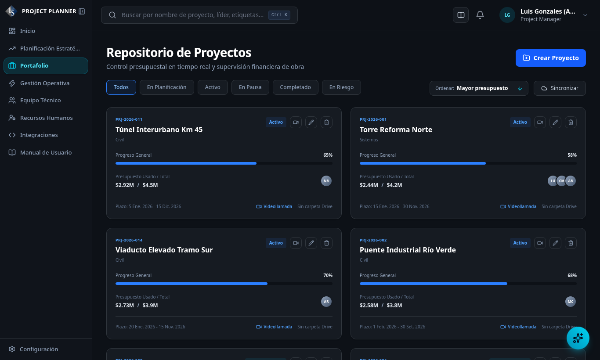
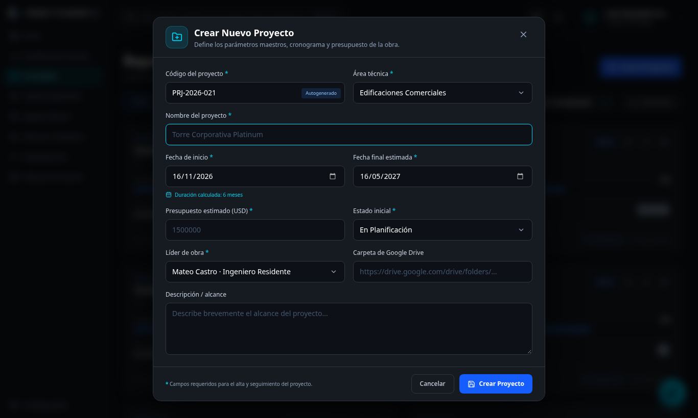
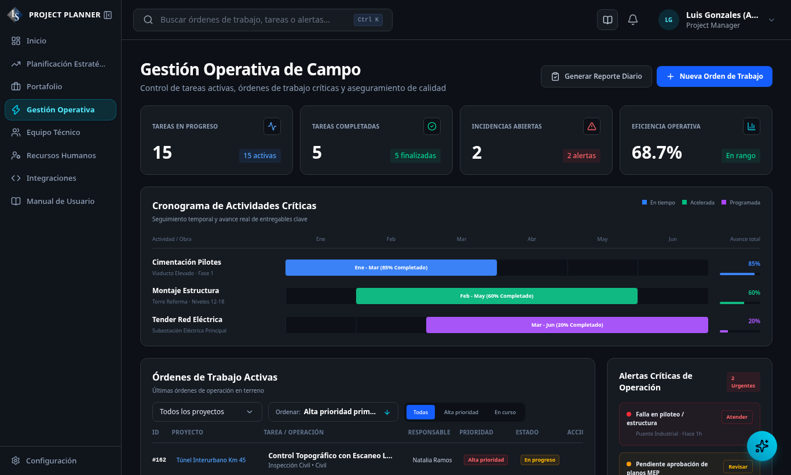

# 3. Portafolio y Gestión Operativa

[← Volver al índice](./README.md)

## 3.1 Consultar proyectos

**Disponible para:** todos los roles.

1. Presione **“Portafolio”**.
2. Use el buscador para localizar un proyecto por nombre, código, líder o etiqueta.
3. Aplique los filtros de estado si están disponibles.
4. Use **“Ordenar”** para cambiar el orden de las tarjetas.
5. Revise nombre, código, estado, fechas, presupuesto, avance y miembros.
6. Presione la tarjeta o la acción correspondiente para abrir el detalle.

Si no obtiene resultados, borre la búsqueda y restablezca los filtros.

> [!NOTE] Indicador de Liderazgo Técnico: Cuando un integrante del equipo técnico asignado como líder accede al portafolio, la tarjeta del proyecto exhibe el distintivo **“Tu Liderazgo”**, permitiéndole reconocer de inmediato sus obras bajo coordinación técnica.

## 3.2 Crear un proyecto

**Disponible para:** Administrador y Subadministrador.

1. Presione **“Crear Proyecto”**.
2. Complete el código y nombre del proyecto.
3. Seleccione el área técnica.
4. Indique fecha de inicio y fecha final.
5. Ingrese el presupuesto.
6. Seleccione el estado inicial y el líder de obra.
7. Agregue la carpeta de Google Drive, si existe.
8. Escriba la descripción o alcance.
9. Presione **“Crear Proyecto”**.

**Resultado esperado:** aparece **“¡Proyecto Creado con Éxito!”** y se agrega una nueva tarjeta.

**Errores frecuentes:** código repetido, fecha final anterior a la inicial, presupuesto inválido o campos obligatorios vacíos.

*Figura 3.1: Vista general del Portafolio de Proyectos con distinción de gobernanza presupuestaria `Comité (>$100k)`.*

*Figura 3.2: Diálogo para dar de alta un nuevo proyecto con presupuesto, fechas y líder asignado.*

## 3.3 Editar un proyecto

1. Localice la tarjeta.
2. Presione el icono **“Editar proyecto”**.
3. Modifique los campos permitidos.
4. Presione **“Guardar Cambios”**.

El presupuesto y la reasignación del líder pueden estar bloqueados para un técnico o líder de proyecto. La eliminación es exclusiva del administrador.

## 3.4 Eliminar un proyecto

**Disponible para:** Administrador.

1. Presione el icono **“Eliminar proyecto”**.
2. Revise el código y nombre mostrados en **“Confirmar Eliminación”**.
3. Presione **“Eliminar Proyecto”** únicamente si corresponde.

Esta acción puede eliminar información relacionada. Antes de usarla, confirme que el proyecto no deba conservarse para auditoría.

## 3.5 Consultar historial y videoconferencia

- Revise **“Historial de Cambios Reciente”** para conocer modificaciones registradas.
- Use el icono de videollamada de una tarjeta para abrir las salas Jitsi asociadas.
- Use el acceso a carpeta cuando el proyecto tenga documentación de Drive.

## 3.6 Consultar órdenes de trabajo

**Disponible para:** todos los roles.

1. Presione **“Gestión Operativa”**.
2. Seleccione el proyecto operativo.
3. Use las pestañas **Todas**, **Alta prioridad** o **En curso**.
4. Aplique búsqueda y ordenamiento.
5. En una fila, presione el botón de acción para abrir la ficha.
6. Revise proyecto, área, responsable, prioridad, fechas, progreso, ruta crítica e instrucciones.
7. Use **“Abrir en Drive”** cuando exista documentación vinculada.

> [!TIP] Vista Operativa del Técnico: Los miembros del equipo técnico asignados como responsables visualizan directamente en su panel las órdenes de trabajo asignadas con su prioridad, ruta crítica y enlaces a planos en Drive, permitiéndoles consultar instrucciones y actualizar el avance en terreno.

## 3.7 Crear una orden de trabajo

**Disponible para:** Administrador y Subadministrador.

1. Presione **“Nueva Orden de Trabajo”**.
2. Seleccione el proyecto asociado y el tipo de operación.
3. Escriba el título de la tarea u orden.
4. Seleccione el área técnica y el responsable.
5. Indique fecha inicial y fecha límite.
6. Seleccione la prioridad.
7. Active ruta crítica y tolerancia solo cuando corresponda.
8. Agregue el vínculo de Drive.
9. Escriba instrucciones claras para terreno.
10. Presione **“Emitir Orden de Trabajo”**.

**Resultado esperado:** aparece **“Orden Emitida”** y la orden se incorpora al panel.

> [!NOTE] Consolidación y despacho operativo: Las órdenes de trabajo emitidas se incorporan de inmediato al panel operativo y su estado se actualiza en tiempo real. Para consolidar el historial y emitir la bitácora formal hacia los supervisores de obra, utilice la función **“Generar Reporte Diario”** al cierre del turno.

## 3.8 Completar, reabrir o continuar una orden

1. Abra la ficha de la orden.
2. Si está en curso, presione **“Completar”**.
3. Si existe una tarea siguiente, elija entre:
   - **“Completar y pasar a siguiente”**;
   - **“Solo completar”**.
4. Si una orden finalizada necesita correcciones, presione **“Reabrir Orden”**.

Revise el mensaje de confirmación y los indicadores del módulo.

## 3.9 Generar el reporte diario

1. Aplique el proyecto y los filtros deseados.
2. Presione **“Generar Reporte Diario”**.
3. Espere el mensaje **“Reporte Exportado”**.
4. Abra el archivo descargado y compruebe los registros.

*Figura 3.3: Ficha técnica de órdenes de trabajo en terreno (`WorkOrderDetailDialog`) con avance, ruta crítica y acceso a planos Drive.*

