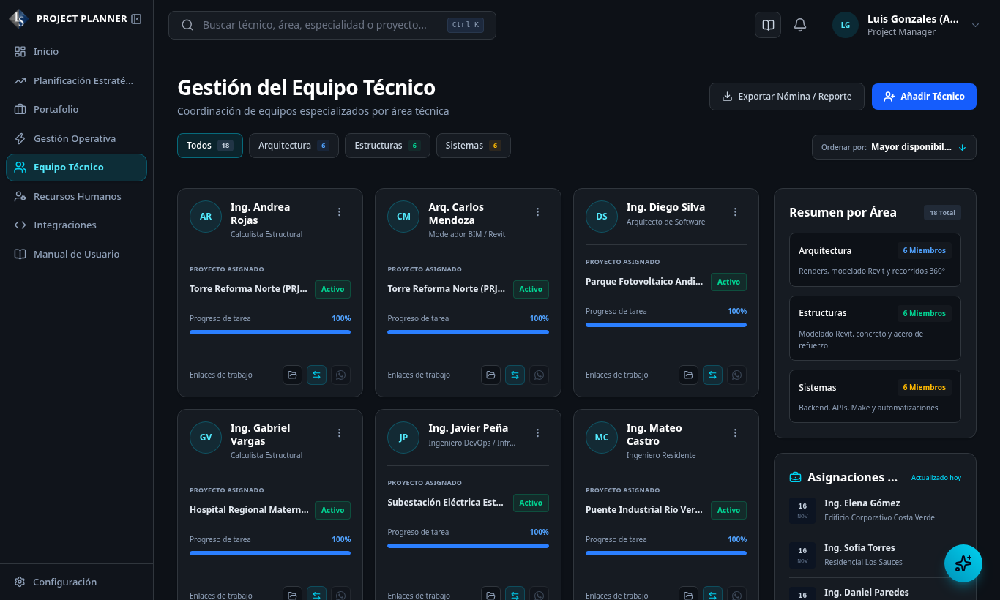
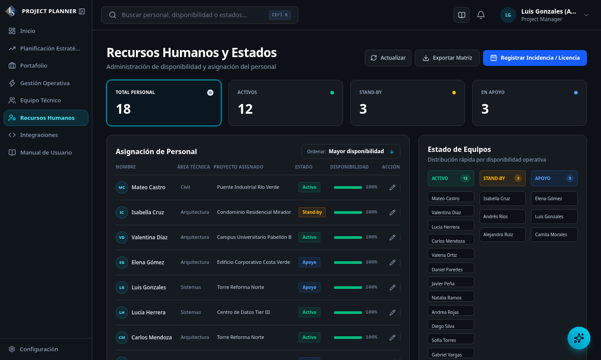

# 4. Equipo Técnico y Recursos Humanos

[← Volver al índice](./README.md)

## 4.1 Consultar el Equipo Técnico

**Disponible para:** todos los roles.

1. Presione **“Equipo Técnico”**.
2. Seleccione **Todos**, **Arquitectura**, **Estructuras/Civil** o **Sistemas**.
3. Use **“Ordenar por”** para ordenar por disponibilidad, nombre o incorporación.
4. Revise nombre, especialidad, proyecto, estado y porcentaje de carga.
5. Use los iconos de la tarjeta para consultar el proyecto o contactar al integrante cuando exista correo o teléfono.

**Resultado esperado:** se muestran únicamente los integrantes que coinciden con área, búsqueda y orden.

## 4.2 Exportar la nómina técnica

**Disponible para:** Administrador y Subadministrador.

1. Presione **“Exportar Nómina / Reporte”**.
2. Espere la confirmación.
3. Abra el archivo `equipo-tecnico.csv`.

## 4.3 Añadir un técnico

**Disponible para:** Administrador y Subadministrador.

1. Presione **“Añadir Técnico”**.
2. Opcionalmente, presione **“Subir foto de perfil”**. Use PNG o JPG de hasta 2 MB.
3. Complete nombres y apellidos.
4. Ingrese el correo corporativo.
5. Escriba y confirme la contraseña inicial.
6. Seleccione especialidad, área técnica, proyecto inicial y estado.
7. Indique la disponibilidad o carga entre 0 % y 100 %.
8. Presione **“Añadir al equipo”**.

**Resultado esperado:** se crean la cuenta de acceso y el registro técnico, y aparece una nueva tarjeta al actualizar el directorio.

**Errores frecuentes:** correo duplicado, contraseñas diferentes, clave menor de ocho caracteres, fotografía inválida o catálogos sin cargar.

*Figura 4.1: Directorio del Equipo Técnico con métricas de disponibilidad y especialidades.*

## 4.4 Reasignar un proyecto

1. Abra el menú de acciones del técnico.
2. Presione **“Reasignar proyecto”**.
3. Seleccione el nuevo proyecto.
4. Seleccione **Activo**, **Stand-by** o **En apoyo**.
5. Ajuste el porcentaje de dedicación.
6. Seleccione el motivo.
7. Presione **“Guardar reasignación”**.

**Resultado esperado:** la tarjeta cambia y la operación se incorpora a Asignaciones Recientes.

## 4.5 Consultar Recursos Humanos

1. Presione **“Recursos Humanos”**.
2. Use las tarjetas **Total personal**, **Activos**, **Stand-by** y **En apoyo** para filtrar.
3. Use el buscador y el selector de ordenamiento.
4. Revise nombre, área, proyecto, estado y disponibilidad.
5. Presione **“Actualizar registros”** para volver a consultar el servidor.

Una cuenta técnica puede consultar la información, pero no debería ver las acciones administrativas de edición e incidencias.

## 4.6 Exportar la matriz de RR. HH.

1. Presione **“Exportar Matriz”**.
2. Espere mientras el botón indica **“Generando Excel...”**.
3. Abra `matriz-recursos-humanos.xlsx`.

El archivo incluye los integrantes disponibles en la matriz, su asignación, estado y disponibilidad.

## 4.7 Registrar una incidencia o licencia

**Disponible para:** Administrador y Subadministrador.

1. Presione **“Registrar Incidencia / Licencia”**.
2. Seleccione el integrante.
3. Seleccione el tipo de incidencia.
4. Ingrese fecha inicial y fecha de retorno.
5. Revise la duración calculada.
6. Seleccione el estado operativo resultante.
7. Ingrese la disponibilidad durante el periodo.
8. Seleccione un técnico de respaldo, si corresponde.
9. Escriba el motivo y las coordinaciones realizadas.
10. Presione **“Registrar incidencia”**.

**Resultado esperado:** la solicitud se guarda como pendiente. El cambio operativo se aplica cuando la incidencia es aprobada.

**Errores frecuentes:** fechas invertidas, incidencia superpuesta, mismo integrante como respaldo o comentario demasiado corto.

## 4.8 Aprobar, rechazar o finalizar

- **Aprobar:** localice una incidencia pendiente, presione **“Aprobar”**, agregue una observación y confirme.
- **Rechazar:** presione **“Rechazar”**, escriba obligatoriamente el motivo y confirme.
- **Finalizar:** en una incidencia aprobada, presione **“Finalizar”** y confirme la reincorporación.

Revise después el estado, la disponibilidad y el historial del integrante.

*Figura 4.2: Matriz de Recursos Humanos con gestión de ausencias, incidencias y balance de carga laboral.*

