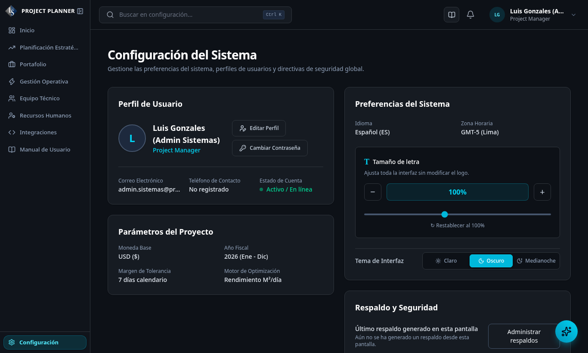
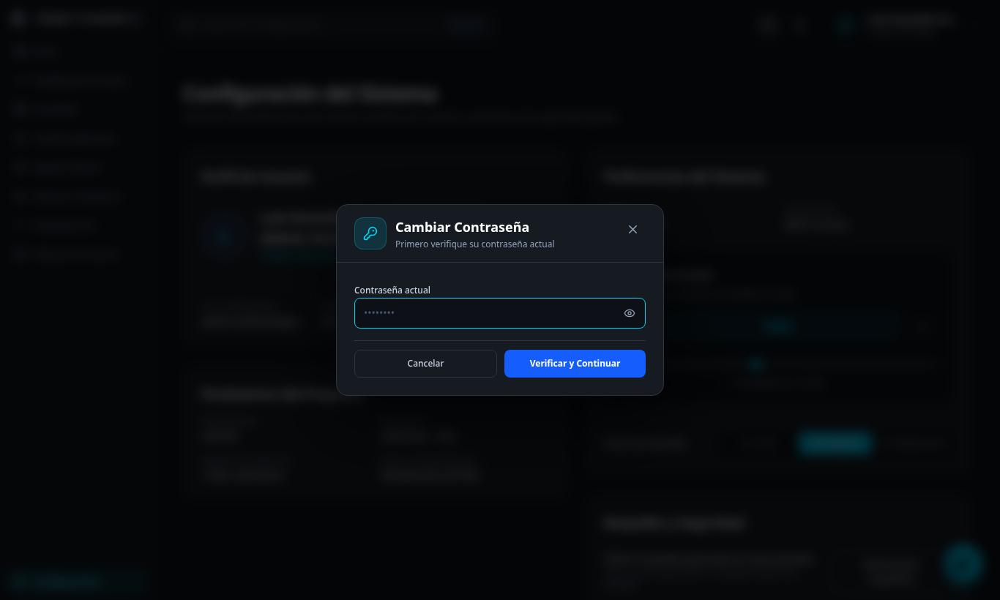

# 6. Configuración y seguridad personal

[← Volver al índice](./README.md)

## 6.1 Abrir Configuración

1. Presione **“Configuración”** en la parte inferior de la barra lateral.
2. También puede abrir el menú del usuario y seleccionar la opción de configuración disponible.

Las opciones visibles cambian según el rol.

## 6.2 Editar el perfil

1. En **Perfil de Usuario**, presione **“Editar Perfil”**.
2. Modifique nombre, correo o teléfono.
3. Para cambiar la imagen, use la opción **“Cambiar”** sobre el avatar.
4. Revise los datos.
5. Presione **“Guardar Cambios”**.

**Resultado esperado:** la información se actualiza en la tarjeta y en la barra superior.

**Errores frecuentes:** correo con formato inválido, correo ya registrado, nombre vacío o imagen demasiado grande.

## 6.3 Cambiar tema y tamaño de interfaz

1. Busque la tarjeta de preferencias.
2. Seleccione el tema **Claro**, **Oscuro** o **Medianoche**.
3. Ajuste el control de tamaño de texto.
4. Compruebe que menús, tablas y formularios sean legibles.

La preferencia se conserva en el navegador. No modifica el logotipo del proyecto.

## 6.4 Cambiar la contraseña

1. En Perfil de Usuario, presione **“Cambiar Contraseña”**.
2. Escriba la contraseña actual.
3. Presione **“Verificar y Continuar”**.
4. Si la contraseña es correcta, aparecerán los campos nuevos.
5. Escriba una nueva contraseña de al menos seis caracteres.
6. Repita exactamente la nueva contraseña.
7. Presione **“Actualizar Clave”**.
8. Cuando aparezca **“¡Contraseña Actualizada!”**, presione **“Aceptar y Volver”**.

**Resultado esperado:** la cuenta conserva la sesión actual y las demás sesiones abiertas con esa cuenta son invalidadas.

Si se equivoca en la contraseña actual, puede corregirla y volver a presionar **“Verificar y Continuar”**. El sistema no debe mostrar la nueva contraseña hasta validar la actual.

**Errores frecuentes:**

- contraseña actual incorrecta;
- nueva contraseña menor de seis caracteres;
- confirmación diferente;
- nueva contraseña igual a la anterior;
- sesión expirada o backend no disponible.

> Nunca muestre contraseñas reales en capturas del manual.

## 6.5 Comprobar el cierre de otras sesiones

Después de cambiar la contraseña:

1. Mantenga abierta la sesión actual.
2. En otro navegador o dispositivo donde la cuenta estuviera abierta, vuelva a una pantalla o espere la validación.
3. La sesión anterior deberá regresar al inicio de sesión.
4. Ingrese nuevamente con la nueva contraseña únicamente si desea continuar en ese dispositivo.

## 6.6 Cerrar sesión manualmente

1. Presione el nombre o avatar en la esquina superior derecha.
2. Presione **“Cerrar Sesión”**.
3. Compruebe que aparezca la pantalla de acceso.

*Figura 6.1: Panel de Configuración con información de perfil de usuario y selector de temas visuales (Claro, Oscuro, Medianoche).*

*Figura 6.2: Diálogo interactivo para cambio seguro de contraseña con validación previa de la clave actual.*

