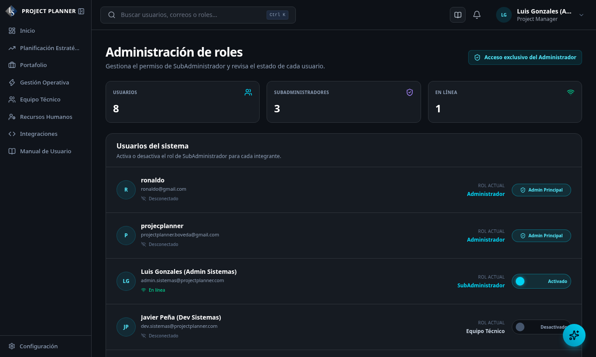
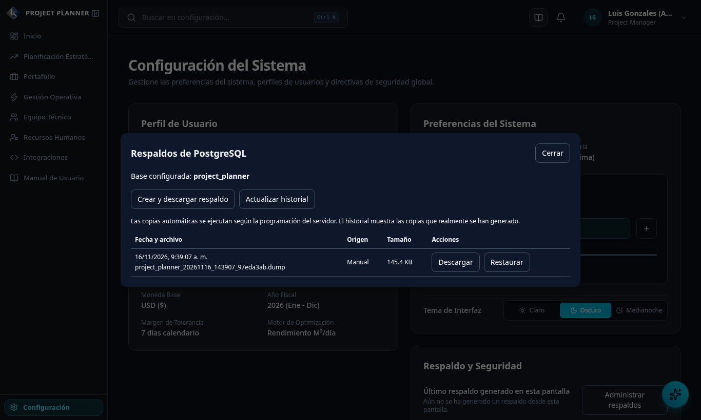

# 7. Administración, roles y respaldos

[← Volver al índice](./README.md)

## 7.1 Abrir Roles y permisos

**Disponible para:** cuentas administrativas autorizadas.

1. Presione el nombre o avatar del usuario.
2. Presione **“Roles y permisos”**.
3. Revise los contadores de usuarios, subadministradores y conexiones.
4. Localice al usuario que desea revisar.

La pantalla distingue Administrador, SubAdministrador y Equipo Técnico. El Administrador principal no debería mostrar un interruptor que permita degradarlo desde la interfaz.

*Figura 7.1: Panel administrativo de Roles y Permisos con lista de usuarios, estados de conexión activa y asignación de Subadministrador.*

## 7.2 Activar un Subadministrador

1. Localice un integrante de Equipo Técnico.
2. Presione el interruptor **“Desactivado”**.
3. Compruebe que cambie a **“Activado”**.
4. Solicite al usuario cerrar sesión e ingresar nuevamente.
5. Confirme que aparezcan las acciones de gestión correspondientes.

Para retirar el permiso, repita el proceso sobre el interruptor **“Activado”**.

## 7.3 Consultar la Bitácora de Auditoría

1. Abra **Configuración**.
2. Busque **“Bitácora de Auditoría”**.
3. Revise usuario, acción, descripción y fecha.
4. Presione el botón de actualización para volver a consultar.

**Resultado esperado:** se muestran cambios de perfil, correo, contraseña y otros eventos registrados.

## 7.4 Consultar respaldos

**Responsabilidad recomendada:** Superadministrador o responsable designado de base de datos.

1. En Configuración, busque **“Respaldo y Seguridad”**.
2. Presione **“Administrar respaldos”**.
3. Ingrese el nombre o correo y la contraseña de la sesión administrativa actual.
4. Presione **“Consultar respaldos”**.
5. Revise base de datos, fecha, archivo, origen y tamaño.

## 7.5 Crear y descargar un respaldo

1. Presione **“Crear y descargar respaldo”**.
2. Espere a que finalice.
3. Guarde el archivo `.dump` en una ubicación segura.
4. Para descargar uno existente, localícelo y presione **“Descargar”**.

No envíe respaldos por canales públicos: pueden contener usuarios, proyectos y datos operativos.

## 7.6 Restaurar un respaldo

> **Acción crítica:** una restauración reemplaza datos actuales por los contenidos en la copia seleccionada. Debe coordinarse con el responsable técnico y realizarse cuando los demás usuarios hayan detenido su trabajo.

1. Localice el respaldo correcto.
2. Presione **“Restaurar”**.
3. Revise nombre, fecha y base de datos.
4. Escriba exactamente el nombre de la base solicitado.
5. Active la casilla de reconocimiento del reemplazo de datos.
6. Presione **“Confirmar restauración”**.
7. No cierre la ventana durante el proceso.
8. Al finalizar, cierre sesión y vuelva a ingresar.
9. Compruebe usuarios, proyectos y registros principales.

El sistema intenta generar una copia preventiva antes de restaurar.

**Errores frecuentes:** credenciales incorrectas, falta de HTTPS en producción, PostgreSQL apagado, archivo inválido, nombre de base diferente o herramientas `pg_dump`/`pg_restore` no disponibles.

*Figura 7.2: Panel de Configuración y Respaldos con historial y verificación de sumas criptográficas SHA-256.*

