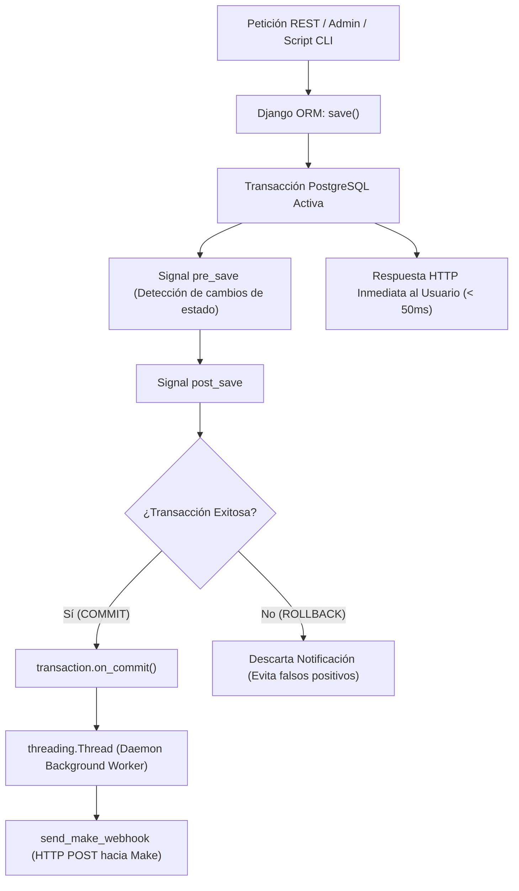

# 9. Automatizaciones y Webhooks con Make (Integromat)

[← Volver al índice](./README.md)

> [!IMPORTANT]
> **Disponibilidad y Perfil de Acceso:**
> La configuración de webhooks y automatizaciones con Make es de uso exclusivo para cuentas con rol de **Administrador** y **Superadministrador** (PMO). Los integrantes de Equipo Técnico no tienen visibilidad ni permisos para alterar las URLs de integración.

---

## 9.1 Propósito y Filosofía de Diseño

Project Planner integra un bus de eventos salientes basado en Webhooks HTTP POST hacia **Make (Integromat)**. Esto permite orquestar flujos de trabajo externos en tiempo real sin recargar la base de datos ni acoplar la lógica de negocio a plataformas de terceros (como Slack, Discord, Microsoft Teams, Google Calendar o gestores de correo corporativo).

Toda la emisión de eventos está centralizada en el backend de Django, garantizando que cualquier cambio relevante en la plataforma —independientemente de si se origina en la interfaz web, el panel de administración de Django (`/admin`) o scripts de sincronización— sea notificado puntualmente.

---

## 9.2 Arquitectura Backend: Django Signals y Desacoplamiento

El sistema adopta el patrón arquitectónico de **Django Signals** implementado en `core/signals.py`, reemplazando cualquier despacho manual dentro de las vistas o ViewSets.



### ¿Por qué usamos `transaction.on_commit`?
En sistemas transaccionales con PostgreSQL, invocar un webhook antes de que la transacción se confirme puede ocasionar **notificaciones fantasma**: si ocurre una excepción de integridad o un error de validación posterior, la base de datos revierte los cambios (`ROLLBACK`), pero el webhook externo ya habría informado falsamente que el recurso fue creado.  
Al registrar el callback dentro de `transaction.on_commit(...)`, Django garantiza que el webhook **solo se despache después de que los datos hayan sido persistidos de manera definitiva** en la base de datos.

### ¿Por qué usamos `threading.Thread(target=..., daemon=True)`?
Una solicitud HTTP hacia un webhook externo involucra resolución DNS, negociación SSL y tiempo de respuesta del servidor de Make (que puede demorar entre 500 ms y 5 segundos).  
Ejecutar esta llamada de forma síncrona en el hilo principal bloquearía el worker de Django/Gunicorn, aumentando la latencia para el usuario.  
El despachador `_dispatch_async_webhook` delega la llamada a un hilo demonio secundario en segundo plano:
1. El usuario en el navegador recibe su respuesta HTTP en **menos de 50 ms**.
2. Si el servidor de Make experimenta lentitud o interrupciones de red, la experiencia de usuario y la estabilidad del servidor principal no se ven comprometidas.
3. Se evita la sobrecarga de mantener infraestructuras complejas como Redis o Celery para este flujo de eventos.

> [!NOTE]
> **Comportamiento en Pruebas Unitarias:** Durante la ejecución de `python manage.py test`, `_dispatch_async_webhook` conmuta automáticamente a modo síncrono para permitir que las pruebas con `@patch` y aserciones de `mock` se ejecuten de manera determinista y sin condiciones de carrera.

---

## 9.3 Matriz de Eventos Disponibles

A continuación se detallan los 4 eventos principales y sus eventos complementarios de ciclo de vida:

| Evento | Modelo de Origen | Momento de Activación | Carga Útil (`data`) Principal |
| :--- | :--- | :--- | :--- |
| **`project.created`** | `core.models.Project` | Al registrar un nuevo proyecto (`created=True`). | `id`, `code`, `name`, `description`, `start_date`, `end_date`, `budget`, `status`, `leader_name`, `leader_email`. |
| **`project.leader_assigned`** | `core.models.TeamMember` | Al vincular o reasignar un miembro con rol de liderazgo (`can_manage_projects=True` o rol afín) a un proyecto. | `project_id`, `project_code`, `project_name`, `leader_id`, `leader_name`, `leader_email`, `leader_role`, `technical_area`. |
| **`task.assigned`** | `core.models.Task` | Al crear una tarea con responsable o al transferir una tarea existente a otro miembro técnico. | `task_id`, `task_title`, `task_description`, `start_date`, `end_date`, `project` (código y nombre), datos de `assignee`. |
| **`meeting.created`** | `core.models.ProjectMeeting` | Al agendar o iniciar una nueva videoconferencia Jitsi Meet (`created=True`). | `meeting_id`, `project_code`, `title`, `room_name`, `meeting_url`, `scheduled_at`, `created_by` (`username`, `email`). |
| **`project.updated`** | `core.models.Project` | Al actualizar fechas, presupuesto o estado de un proyecto existente. | Datos actualizados del proyecto. |
| **`project.deleted`** | `core.models.Project` | Al eliminar un proyecto del sistema (`post_delete`). | `id`, `code`, `name`. |

---

## 9.4 Tratamiento Seguro en la Asignación de Tareas (`task.assigned`)

El evento `task.assigned` está especialmente diseñado para que Make pueda notificar de inmediato al colaborador técnico sobre sus asignaciones y responsabilidades.

### Estructura de Carga Útil Transmitida
```json
{
  "event": "task.assigned",
  "timestamp": "2026-11-18T05:30:00Z",
  "source": "Project Planner API",
  "data": {
    "task_id": 42,
    "task_title": "Cálculo y Modelado de Nodos Estructurales",
    "task_description": "Diseño de uniones viga-columna en nave industrial.",
    "start_date": "2026-03-01",
    "end_date": "2026-03-15",
    "duration_days": 14,
    "status": "Por Hacer",
    "is_critical_path": true,
    "project": {
      "id": 8,
      "code": "PRJ-2026-012",
      "name": "Planta Industrial San Pedro"
    },
    "assignee": {
      "id": 105,
      "name": "Carlos Mendoza",
      "email": "carlos.mendoza@polyline.com",
      "username": "carlos_mendoza",
      "technical_area": "Estructuras y BIM",
      "role": "Ingeniero Estructural"
    }
  }
}
```

> [!CAUTION]
> **Regla Estricta de Seguridad (OWASP & Zero-Leak):**
> Por directrices de seguridad, **NUNCA se transmiten contraseñas en texto plano ni hashes criptográficos** (`password`) a través de webhooks.  
> Make recibe únicamente el **correo corporativo (`email`)** para el despacho de la notificación y el **identificador de usuario (`username`)** para que el técnico sepa con qué cuenta autenticarse en el portal (`/login`).

---

## 9.5 Guía Paso a Paso: Configurar un Escenario en Make

Para conectar Project Planner con un nuevo escenario automatizado en Make, siga estos pasos:

### Paso 1: Crear el Webhook en Make
1. Inicie sesión en [Make.com](https://www.make.com/) y cree un nuevo escenario (**Create a new scenario**).
2. Presione el botón **+** y busque el módulo **Webhooks**.
3. Seleccione la opción **Custom webhook**.
4. Presione **Add** y asigne un nombre descriptivo (ej: `Project Planner - Event Gateway`).
5. Make generará una URL única con el formato:  
   `https://hook.eu2.make.com/abcdef1234567890abcdef`
6. Presione **Copy address to clipboard**. No cierre la pestaña de Make (quedará en estado *Listening for data*).

### Paso 2: Registrar la URL en Project Planner
Existen dos formas de vincular la URL:
* **Desde la Interfaz Web (Recomendado para Administradores):**
  1. Ingrese a Project Planner con credenciales de Administrador.
  2. Diríjase a **Menú lateral → Integraciones**.
  3. Localice la tarjeta **Make (Integromat)** y presione **“Configurar”**.
  4. Pegue la URL del webhook en el campo de texto.
  5. Presione **“Probar Webhook”**. El sistema despachará un evento de diagnóstico (`system.ping`).
  6. Al confirmar la respuesta exitosa, presione **“Guardar escenarios”**.
* **Desde Variables de Entorno del Servidor (`.env`):**
  Agregue en el archivo `.env` del backend:
  ```env
  MAKE_WEBHOOK_URL=https://hook.eu2.make.com/abcdef1234567890abcdef
  ```

### Paso 3: Determinar la Estructura en Make y Enrutar Eventos
1. Tras presionar **“Probar Webhook”** en Project Planner, regrese a Make. Verá el mensaje verde *Successfully determined*.
2. Agregue un módulo **Router** inmediatamente después del módulo Custom Webhook.
3. Configure las rutas de filtrado haciendo clic en la línea de conexión:
   * **Filtro Ruta 1 (Proyectos Nuevos):** Condición: `event` igual a `project.created`.  
     *Acción:* Conectar a un módulo de canal de Discord o Microsoft Teams para anunciar el nuevo proyecto al equipo.
   * **Filtro Ruta 2 (Asignación de Líder):** Condición: `event` igual a `project.leader_assigned`.  
     *Acción:* Enviar un correo electrónico formal de designación a `data.leader_email`.
   * **Filtro Ruta 3 (Asignación de Tareas):** Condición: `event` igual a `task.assigned`.  
     *Acción:* Enviar un correo a `data.assignee.email` informándole el inicio de la tarea y su fecha límite.
   * **Filtro Ruta 4 (Videoconferencias):** Condición: `event` igual a `meeting.created`.  
     *Acción:* Crear una reunión en Google Calendar con el enlace `data.meeting_url` e invitar al equipo.

### Paso 4: Activar el Escenario
1. En la esquina inferior izquierda de Make, cambie el interruptor a **ON**.
2. Configure la programación (*Run scenario*) en **Immediately** (Inmediatamente al recibir datos).
3. Guarde los cambios del escenario.

---

## 9.6 Guía para Desarrolladores y Futuras IAs (Evitar Duplicidad)

Para extender el sistema con nuevos eventos o entidades:

1. **NO invocar `send_make_webhook` en ViewSets ni Serializers:**  
   Mantenga las vistas libres de lógica de integración de terceros.
2. **Utilizar siempre `core/signals.py`:**  
   Suscriba los nuevos modelos al decorador `@receiver(post_save, sender=MiModelo)` o `@receiver(post_delete)`.
3. **Despachar mediante `_dispatch_async_webhook(event, payload)`:**  
   Esta función interna encapsula automáticamente el `transaction.on_commit` y el hilo asíncrono `threading.Thread`.
4. **Validar la suite de pruebas tras cada cambio:**  
   Ejecute `python manage.py test core.tests.MakeSignalsIntegrationTests` para verificar la conectividad de los signals antes de desplegar a producción.
