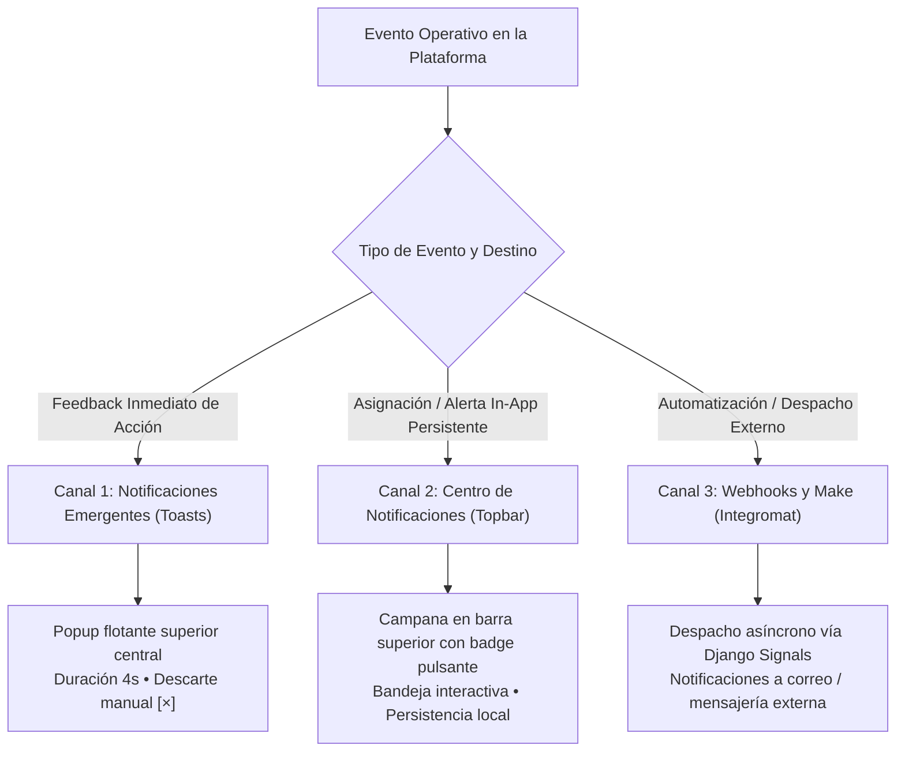
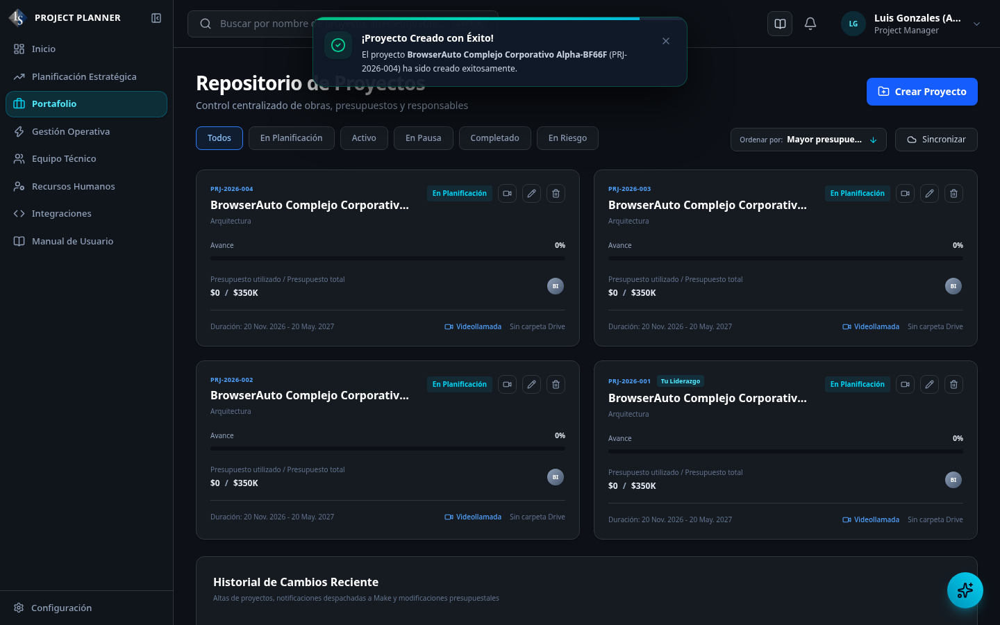
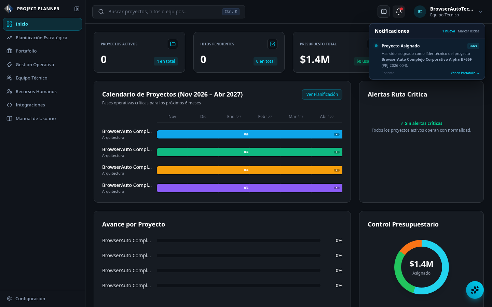
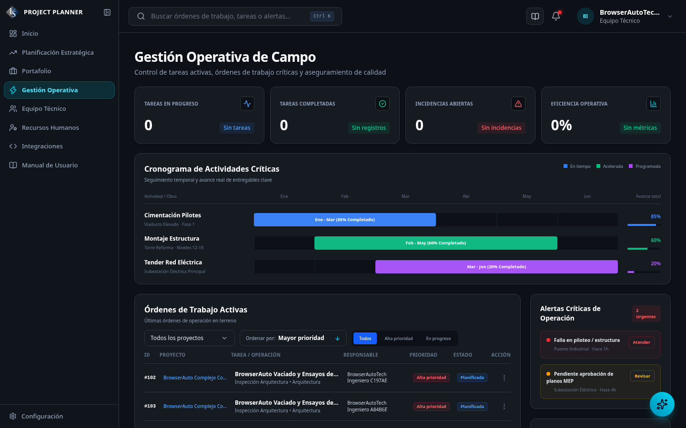

# 10. Control y Centro de Notificaciones

[← Volver al índice](./README.md)

> [!IMPORTANT]
> **Disponibilidad y Alcance:**  
> El sistema de notificaciones de Project Planner opera como un ecosistema coordinado entre la experiencia visual en el navegador y los canales externos. Todos los roles (Equipo Técnico, Subadministradores y Administradores) tienen acceso al Centro de Notificaciones y a las alertas emergentes, visualizando únicamente los eventos pertinentes a su nivel de autorización y asignación de obras.

---

## 10.1 Arquitectura Multicanal de Alertas

Project Planner implementa una arquitectura de comunicación en tres niveles complementarios para garantizar que ningún evento operativo crítico pase inadvertido, manteniendo al mismo tiempo una interfaz limpia y libre de saturación:

1. **Canal 1: Notificaciones Emergentes Instantáneas (Toasts):** Mensajes temporales reactivos que confirman de manera inmediata el resultado de una acción directa en pantalla (creación, edición, eliminación o error de validación).
2. **Canal 2: Centro de Notificaciones en Barra Superior (In-App Topbar):** Bandeja desplegable permanente accesible desde el ícono de campana, donde los usuarios consultan invitaciones, cambios de liderazgo de proyectos y órdenes de trabajo asignadas.
3. **Canal 3: Automatizaciones Salientes (Webhooks / Make):** Bus asíncrono para notificaciones fuera de la plataforma (correo electrónico corporativo o canales de mensajería).  
   *(Para detalles sobre el flujo de Django Signals y configuración de escenarios, consulte el [Capítulo 9: Automatizaciones y Webhooks con Make](./09-configuracion-make.md)).*

---

## 10.2 Canal 1: Notificaciones Emergentes Instantáneas (Toasts)

### 10.2.1 Propósito y Comportamiento
Los Toasts proporcionan confirmación visual inmediata sin interrumpir el flujo de trabajo del usuario ni requerir interacción obligatoria.

*Figura 10.1: Notificación flotante tipo Toast confirmando el alta exitosa de un proyecto.*

### 10.2.2 Anatomía Visual y Funcional
- **Posición Central Superior:** Aparece centrado en la parte superior de la pantalla (`top-6`), garantizando visibilidad sin obstruir formularios modales activos.
- **Identificador de Tipo:**
  - **Éxito (Cyan / Verde):** Operaciones completadas exitosamente (alta de técnico, creación de proyecto, emisión de orden).
  - **Advertencia / Error (Rojo / Ámbar):** Errores de validación, discrepancias de contraseña o accesos restringidos.
- **Barra de Progreso Regresiva:** Una línea luminosa inferior desciende de forma continua indicando el tiempo restante antes de que el mensaje desaparezca automáticamente (temporizador estándar de 4 segundos).
- **Descarte Manual:** El usuario puede pulsar el botón **[×]** en cualquier instante para cerrar la alerta sin esperar al temporizador.
- **Accesibilidad (a11y):** Los Toasts están etiquetados con el atributo `role="status"` o `role="alert"` y regiones en vivo (`aria-live="polite"`), permitiendo que lectores de pantalla anuncien la confirmación en tiempo real.

---

## 10.3 Canal 2: Centro de Notificaciones en Barra Superior (Topbar)

### 10.3.1 Indicador de Alertas Pendientes (Badge Pulsante)
En la esquina superior derecha del panel principal, junto al manual de usuario y el avatar de perfil, se ubica el botón interactivo de **Notificaciones** (representado por una campana).

*Figura 10.2: Bandeja in-app desplegada desde la campana del Topbar con la alerta de nuevo liderazgo.*

Cuando existen notificaciones no leídas:
1. Un punto luminoso rojo (`animate-pulse`) se activa sobre la campana.
2. El sistema actualiza periódicamente el estado de notificaciones en segundo plano cada 15 segundos sin recargar la página.
3. El usuario puede abrir la bandeja pulsando sobre la campana o navegando hacia ella mediante el teclado (`Tab` + `Enter`).

### 10.3.2 Bandeja Desplegable de Notificaciones
Al activar la campana, se despliega una tarjeta flotante estructurada:

- **Cabecera de Bandeja:**
  - Título **“Notificaciones”**.
  - Contador de mensajes no leídos (ej. *“1 nueva”*).
  - Enlace rápido **[Marcar leídas]**: Marca todas las alertas como leídas en una sola acción sin eliminarlas del historial.
- **Tarjetas de Notificación:**
  - **Indicador de lectura:** Punto cyan brillante para elementos pendientes de revisión.
  - **Título y Distintivo:** Identifica el tipo de evento con etiquetas de contexto, como el distintivo **[Líder]** en color cyan cuando se asigna la dirección técnica de una obra.
  - **Detalle de la asignación:** Texto formateado indicando el nombre formal del proyecto o tarea y su código oficial (ej. `PRJ-2026-004`).
  - **Acción Rápida de Navegación:** Enlace contextual **[Ver en Portafolio →]** o **[Ver en Operaciones →]** que transporta al usuario directamente al módulo y ficha correspondiente.

### 10.3.3 Gestión de Lecturas y Persistencia
- **Marcado Individual:** Hacer clic sobre cualquier tarjeta de notificación marca ese elemento específico como leído y redirige al recurso correspondiente.
- **Persistencia en Navegador:** Los identificadores de notificaciones leídas se preservan en el almacenamiento local del navegador (`localStorage: project_planner_read_notifs`), de manera que las alertas ya revisadas permanezcan como leídas incluso tras cerrar el navegador o reiniciar la sesión.
- **Cierre Rápido:** La bandeja se cierra automáticamente al pulsar la tecla `Escape`, al hacer clic fuera del panel (*click-outside*) o al seleccionar cualquier enlace de navegación.

---

## 10.4 Canal 3: Impacto Operativo en la Sesión del Técnico

El ciclo de notificaciones no concluye con la lectura de una alerta: se refleja de inmediato en los módulos de trabajo del especialista técnico incorporado.

*Figura 10.3: Panel de Gestión Operativa mostrando las órdenes de trabajo asignadas al especialista técnico.*

### 10.4.1 Asignación de Tareas en Gestión Operativa
Cuando el Administrador emite una nueva Orden de Trabajo (OT) y designa como responsable al nuevo técnico:
1. El técnico recibe la alerta correspondiente en su Centro de Notificaciones.
2. Al ingresar al módulo **Gestión Operativa** (`Shift + 4`), la nueva orden figura en la tabla de **Órdenes de Trabajo Activas**, indicando:
   - Nombre de la tarea (ej. *“Vaciado y Ensayos de Resistencia Nivel 3”*).
   - Nivel de prioridad (*Alta prioridad*).
   - Estado operativo inicial (*Planificada*).
   - Proyecto asociado y especialidad técnica requerida.

### 10.4.2 Proyectos Asignados en el Portafolio
Cuando el especialista es designado como líder de un proyecto:
1. En el módulo **Portafolio** (`Shift + 3`), el proyecto se destaca con el distintivo **“Tu Liderazgo”**.
2. El técnico tiene acceso directo para consultar las especificaciones técnicas, avances porcentuales y bitácora de la obra.

---

## 10.5 Gobernanza Antispam y Supresión de Duplicados

Para proteger la productividad de los equipos de campo y supervisores, el motor de eventos de Project Planner cuenta con reglas estrictas de supresión de alertas redundantes:

> [!NOTE]
> **Supresión de Señal de Líder Inicial (`_skip_leader_assigned_signal`):**  
> Cuando un Administrador da de alta un proyecto y define a su Líder Técnico en el mismo formulario inicial, el sistema emite un único evento maestro de creación (`project.created`), el cual ya incluye los datos del líder asignado.  
> La señal secundaria `project.leader_assigned` se suprime automáticamente durante la creación inicial. De este modo, se evita que el especialista reciba dos correos electrónicos idénticos con segundos de diferencia por una misma acción administrativa.

### Matriz de Eventos y Notificaciones Despachadas

| Acción en la Plataforma | Canal Toast (Emisor) | Notificación In-App (Destinatario) | Webhook Make (Canal Externo) |
|---|---|---|---|
| **Alta de Técnico** | Sí (*“Técnico añadido al equipo”*) | N/A (Cuenta nueva) | `member.created` (Bienvenida/Credenciales) |
| **Nuevo Proyecto con Líder** | Sí (*“¡Proyecto Creado con Éxito!”*) | Sí (*“Proyecto Asignado”* [Líder]) | `project.created` (Alerta con líder integrado) |
| **Cambio Posterior de Líder** | Sí (*“Líder actualizado”*) | Sí (*“Nuevo Proyecto Asignado”*) | `project.leader_assigned` (Actualización) |
| **Emisión de Orden de Trabajo** | Sí (*“Orden de trabajo emitida”*) | Sí (*“Nueva Tarea Asignada”*) | `task.assigned` (Aviso operativo) |
| **Videoconferencia / Reunión** | Sí (*“Reunión creada”*) | Sí (*“Nueva Videoconferencia”*) | `meeting.created` (Enlace Jitsi y agenda) |
| **Error / Permiso Denegado** | Sí (*“Acceso denegado”*) | N/A | No se emite |

---

## 10.6 Solución de Problemas Frecuentes

| Síntoma o Situación | Causa Probable | Solución Paso a Paso |
|---|---|---|
| La campana muestra un punto rojo pero la bandeja aparece vacía. | El filtro local o la sincronización con el servidor tiene un desfase de red. | Pulse **[Marcar leídas]** en la cabecera o recargue la página (`F5`). El polling se actualizará automáticamente. |
| Un técnico no visualiza la notificación de un proyecto donde fue asignado. | El usuario inició sesión antes de que el Administrador guardara la asignación. | Espere hasta 15 segundos para el siguiente ciclo de polling automático o navegue al **Portafolio** (`Shift + 3`) para refrescar la vista. |
| El Toast desaparece demasiado rápido antes de leerlo. | El temporizador automático es de 4 segundos. | El evento queda registrado permanentemente en el historial de cambios del módulo correspondiente y en la bandeja in-app si requirió asignación. |
| Los mensajes ya leídos vuelven a aparecer como nuevos tras cambiar de equipo. | La preferencia de lectura se almacena de forma local (`localStorage`). | Es el comportamiento normal de la caché del navegador para máxima velocidad de respuesta sin sobrecargar el servidor central. |

