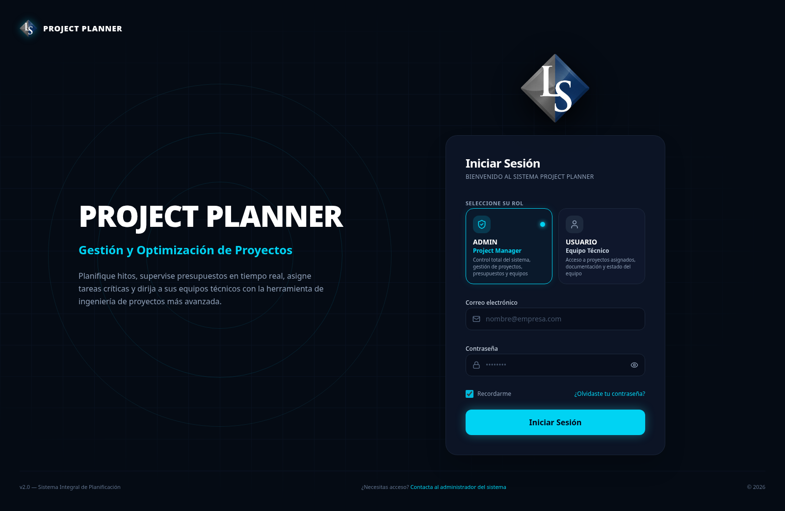

# 1. System Access, Authentication, and Global Navigation

[← Back to Index](./README.md)

---

## Sign-In Screen Components

The initial screen centralizes secure access to Project Planner with the following components:
- **Quick Role Selector:** Interactive cards **[USER — Technical Team]** and **[ADMIN — Project Manager]** to switch profiles with a single click.
- **Credentials Form:** Institutional email and password fields with a visibility toggle button (eye icon) and optional *“Remember me”* checkbox.
- **2FA Verification Modal:** Security screen for administrative accounts requesting the temporary 6-digit code.
- **Initial Setup Assistant (QR):** Modal for new administrators displaying a QR code to configure the authenticator app.

---

## 1.1 Sign in as Technical Team

**Available for:** active technical accounts.

1. Open Project Planner in your web browser.
2. On the initial screen, click the **“USER — Technical Team”** card.
3. Enter your assigned corporate email address.
4. Enter your secret password.
5. Check **“Remember me”** only if you are using a personal, non-shared computer.
6. Click **“Sign In”**.

**Expected result:** the system opens the Control Panel (Dashboard) and displays your name in the upper right corner.

**If it doesn't work:**
- Verify that you selected the **USER** card and not **ADMIN**.
- Click the eye icon to verify that there are no capitalization errors in the password.
- If a service unavailable message appears, check your network connection or wait a few moments.
- If the account is deactivated, contact coordination for reactivation.

*Figure 1.1: Sign-in screen featuring quick role selector and credentials form.*

---

## 1.2 Sign in as Administrator (with 2FA)

**Available for:** Administrators and Subadministrators.

1. Click the **“ADMIN — Project Manager”** card.
2. Enter your corporate email and password.
3. Click **“Sign In”**.
4. On the 2FA verification screen, open your authenticator mobile app (Google Authenticator or Microsoft Authenticator).
5. Enter the temporary 6-digit code and click **“Verify Code”**.

**If it is your first administrative access:**
1. On the 2FA screen, click **“First time? Set up Authenticator”**.
2. Open the authenticator app on your phone and scan the QR code displayed on screen.
3. Enter the 6-digit code generated by the app and click **“Verify Code”**.

**Expected result:** the system opens with all project management, editing, and reporting features enabled.

**If it doesn't work:**
- If the code is rejected, wait a few seconds for the mobile app to generate a fresh code before entering it.
- Ensure that your mobile phone's clock is set to automatic network time.

---

## 1.3 What to do if you forget your password? (Credential Recovery)

**Available for:** all registered users.

1. On the sign-in screen, click the **“Forgot your password?”** link.
2. Enter your registered corporate email and click **“Send code”**.
3. Check your inbox (and spam folder) to copy the 6-digit verification code received.
4. Enter the code on screen and click **“Verify code”**.
5. Type your new password (minimum 6 characters) and confirm it in the second field.
6. Click **“Reset Password”**.
7. Return to the main screen and sign in with your new credentials.

**Expected result:** the system confirms the update and allows you to sign in immediately.

**If it doesn't work:**
- Ensure the email address entered does not contain trailing or leading spaces.
- If the code expired, request a new code by clicking resend.
- If your account is locked or deactivated, contact the Administrator to reactivate it from Role Management.

---

## 1.4 What to do if you lose your phone or 2FA app access?

**Available for:** accounts with two-factor authentication enabled.

1. On the 2FA verification screen, click **“Use emergency recovery code”**.
2. Enter one of the single-use backup codes you saved when enabling 2FA.
3. The system grants immediate access.
4. Once logged in, navigate to **Settings** (`Shift + 9`) to bind your new mobile device.

**If you do not have backup codes:**
- Contact the primary System Administrator to reset your authenticator binding.

---

## 1.5 Main Menu and Keyboard Shortcuts

The left sidebar allows swift navigation across platform modules:

| Shortcut | Action |
| :--- | :--- |
| `Shift + 0` | Collapse or expand the sidebar. |
| `Shift + 1` | Open Control Panel (Dashboard). |
| `Shift + 2` | Open Strategic Planning. |
| `Shift + 3` | Open Project Portfolio. |
| `Shift + 4` | Open Operations Management. |
| `Shift + 5` | Open Technical Team Directory. |
| `Shift + 6` | Open Human Resources. |
| `Shift + 7` | Open Project Audit (Admin and Subadmin). |
| `Shift + 8` | Open Integrations. |
| `Shift + 9` | Open User Manual. |
| `Ctrl + K` | Focus global search bar at any time. |

---

## 1.6 Secure Sign Out

1. In the upper right corner, click your name or profile picture.
2. In the dropdown menu, select **“Sign Out”**.
3. Verify that the screen returns to the initial access form.

> [!NOTE]
> On shared computers, always sign out when finished and avoid checking the *Remember me* option.
