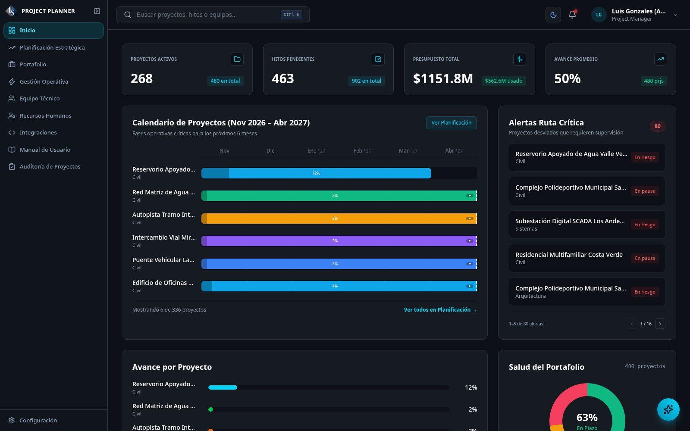

# 2. Control Panel (Dashboard)

[← Back to Index](./README.md)

---

## Screen Spaces, Charts, and User Value

The **Control Panel (Dashboard)** summarizes organizational portfolio health in a single unified view:

- **1. Top KPI Summary Cards (Executive Overview):**
  - **Active Projects:** Shows total simultaneous active works to measure current operational volume.
  - **Pending Milestones:** Quantifies intermediate project goals or contract milestones approaching deadline.
  - **Total Budget:** Displays consolidated capital investment across all recorded projects.
  - **Optimization Rate / Average Progress:** Reflects average physical progress achieved across the portfolio.

- **2. 6-Month Project Calendar (Mini-Gantt):**
  - *User Value:* Allows identifying project operational phases over the next 6 months at a glance without opening the complex master plan.
  - *Reading the Gantt bars:*
    - **Shaded progress fill:** Displays the exact physical percentage completed.
    - **Left arrow ◀:** Indicates the project started prior to the visible 6-month window.
    - **Right arrow ▶:** Indicates the project continues past the visible window.
    - **[View Planning] button:** Jumps directly to the full interactive annual schedule.

- **3. Critical Path Alerts Panel:**
  - *User Value:* Acts as an early-warning radar flagging projects with overdue critical tasks, risk status, or paused workflows before delays impact contractual delivery. Features a red badge counter and paginated list.

- **4. Progress by Project (Horizontal Performance Bars):**
  - *User Value:* Visually benchmarks the physical progress of primary works to highlight disciplines progressing on schedule versus those requiring reinforcement.

- **5. Portfolio Health Donut Chart:**
  - *User Value:* Categorizes overall portfolio health into three color bands:
    - **Green (On Schedule):** Works progressing normally with zero overdue critical tasks.
    - **Yellow (Warning):** Works with moderate delay (10% to 25% deviation).
    - **Red (Critical / Delayed):** Works with severe delay (>25% deviation) or stalled progress.
  - Center label: Displays overall percentage of works on track.
  - **[View Full Audit] button:** Direct shortcut to the Periodic Project Audit view.

*Figure 2.1: Control Panel with executive KPI cards, 6-month Mini-Gantt, and portfolio health chart.*

---

## 2.1 Review Indicators and Dashboard Metrics

**Available for:** all user roles.

1. In the sidebar, click **“Dashboard”** or use shortcut `Shift + 1`.
2. Review the 4 top cards to check active works, pending milestones, and total capital budget.
3. Observe the 6-month Gantt calendar to monitor ongoing work continuity.
4. Check the **Critical Path Alerts** panel to review flagged projects.
5. Inspect the **Portfolio Health** donut chart to evaluate overall on-track percentage.

**Expected result:** metrics and charts display updated information from the platform.

---

## 2.2 Search Projects from the Search Bar

**Available for:** all user roles.

1. Click the search box at the top or press `Ctrl + K`.
2. Type the name, code, or area of the desired project.
3. The screen filters results in real time.
4. To view all projects again, clear the search text.

---

## 2.3 What to Do If the Dashboard Appears Empty?

If cards display zero values or charts appear blank:
1. Verify whether projects are registered by navigating to **Portfolio** (`Shift + 3`).
2. If the platform was just opened, wait a few moments while data finishes loading.
3. Refresh your web browser to reload information.
