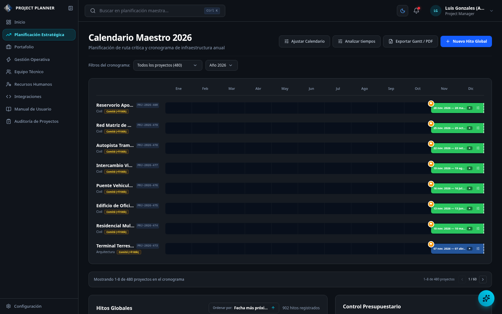
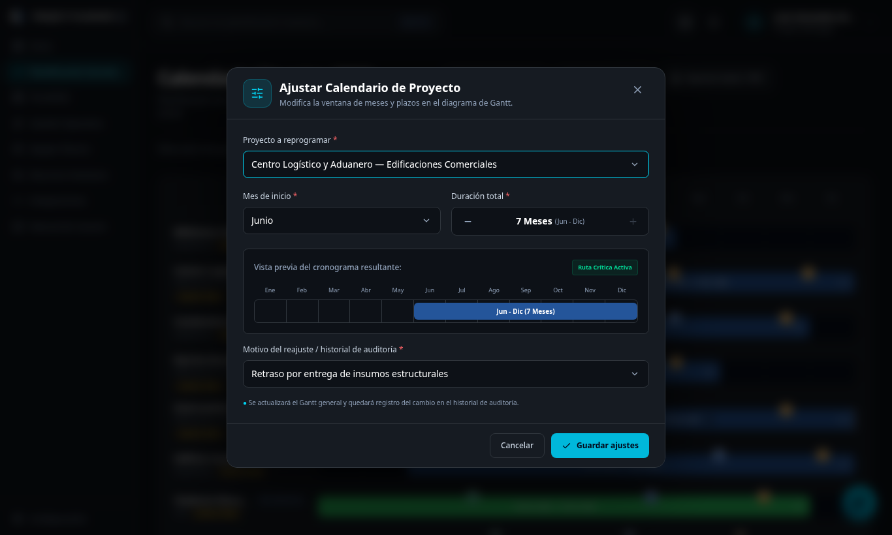

# 3. Strategic Planning, Global Milestones, and Schedule Adjustments

[← Back to Index](./README.md)

---

## Screen Spaces, Charts, and Controls

The **Strategic Planning** view coordinates delivery timeframes and budget control through 4 interactive sections:

- **1. Master Annual Gantt Schedule:**
  - Displays monthly lifecycle bars for all works planned throughout the year.
  - **Filter by Project:** Dropdown allowing focus on a single project or selecting *“All projects”*.
  - **Year Selector:** Toggles between different calendar years (e.g., 2025, 2026, 2027).
  - **Milestone Markers:** Numbered diamonds on schedule bars indicating contract milestones.
  - **$100k Budget Governance Badge:** Distinctive marker on works meeting or exceeding $100,000 USD.
  - **[Export Gantt / PDF] Button:** Generates a formatted layout ready for printing or archiving as PDF.
  - **Management Action Buttons:** Access to **[Adjust Schedule]**, **[Analyze Timelines]**, and **[New Milestone]**.

- **2. Global Milestones Panel:**
  - **Synchronization:** When filtering by a specific project in the Gantt, the milestone list synchronizes automatically to display only milestones belonging to that project. Selecting *“All”* shows milestones across the entire portfolio.
  - **Sort Dropdown Menu (`SortDropdown`):** Organizes milestones according to need:
    - *Earliest Date (Date Ascending)*
    - *Latest Date (Date Descending)*
    - *By Status: In Progress First*
    - *By Status: Pending First*
    - *By Status: Completed First*
  - **Milestone Card:** Displays milestone title, linked project code (`PRJ-2026-xxx`), project name, and target deadline.
  - **Inline Status Dropdown:** Easily toggle milestone status between *Pending*, *In Progress*, and *Completed*.
  - **Actions:** Details button (three dots) to view validator and description, and delete button (trash can).

- **3. Budget Control and Technical Discipline Breakdown:**
  - Donut chart displaying total allocated capital, executed funds, and remaining balance.
  - **When a specific project is selected:** Details discipline area, duration in months, progress percentage, and execution rate.
  - **In global overview:** Displays horizontal capital bars distributed across Technical Disciplines (*Civil*, *Architecture*, *Systems*), average budget per project, and total active initiatives.

- **4. Schedule Adjustments & Audit History:**
  - Immutable table at the bottom of the page recording every schedule rebaselining event.
  - Columns: Project Name, Previous Dates, New Adjusted Dates, Adjusted Duration, Responsible User, Timestamp, and the **Mandatory Adjustment Rationale** (e.g., *Weather delay*, *Scope change*, *Contract addendum*).

*Figure 3.1: Strategic Planning view featuring master Gantt chart, milestones panel, and budget breakdown.*

---

## 3.1 Review and Filter the Gantt Schedule

**Available for:** all roles.

1. In the sidebar, select **“Strategic Planning”** (`Shift + 2`).
2. In the **Filter by project** dropdown, choose a specific work or select **All projects**.
3. In the year selector, choose the calendar year to review (e.g., 2026).
4. Review the timeline bars to check start dates, completion dates, and scheduled milestone diamonds.

**Expected result:** the Gantt schedule updates to display only projects matching selected filters.

---

## 3.2 Adjust a Project Schedule (Reprogramming)

**Available for:** Administrator and Subadministrator.

1. Click the **[Adjust Schedule]** button at the top of the view.
2. In the modal dialog, select the project requiring date changes.
3. Choose the updated start month and year.
4. Set the total duration in months using the number stepper.
5. Enter the **Adjustment Rationale** (mandatory field justifying schedule modification for audits).
6. Review the preview dates and click **[Save Adjustments]**.

**Expected result:** the project bar shifts in the Gantt chart and the change is immediately recorded in the **Schedule Adjustments & Audit History** table.

**If it doesn't work:** ensure the duration is at least 1 month and a valid technical rationale has been provided.

*Figure 3.2: Schedule adjustment assistant dialog with mandatory audit rationale.*

---

## 3.3 Consult and Sort Global Milestones

**Available for:** all roles (status changes restricted to management roles).

1. Scroll to the **Global Milestones** section.
2. Open the **Sort:** dropdown and select the desired criteria (*Earliest Date*, *In Progress First*, etc.).
3. To update milestone progress, click its status badge and select *In Progress* or *Completed*.
4. To view full details or the designated validator, click the three-dots icon.

**Expected result:** the list reorganizes immediately and status updates reflect on the Gantt diamond.

---

## 3.4 Register a New Global Milestone

**Available for:** Administrator and Subadministrator.

1. Click the **[New Milestone]** button in the header.
2. Type the milestone title (e.g., *"Foundation completion and structural slab sign-off"*).
3. Select the linked project.
4. Set the target completion date.
5. Designate the responsible engineer or team leader.
6. Click **[Save Milestone]**.

**Expected result:** the new milestone appears in the panel and displays as a numbered diamond on the project's Gantt bar.

---

## 3.5 Analyze Timelines with the Optimization Engine

**Available for:** Administrator and Subadministrator.

1. Click the **[Analyze Timelines]** button.
2. Select the project you wish to evaluate.
3. The platform analyzes task dependencies and float to suggest schedule compression opportunities.
4. Review mathematical recommendations and decide whether to apply adjustments.

---

## 3.6 Export or Print the Schedule as PDF

**Available for:** all roles.

1. Configure the project and year filters you wish to export.
2. Click the **[Export Gantt / PDF]** button.
3. A print-formatted view opens ready to save as PDF or send to a printer.

---

## 3.7 Consult the Schedule Adjustments History

**Available for:** all roles.

1. Scroll to the table located at the bottom of the view.
2. Review audit rows to check which projects were rescheduled, who executed the change, when it occurred, and the mandatory rationale recorded.
