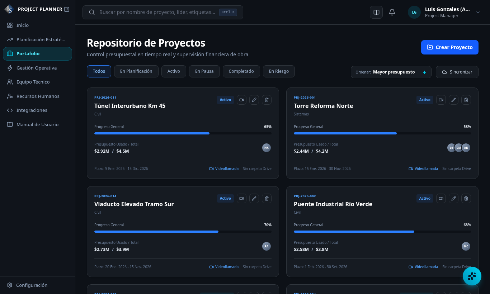
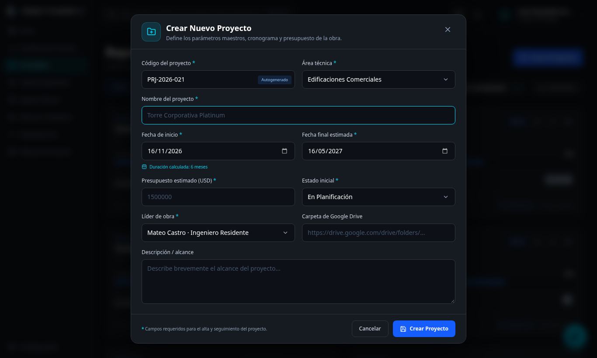
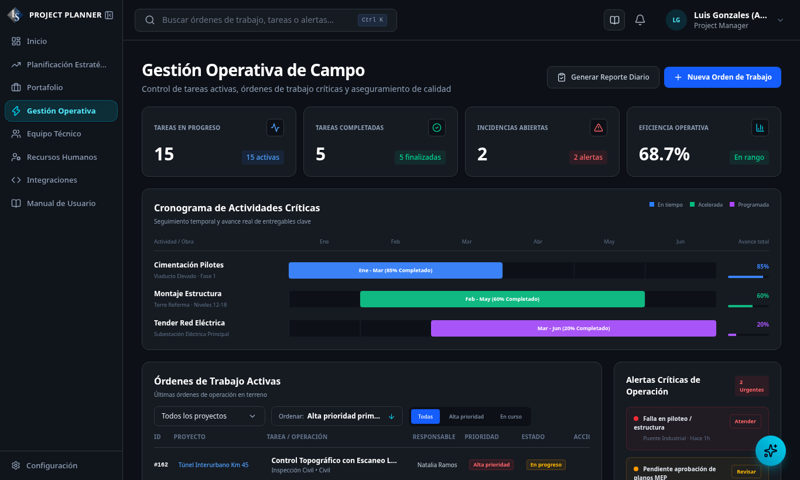

# 3. Portfolio and Operational Management

[← Back to contents](./README.md)

## 3.1 View projects

**Available for:** All roles.

1. Tap **“Portfolio”**.
2. Use the search tool to find a project by name, code, leader, or tag.
3. Apply the status filters if available.
4. Use **“Sort”** to change the order of the cards.
5. Review name, code, status, dates, budget, progress, and members.
6. Tap the card or the corresponding action to open the details.

If you don't get any results, clear the search and reset the filters.

> [!NOTE] Technical Leadership Indicator: When a technical team member assigned as project leader accesses the portfolio, the project card displays the **“Tu Liderazgo”** badge, allowing immediate identification of projects under their technical coordination.

## 3.2 Create a project

**Available to:** Administrator and Sub-administrator.

1. Click **"Create Project"**.
2. Enter the project code and name.
3. Select the technical area.
4. by Start Date and End Date
5. Enter the budget.
6. Select the initial status and the site leader.
7. Add the Google Drive folder, if it exists.
8. Enter the description or scope.
9. Click **"Create Project"**.

**Expected result:** **“Project Created Successfully!”** appears and a new card is added.

**Common errors:** Duplicate code, end date before start date, invalid budget, or empty required fields.

*Figure 3.1: Overview of the Project Portfolio with distinction of budget governance `Comité (>$100k)`.*

*Figure 3.2: Dialog box for creating a new project with budget, dates, and assigned leader.*

## 3.3 Editing a project

1. Locate the card.
2. Tap the **“Edit project”** icon.
3. Modify the allowed fields.
4. Press **“Save Changes”**.

The budget and the leader's reassignment may be blocked for a technician or project leader. Deletion is reserved for the administrator.

## 3.4 Deleting a project

**Available to:** Administrator.

1. Tap the **“Delete project”** icon.
2. Check the code and name shown in **“Confirm Deletion”**.
3. Press **“Delete Project”** only if applicable.

This action may delete related information. Before using it, confirm that the project does not need to be retained for audit purposes.

## 3.5 Check history and videoconference

- Review **“Recent Change History”** to see recorded changes.
- Use the video call icon on a card to open the associated Jitsi rooms.
- Use folder access when the project has Drive documentation.

## 3.6 Viewing work orders

**Available for:** All roles.

1. Press **“Operational Management”**.
2. Select the operational project.
3. Use the **All**, **High Priority**, or **In Progress** tabs.
4. Apply search and sorting.
5. In a row, press the action button to open the tab.
6. Review project, area, person responsible, priority, dates, progress, critical path, and instructions.
7. Use **“Open in Drive”** when there is linked documentation.

> [!TIP] Technician Operational View: Technical team members assigned as task assignees directly view their assigned work orders on their dashboard with priority, critical path, and Drive drawing links, enabling fast instruction reviews and on-site field updates.

## 3.7 Creating a Work Order

**Available to:** Administrator and Sub-administrator.

1. Press **“New Work Order”**.
2. Select the associated project and the type of operation.
3. Enter the title of the task or order.
4. Select the technical area and the person responsible.
5. Enter the start date and the deadline.
6. Select Priority
7. Enable critical path and float only when applicable.
8. Add the Drive link.
9. Write clear instructions for the field.
10. Press **“Issue Work Order”**.

**Expected result:** **“Order Issued”** appears, and the order is added to the dashboard.

> [!NOTE] Consolidation and operational dispatch: Issued work orders are immediately incorporated into the operational dashboard, and their status is updated in real time. To consolidate the history and issue the formal log to the site supervisors, use the **“Generate Daily Report”** function at the end of the shift.

## 3.8 Completing, reopening, or continuing an order

1. Open the order tab.
2. If it is in progress, press **“Complete”**.
3. If there is a next task, choose from:
   - **“Complete and move to next”**;
   - **“Fill out only”**.
4. If a completed order needs corrections, press **“Reopen Order”**.

Check the confirmation message and the module indicators.

## 3.9 Generate the daily report

1. Apply the desired project and filters.
2. Press **“Generate Daily Report”**.
3. Wait for the message **“Report Exported”**.
4. Open the downloaded file and check the records.

*Figure 3.3: Data sheet for field work orders (`WorkOrderDetailDialog`) with progress, critical path and access to Drive drawings.*

