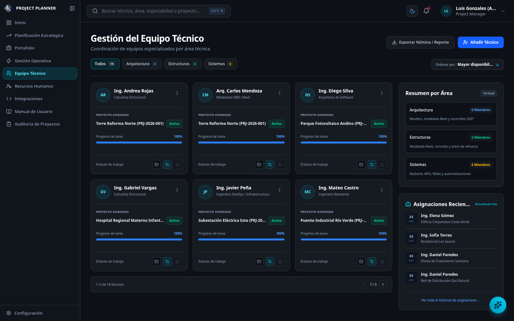
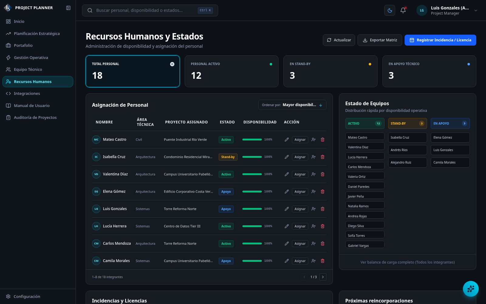

# 4. Technical Team and Human Resources

[← Back to contents](./README.md)

## 4.1 Consult the Technical Team

**Available for:** All roles.

1. Press **“Technical Team”**.
2. Select **All**, **Architecture**, **Structural/Civil** or **Systems**.
3. Use **“Sort by”** to sort by availability, name, or onboarding.
4. Check name, specialty, project, status and workload percentage.
5. Use the icons on the card to view the project or contact the member if an email address or phone number is available.

**Expected result:** Only the members who match the area, search, and order are shown.

## 4.2 Exporting the technical roster

**Available to:** Administrator and Sub-administrator.

1. Press **“Export Payroll / Report”**.
2. Please wait for the confirmation after clicking.
3. Open the file `equipo-tecnico.csv`.

## 4.3 Add a technician

**Available to:** Administrator and Sub-administrator.

1. Press **“Add Technician”**.
2. Optionally, tap **“Upload profile photo”**. Use PNG or JPG files up to 2 MB.
3. Enter first and last names.
4. Enter the corporate email address.
5. Enter and confirm the initial password.
6. Select specialty, technical area, initial project and status.
7. Indicate availability or load between 0% and 100%.
8. Press **"Add to team"**.

**Expected result:** The access account and the technical record are created, and a new card appears when the directory is updated.

**Common errors:** Duplicate email, different passwords, password less than eight characters, invalid photo, or catalogs not uploaded.

*Figure 4.1: Technical Team Directory with Availability Metrics and Specialties.*

## 4.4 Reassigning a project

1. Open the technician actions menu.
2. Press **“Reassign project”**.
3. Select the new project.
4. Select **Active**, **Standby**, or **In support**.
5. Adjust the percentage of time spent.
6. Select the reason
7. Press **“Save reassignment”**.

**Expected result:** The card changes and the transaction is added to Recent Allocations.

## 4.5 Consult Human Resources

1. Tap **“Human Resources”**.
2. Use the **Total staff**, **Active**, **Standby**, and **Supporting** cards to filter.
3. Use the search tool and the sort selector.
4. Check name, area, project, status, and availability.
5. Press **“Update records”** to query the server again.

A technical account can view the information, but should not see administrative actions related to editing and incidents.

## 4.6 Exporting the HR matrix

1. Press **“Export Matrix”**.
2. Wait while the button indicates **“Generating Excel...”**.
3. Open `matriz-recursos-humanos.xlsx`.

The file includes the members available in the matrix, their assignment, status, and availability.

## 4.7 Reporting an incident or leave of absence

**Available to:** Administrator and Sub-administrator.

1. Press **“Report Incident / Leave”**.
2. Select the member.
3. Select the type of issue.
4. Enter start date and return date.
5. Check the calculated duration.
6. Select the resulting operating status.
7. Enter the availability for the period.
8. Select a backup technician, if applicable.
9. Write the reason and the coordination carried out.
10. Press **“Report an incident”**.

**Expected result:** The request is saved as pending. The operational change is applied when the incident is approved.

**Common errors:** Reversed dates, overlapping incidents, same member as backup, or comment too short.

## 4.8 Approve, reject, or terminate

- **Approve:** Find a pending incident, press **“Approve”**, add a comment, and confirm.
- **Reject:** Press **"Reject"**, enter the reason (mandatory), and confirm.
- **Finalize:** For an approved incident, press **“Finalize”** and confirm the return to work.

Check the member's status, availability, and history later.

*Figure 4.2: Human Resources Matrix with management of absences, incidents, and workload balance.*

