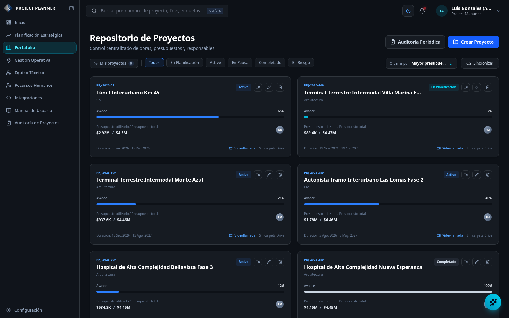
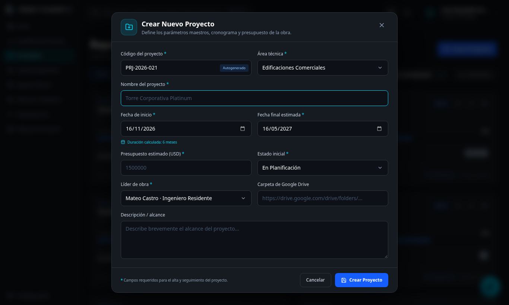

# 4. Project Portfolio and Repository

[← Back to Index](./README.md)

---

## Screen Spaces, Controls, and Project Cards

The **Portfolio** centralizes the repository of all corporate works through high-density visual cards and rapid filtering tools:

- **1. Header Controls and Actions:**
  - **[Project Audit] Button:** Opens the Periodic Project Audit modal directly within the Portfolio, allowing teams to inspect deviations without leaving the page.
  - **[Create Project] Button:** Launches the modal dialog to register a new project (restricted to management roles).

- **2. Filter System and Sorting:**
  - **Status Tabs:** Filter projects by operational lifecycle: *All Projects*, *Active (In Progress)*, *In Planning*, *Paused*, and *At Risk*.
  - **Scope Tabs:** Toggle between *“My Projects”* (shows only projects where the logged-in user is site leader or member) versus *“All”*.
  - **Sort Dropdown Menu (`SortDropdown`):** Offers 4 sorting categories:
    - *Highest Budget* / *Lowest Budget*.
    - *Name (A-Z)* / *Name (Z-A)*.
    - *Highest Progress* / *Lowest Progress*.
    - *Earliest Delivery* / *Furthest Date*.
  - **[Clear Filters] Button:** Automatically activates whenever search text or filters are applied, allowing you to reset the entire grid with a single click.

- **3. Project Card Details:**
  - **Header:** Institutional code (`PRJ-2026-xxx`), official title, and cyan *"Your Leadership"* badge if you are the designated leader.
  - **Governance Badge:** `Committee (>$100k)` marker for works with budgets exceeding $100,000 USD.
  - **Key Metrics:** Physical progress bar with exact percentage, scheduled start and completion dates, total budget, and assigned team avatars.
  - **Direct Connectors:**
    - Folder icon: Opens the shared **Google Drive** folder containing DWG blueprints and technical specs.
    - Video camera icon: Launches the **Jitsi Meet** virtual room for remote technical coordination.
  - **Action Tools:** Pencil icon to edit project details and trash can icon to delete works (subject to permissions).

*Figure 4.1: Project Portfolio overview featuring status cards, filters, and governance indicators.*

---

## 4.1 Consult and Sort Projects

**Available for:** all roles.

1. In the sidebar, select **“Portfolio”** (`Shift + 3`).
2. Use the tabs to filter by status (*Active*, *Paused*, etc.) or click the **My Projects** tab to view only your assigned works.
3. Open the **Sort by** dropdown and choose your preferred order (e.g., *Highest Budget* or *Earliest Delivery*).
4. Type in the top search bar to locate a project by name or code.
5. To reset the view, click **[Clear Filters]**.

**Expected result:** the grid displays only project cards matching your selected criteria.

---

## 4.2 Create a New Project

**Available for:** Administrator and Subadministrator.

1. Click the **[Create Project]** button in the header.
2. Complete the required form fields:
   - **Code (\*):** Institutional alphanumeric code (e.g., `PRJ-2026-045`).
   - **Project Name (\*):** Official title of the work.
   - **Technical Area (\*):** Choose *Civil*, *Architecture*, or *Systems*.
   - **Total Budget (\*):** Capital investment in USD.
   - **Start Date and End Date (\*):** Scheduled project timeframe.
   - **Project Leader (\*):** Select the technical lead from the directory.
   - **Google Drive Folder (Optional):** Shared cloud link for blueprints and records.
3. Click **[Create Project]**.

**Expected result:** the confirmation message *"Project Created Successfully!"* appears and the new card is added to the grid.

**If it doesn't work:**
- Verify that the code is not already registered by another project.
- Check that the end date is scheduled after the start date.
- Ensure the budget field contains valid positive numbers.

*Figure 4.2: Assistant dialog for creating a new project with budget, timeframe, and assigned leader.*

---

## 4.3 Edit an Existing Project

**Available for:** Administrator and Subadministrator.

1. Locate the project card in the portfolio.
2. Click the pencil icon (**Edit project**) in the upper corner of the card.
3. Update dates, budget, operational status, or Drive link.
4. Click **[Save Changes]**.

**Expected result:** the card immediately updates with the new data.

---

## 4.4 Open Google Drive or Join Jitsi Video Room

**Available for:** all roles with access to the project.

1. On the project card, click the folder icon to open **Google Drive** blueprints and specs in a new tab.
2. Click the video camera icon to instantly join the **Jitsi Meet** coordination room linked to the project.

---

## 4.5 Launch Quick Audit from Portfolio

**Available for:** all roles.

1. In the view header, click the **[Project Audit]** button.
2. A modal dialog opens displaying audited projects, schedule slippage, and critical path metrics without leaving the portfolio.
3. Press `Escape` or the close icon (`X`) to return to the portfolio grid.

---

## 4.6 Delete a Project

**Available for:** Administrator only.

1. On the project card, click the trash can icon.
2. A confirmation dialog opens detailing the impact of deletion.
3. Confirm the action by clicking **[Confirm Deletion]**.

**Expected result:** the project is removed from the portfolio while maintaining historic audit logs.
