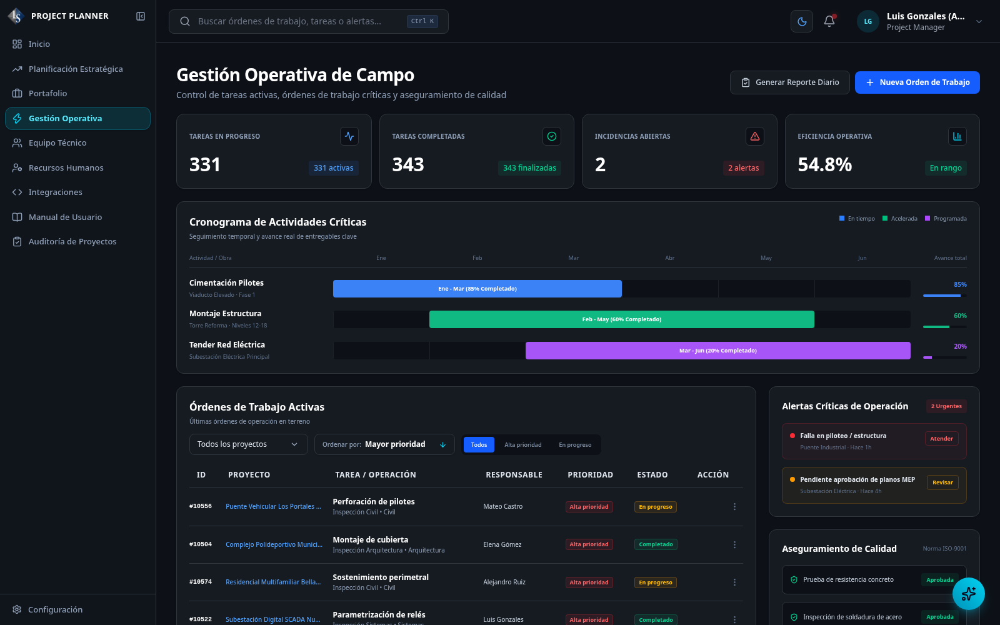

# 5. Operations Management and Work Orders

[← Back to Index](./README.md)

---

## Screen Spaces, Metrics, and Components

The **Operations Management** view coordinates field and office tasks through operational productivity KPIs, critical path monitoring, and work order tracking:

- **1. Top Operational KPI Cards:**
  - **Tasks in Progress:** Count of active activities currently underway in the field.
  - **Tasks Completed:** Verified and approved completed activities.
  - **Open Incidents:** Number of operational bottlenecks, accidents, or alerts requiring resolution.
  - **Operational Efficiency:** Overall percentage of deadline and milestone compliance.

- **2. Field Critical Schedule:**
  - Visual panel summarizing active operational phases and high-priority tasks scheduled for the active week.

- **3. Consolidated Project Technical Datasheet:**
  - Selecting a project from the dropdown reveals the designated lead engineer, discipline, accumulated labor hours, and actual progress percentage.

- **4. Work Orders Board:**
  - **Combined Filters:** Filter orders by status (*All*, *In Progress*, *Completed*, *Paused*) and by linked project.
  - **Sort Dropdown Menu (`SortDropdown`):** Organizes work orders by target deadline, estimated labor hours, or priority level (*Critical*, *High*, *Medium*, *Low*).
  - **Activities Table:**
    - Order code (`OT-xxx`) and task description.
    - Assigned specialist and linked project.
    - **Red `CPM` Badge:** Identifies critical path tasks with zero slack that cannot be delayed.
    - Estimated hours versus actual logged labor hours.
    - Interactive inline status dropdown (*Pending*, *In Progress*, *Completed*, *Overdue*).
    - Details button: Opens the full work order sheet with technical instructions and approval signatures.

- **5. Header Actions:**
  - **[Generate Daily Report] Button:** Immediate download of structured `reporte-operativo-diario.csv`.
  - **[New Work Order] Button:** Opens the work order creation dialog.

*Figure 5.1: Operations Management panel featuring KPI cards, critical schedule, and work orders table.*

---

## 5.1 Consult Operational Metrics and Critical Schedule

**Available for:** all roles.

1. In the sidebar, select **“Operations Management”** (`Shift + 4`).
2. Review the 4 KPI cards to check active tasks, completions, and overall efficiency.
3. Observe the critical schedule to identify which tasks must be addressed urgently.
4. Select a project from the dropdown to review its consolidated technical datasheet.

**Expected result:** the view filters metrics and displays work orders belonging to the selected project.

---

## 5.2 Issue a New Work Order

**Available for:** Administrator, Subadministrator, and Project Leader.

1. Click the **[New Work Order]** button in the header.
2. Complete the form fields:
   - **Linked Project (\*):** Confirm the project where the work will be executed.
   - **Task Title (\*):** Clear description of the activity (e.g., *"Concrete pouring on Level 3 slab"*).
   - **Assigned Specialist (\*):** Choose the responsible technician from the available staff.
   - **Priority (\*):** Select *Low*, *Medium*, *High*, or *Critical*.
   - **Estimated Hours (\*):** Planned labor effort in hours.
   - **Predecessor Task (Optional):** If the activity requires another task to finish first, select it from the list.
   - **Description & Specs:** Quality specifications, safety standards, and instructions.
3. Click **[Issue Order]**.

**Expected result:** the work order appears on the board with its official code and is added to the assigned technician's workspace.

---

## 5.3 Update Work Order Status

**Available for:** all roles (technicians can update the status of their assigned tasks).

1. Locate the work order in the table.
2. In the **Status** column, open the dropdown menu.
3. Select the updated status (*In Progress* or *Completed*).

**Expected result:** the status badge updates immediately and the system recalculates overall project progress.

---

## 5.4 View Full Work Order Details

**Available for:** all roles.

1. In the work order row, click the inspection button (three dots or document icon).
2. A modal dialog opens displaying full specifications, logged hours, and recorded notes.
3. Click close to return to the table.

---

## 5.5 Export Daily Operational Report as CSV

**Available for:** all roles.

1. Apply desired project or status filters to the table.
2. In the header, click the **[Generate Daily Report]** button.
3. The browser automatically downloads `reporte-operativo-diario.csv` ready for spreadsheet analysis.
