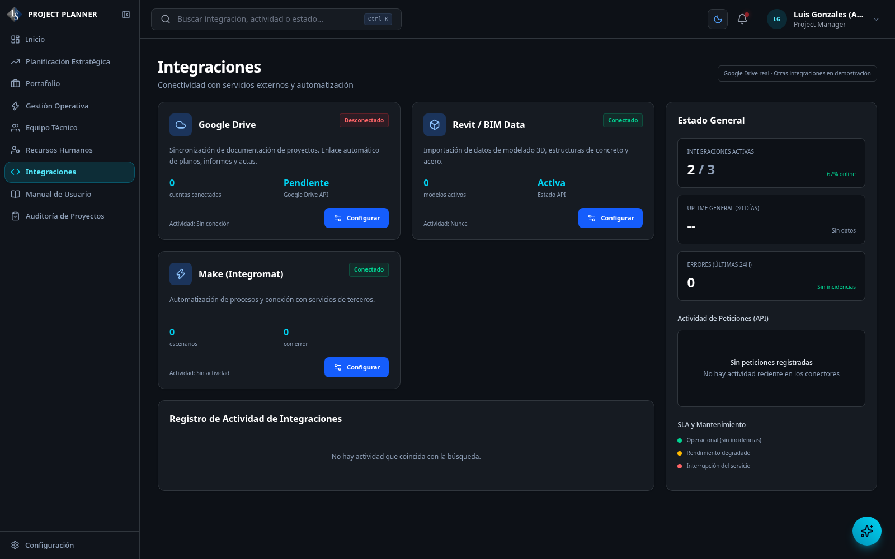

# 5. Integrations​

[← Back to contents](./README.md)

The **Integrations** screen is visible to all roles, but some operations require administrative permissions and external credentials configured on the server.

## 5.1 Check the general condition

1. Tap **“Integrations”**.
2. Review the Google Drive, Revit/APS, and Make cards.
3. Check the status panel, recent activity, and errors.
4. Tap **“Configure”** on the integration you want to review.

## 5.2 Connect Google Drive

1. In Google Drive, tap **“Settings”**.
2. Tap **“Connect Google Drive”** or **“Reauthorize Google Drive”**.
3. Personally complete the Google authorization in the open tab.
4. Return to Project Planner.
5. Press **“Test Connection”**.

**Expected result:** The integration changes to **Connected**.

Do not share or take screenshots of authorization screens, tokens, or personal accounts.

## 5.3 Managing Drive files

When Drive is connected:

1. Open the file manager.
2. Tap a folder to enter.
3. Use **Back** to return.
4. Use Refresh to reload the location.
5. Enter a name and press **"Create"** to generate a folder.
6. Select a file and press **“Upload”**.
7. Use the icons to open in Drive, rename, or delete.

Before deleting, check that the file is not required by another project.

## 5.4 Configure Make

1. In **Make (Integromat)**, press **“Configure”**.
2. Review the available scenarios.
3. Enter a valid URL that starts with `http://` or `https://`.
4. Press **“Test Webhook”**.
5. If the test responds correctly, press **“Save Scenarios”**.

> [!NOTE] Webhook Diagnostics: The **“Test Webhook”** function sends a diagnostic payload to the scenario configured in Make to verify the availability of the service and the timely receipt of alerts in Discord and corporate email.

## 5.5 Manage Revit/APS models

1. In **Revit / BIM Data**, press **“Configure”**.
2. Click **“Connect to Autodesk APS”**.
3. To add a model, select a `.rvt` file and use the upload option.
4. Please wait while we process your request.
5. Review **Shared Models**.
6. Use the actions to rename, download, view in 3D, or delete.

**Common errors:** APS credentials missing, translation pending, invalid format, token rejected, or insufficient permissions.

## 5.6 If an integration fails

1. Read the full message.
2. Press Update or Test Connection.
3. Confirm that the backend is available.
4. Check that the account has permissions.
5. Do not re-enter secrets in forms not intended for this purpose.
6. Send the technical manager the name of the integration, the time of the error and the message displayed, without attaching any passwords.

*Figure 5.1: Central panel for external service integrations (Autodesk Platform Services BIM 3D, Google Drive, and Make).*

