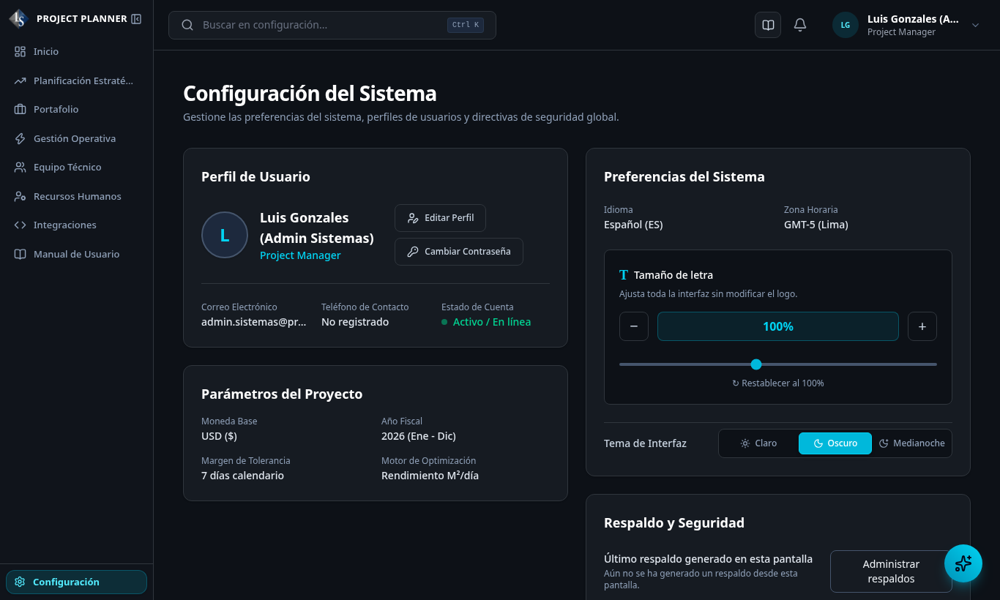
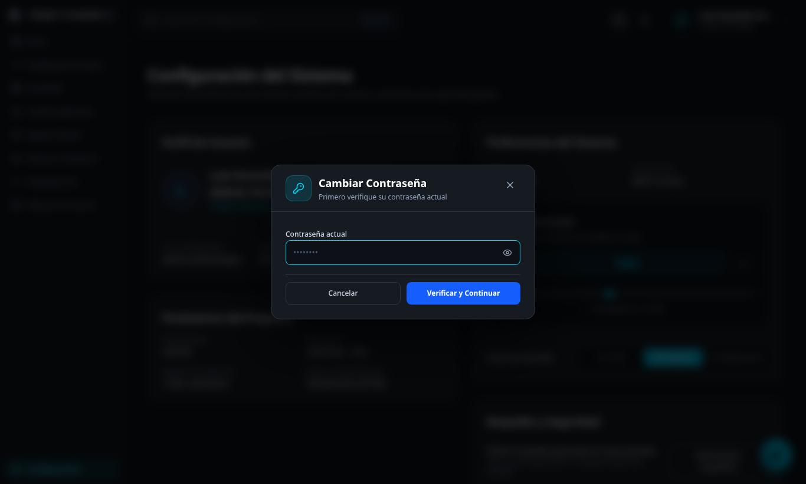

# 6. Settings and personal security

[← Back to contents](./README.md)

## 6.1 Open Settings

1. Tap **“Settings”** at the bottom of the sidebar.
2. You can also open the user menu and select the available settings option.

The options displayed change depending on the role.

## 6.2 Edit profile

1. In **User Profile**, tap **“Edit Profile”**.
2. Change name, email, or phone number.
3. To change the image, use the **“Change”** option above the avatar.
4. Please check details.
5. Press **“Save Changes”**.

**Expected result:** The information is updated on the card and in the top bar. If the email address was modified, for security reasons the system automatically issues a new session token for the current device and immediately invalidates all other active sessions across other browsers or devices.

**Common errors:** Email with invalid format, email already registered, name field empty, or image too large.

## 6.3 Change theme and interface size

1. Look for the preferences card.
2. Select the **Light**, **Dark**, or **Midnight** theme.
3. Adjust the text size control.
4. Check that menus, tables, and forms are legible.

The preference is stored in the browser. It does not change the project logo.

## 6.4 Changing the password

1. In User Profile, tap **“Change Password”**.
2. type current password
3. Press **“Verify and Continue”**.
4. If the password is correct, the new fields will appear.
5. Enter a new password of at least six characters.
6. Repeat the new Password
7. Press **“Update Password”**.
8. When **“Password Updated!”** appears, press **“Accept and Return”**.

**Expected result:** The account retains the current session, and the other sessions open with that account are invalidated.

If you enter the current password incorrectly, you can correct it and press **“Verify and Continue”** again. The system should not display the new password until the current one has been validated.

Frequent mistakes

- Wrong current password
- new password less than six characters;
- different confirmation;
- new password same as the previous one;
- Session expired or backend unavailable.

> Never show real passwords in screenshots in the manual.

## 6.5 Check that other sessions are closed (Password and Email)

Both when changing the password and when updating the primary email address:

1. Keep the current session open (the system automatically refreshes your active credentials seamlessly).
2. On another browser, tab, or device where the account was previously open, perform an action or wait for the automatic validation heartbeat (15-second interval).
3. The previous session will be immediately invalidated by the backend (HTTP 401) and the interface will automatically redirect to the login screen.
4. Log in again with the updated credentials only on authorized devices.

## 6.6 Logging out manually

1. Tap the name or avatar in the top-right corner.
2. Tap **“Log Out”**.
3. Check that the login screen appears.

*Figure 6.1: Settings panel with user profile information and visual theme selector (Light, Dark, Midnight).*

*Figure 6.2: Interactive dialog for secure password change with prior validation of the current password.*

