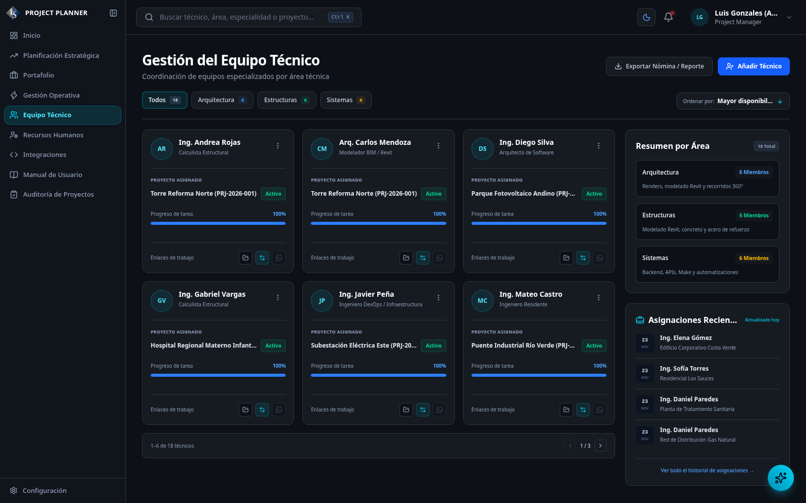

# 6. Technical Team Directory and Specialists

[← Back to Index](./README.md)

---

## Screen Spaces, Cards, and Availability Indicator

The **Technical Team** module manages the roster of engineers, architects, and specialists forming the organization's technical workforce:

- **1. Discipline Tabs with Numerical Counters:**
  - **All Specialists:** Displays the entire workforce with global count.
  - **Architecture:** Specialists in spatial design, urbanism, and BIM modeling.
  - **Civil / Structures:** Structural calculation, foundation, and site engineers.
  - **Systems / MEP:** Electromechanical, sanitary, and HVAC/telecommunication engineers.

- **2. Sort Dropdown Menu (`SortDropdown`):**
  - *Highest Availability First* / *Lowest Availability First*.
  - *Name (A-Z)* / *Name (Z-A)*.
  - *Most Recent Join Date*.

- **3. Dynamic Search and [Clear Filters] Button:**
  - Locate any professional by typing their name, specialty, or active project assignment.

- **4. Specialist Cards:**
  - **Profile Photo:** Professional avatar with status badge.
  - **Identity:** Full name, specialty title, and corporate email.
  - **Active Project:** Currently assigned project or *“No initial project”* badge.
  - **Workload Availability Indicator:**
    - **Green (Available):** Dedication at or below 70%. Ready for new task assignments.
    - **Blue (Assigned):** Dedication between 71% and 100%. Balanced capacity.
    - **Red (Overloaded):** Dedication exceeding 100%. Alert signal to prevent burnout and bottlenecks.
  - **Direct Contact Channels:** Email icon for quick messaging and phone icon for direct calling.
  - **Card Action Menu:** Access to project reassignment, temporary deactivation, and audited permanent deactivation.

*Figure 6.1: Technical Team Directory featuring discipline tabs, availability meters, and reassignment tools.*

---

## 6.1 Consult Specialists and Availability

**Available for:** all roles.

1. In the sidebar, select **“Technical Team”** (`Shift + 5`).
2. Use the tabs to filter by discipline (*Civil*, *Architecture*, etc.).
3. Check the color bar on each card to verify if the specialist is available (green), assigned (blue), or overloaded (red).
4. Use the **Sort:** menu to rank professionals by highest available capacity.

**Expected result:** the directory organizes cards according to selected filters and sorting criteria.

---

## 6.2 Onboard a New Technical Specialist

**Available for:** Administrator and Subadministrator.

1. Click the **[Add Specialist]** button in the header.
2. Complete the required form fields:
   - **First and Last Name (\*):** Full name of the professional.
   - **Corporate Email (\*):** Email used for system sign-in.
   - **Initial Password (\*):** Access password (minimum 6 characters).
   - **Technical Area (\*):** Select *Civil*, *Architecture*, or *Systems*.
   - **Specialty (\*):** Specific technical title (e.g., *"Structural Engineer"* or *"Surveyor"*).
   - **Initial Project and Status:** Assign an existing project and set status (*Active*, *Stand-by*, *Support*).
   - **Dedication Percentage (\*):** Initial capacity assignment (0% to 100%).
   - **Photo (Optional):** Image in JPG or PNG format.
3. Click **[Add to Team]**.

**Expected result:** confirmation toast appears and the new card is added to the directory.

---

## 6.3 Reassign a Specialist to Another Project

**Available for:** Administrator and Subadministrator.

1. On the specialist's card, open the options menu (three dots icon) and select **[Reassign project]**.
2. Select the destination project from the dropdown list.
3. Adjust dedication percentage and select the reason for the transfer.
4. Click **[Save Reassignment]**.

**Expected result:** the card immediately reflects the newly assigned project and the change is logged in system history.

---

## 6.4 Temporarily Deactivate a Specialist (Soft Mode)

**Available for:** Administrator and Subadministrator.

1. In the specialist card menu, select **[Deactivate specialist]**.
2. Confirm the action in the dialog.

**Expected result:** the account enters paused status, retaining all historic tasks and records until reactivated.

---

## 6.5 Permanently Deactivate a Specialist (Audited Removal)

**Available for:** Administrator only.

1. In the specialist card menu, select **[Delete / Deactivate]**.
2. The platform automatically evaluates whether the specialist has active work orders or site leadership.
3. In the confirmation dialog, review active dependencies and confirm if tasks should be reassigned to general coordination.
4. Click **[Confirm Permanent Deactivation]**.

**Expected result:** the account is retired from the active roster while preserving full historic audit trail integrity.
