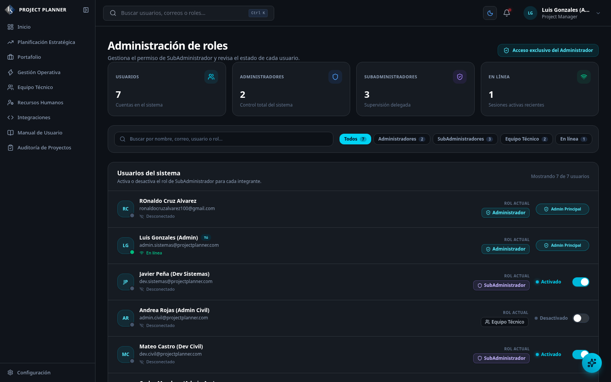
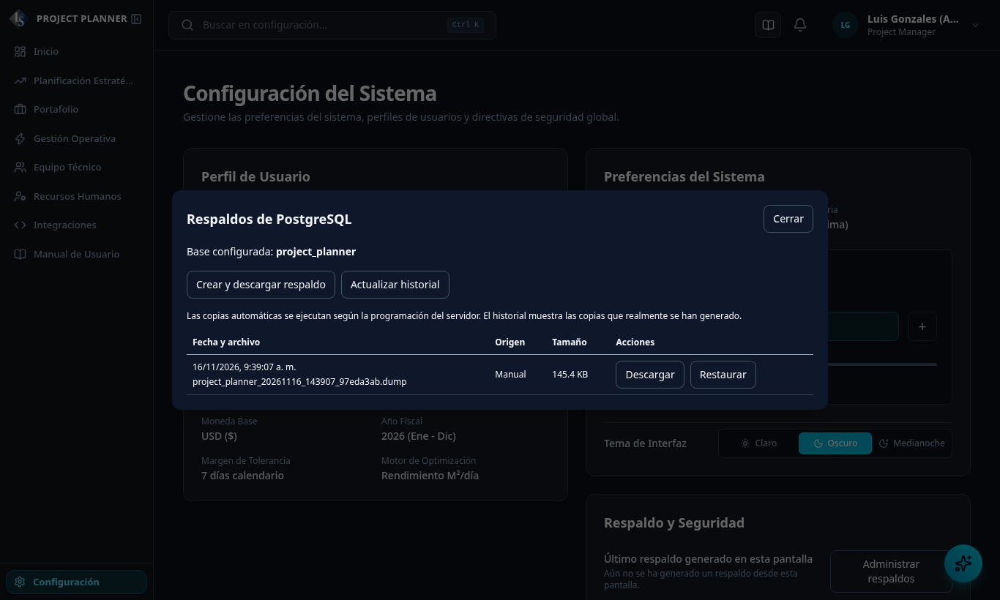

# 7. Administration, roles, and backups

[← Back to contents](./README.md)

## 7.1 Open Roles and Permissions

**Available for:** Authorized administrative accounts.

1. Tap the user's name or avatar.
2. Tap **“Roles and Permissions”**.
3. Check the user, sub-administrator, and connection counters.
4. Locate the user you want to review.

The screen distinguishes between Administrator, Sub-Administrator and Technical Team. The Main Administrator should not be shown a switch that allows them to be downgraded from the interface.

*Figure 7.1: Roles and Permissions admin panel with list of users, active connection statuses, and Sub-admin assignment.*

## 7.2 Activate a Sub-administrator

1. Locate a member of the Technical Team.
2. Press the **“Off”** switch.
3. Check that it changes to **“Enabled”**.
4. Ask the user to log out and log in again.
5. Confirm that the corresponding management actions appear.

To remove permission, repeat the process on the **“Enabled”** switch.

## 7.3 Consult the Audit Log

1. Open "Settings"
2. Search for **“Audit Log”**.
3. Review user, action, description, and date.
4. Press the refresh button to check again.

**Expected result:** Changes to profile, email, password, and other recorded events are displayed.

## 7.4 Check backups

**Recommended responsibility:** Superadministrator or designated database manager.

1. In Settings, look for **“Backup and Security”**.
2. Tap **“Manage backups”**.
3. Enter the username or email and password for the current admin session.
4. Press **“View backups”**.
5. Check database, date, file, source and size.

## 7.5 Create and download a backup

1. Press **“Create and download backup”**.
2. Wait for it to finish.
3. Store the file `.dump` in a secure location.
4. To download an existing one, locate it and press **"Download"**.

Do not send backups over public channels: they may contain users, projects, and operational data.

## 7.6 Restoring a backup

> **Critical action:** A restore replaces current data with the contents of the selected backup. It must be coordinated with the technical manager and carried out when the other users have stopped their work.

1. Locate the correct backrest.
2. Press **“Restore”**.
3. Check name, date, and database.
4. Enter the exact name of the requested database.
5. Check the box to acknowledge the data replacement.
6. Press **“Confirm Restore”**.
7. Do not close the window during the process.
8. When finished, log out and log back in.
9. Check users, projects, and master records.

The system attempts to generate a preventive backup before restoring.

**Common errors:** Incorrect credentials, lack of HTTPS in production, PostgreSQL turned off, invalid file, different database name, or `pg_dump`/`pg_restore` tools not available.

*Figure 7.2: Settings and Backups Panel with History and SHA-256 Cryptographic Checksum Verification.*

