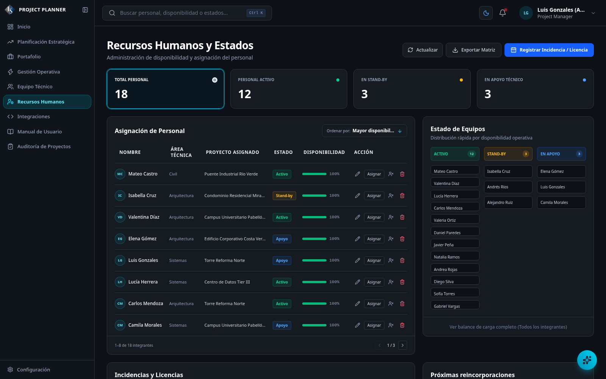

# 7. Human Resources, Workload Balance, and Incidents

[← Back to Index](./README.md)

---

## Screen Spaces, Roster Matrix, and Incident Workflow

The **Human Resources** module oversees fair technical workload distribution, manages personnel leaves, and generates consolidated administrative reports:

- **1. Personnel KPI Cards:**
  - **Total Staff:** Global count of registered engineers, architects, and specialists.
  - **Active:** Personnel actively working on projects without availability impediments.
  - **Stand-by:** Technical specialists in reserve awaiting upcoming phases.
  - **Support:** Staff assigned to cross-functional or secondary assistance roles.
  - **Upcoming Leaves Alert:** Numerical indicator alerting about leaves or permits scheduled to begin in the coming days.

- **2. Workload Allocation Table:**
  - Details specialist name, corporate email, discipline, and assigned project.
  - **Effective Dedication Bar:** Displays percentage of effort allocated. If exceeding 100%, turns red as a visual alert to prevent burnout.

- **3. Personnel Incidents & Approval Table:**
  - Tracks temporary absences: Specialist, Event Type (*Medical leave*, *Special permit*, *Unjustified absence*, *Technical training*, *Workplace accident*), Start and End Dates, Justification, and Status (*Pending*, *Approved*, *Rejected*, *Finalized*).
  - **Inline Approval Workflow Buttons:**
    - **[Approve] Button:** Validates the absence and deducts dedication during the scheduled timeframe.
    - **[Reject] Button:** Opens a dialog to record the reason for denial.
    - **[Finalize] Button:** Concludes the incident upon the specialist's return, restoring their availability to 100%.

- **4. Header Actions:**
  - **[Register Incident / Leave] Button:** Opens the incident registration assistant.
  - **[Export Matrix] Button:** Compiles and downloads the official corporate roster in Microsoft Excel format (`matriz-recursos-humanos.xlsx`).

*Figure 7.1: Human Resources matrix featuring workload balance, incident approval workflow, and Excel export.*

---

## 7.1 Monitor Workload Balance and Prevent Saturation

**Available for:** Administrator and Subadministrator (read-only for team leaders).

1. In the sidebar, select **“Human Resources”** (`Shift + 6`).
2. Review KPI cards to monitor active staff and upcoming scheduled leaves.
3. In the allocation table, examine dedication bars to identify overloaded staff (>100%).
4. Use the search bar to locate an individual collaborator by name or email.

---

## 7.2 Register a Personnel Incident or Leave

**Available for:** Administrator and Subadministrator.

1. Click the **[Register Incident / Leave]** button at the top.
2. Complete the required fields:
   - **Collaborator (\*):** Select the specialist from the dropdown list.
   - **Event Type (\*):** Choose *Medical leave*, *Special permit*, *Absence*, *Training*, or *Workplace accident*.
   - **Start and End Dates (\*):** Define the exact timeframe of absence.
   - **Justification (\*):** Record the reason and reference numbers.
3. Click **[Save Incident]**.

**Expected result:** the incident is added to the tracking table with initial status *Pending*.

---

## 7.3 Incident Supervision and Approval Workflow

**Available for:** Administrator and Subadministrator.

1. Scroll down to the **Registered Incidents** table.
2. Review pending requests:
   - To approve: click the green **[Approve]** button. The platform logs approval and adjusts specialist availability during those dates.
   - To reject: click the red **[Reject]** button, type the denial rationale in the dialog, and confirm.
   - To finalize: when the specialist returns to work, click the **[Finalize]** button to restore their availability to 100%.

---

## 7.4 Export Complete Roster to Excel

**Available for:** Administrator and Subadministrator.

1. In the upper right corner, click the **[Export Matrix]** button.
2. The platform compiles specialist names, disciplines, projects, and hours.
3. The browser automatically downloads `matriz-recursos-humanos.xlsx` styled with corporate headers.
