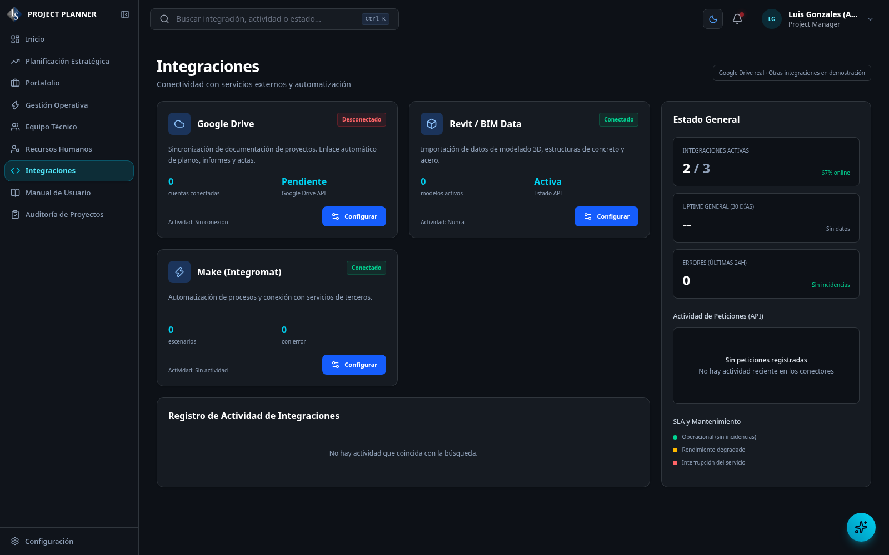

# 8. Cloud Integrations and Services

[← Back to Index](./README.md)

---

## Connectors Overview

The **Integrations** module (`Shift + 8`) centralizes communication with the three external services that extend Project Planner's operational, documentary, and automation capabilities:

1. **Google Drive:** corporate document repository via OAuth.
2. **Autodesk APS / Revit:** interactive 3D BIM viewer and cloud model vault.
3. **Make and Automation Webhooks:** agnostic HTTP POST bus for real-time event dispatch, optional credit monitoring, and security auditing.

*Figure 8.1: Active integrations panel displaying Google Drive, Autodesk Revit, and Make status.*

---

## 8.1 Check General Integrations Status

**Available for:** Administrator and Subadministrator (Make configuration is Administrator-only).

1. In the sidebar, select **“Integrations”** (`Shift + 8`).
2. Review each connector card to verify its current state: **Connected** (green), **Partial** (amber, for Make), or **Disconnected** (gray).
3. Check the live counters and the last reported activity timestamp on each card.

---

## 8.2 Connector 1: Google Drive (Document Repository)

**Available for:** Administrator and Subadministrator.

The **Google Drive** card lets you link a corporate Google account to synchronize documentation, project folders, and blueprints in the cloud.

### Tools and states
- **Status indicator:** shows **Connected** along with the authorized Google display name and email, or **Disconnected** when no active credential exists.
- **[Connect Google Drive] button:** opens a secure tab to complete the corporate Google OAuth authorization flow.
- **[Test Connection] button:** verifies in real time that the OAuth token remains valid and refreshes linked file and project counts.

### Steps to link Google Drive
1. On the **Google Drive** card, click **[Connect Google Drive]**.
2. In the popup tab, sign in with your corporate Google account and grant the requested permissions.
3. Return to Project Planner and click **[Test Connection]**.

**Expected result and audit:** the card switches to **Connected**, displays the authorized email address, and automatically logs the linking event in **`SecurityAuditLog`**.

---

## 8.3 Connector 2: Autodesk APS / Revit (Interactive 3D BIM Viewer)

**Available for:** all roles (model uploads, renames, and deletions are recorded in the security audit log).

The **Autodesk Platform Services (APS) / Revit** connector provides a collaborative vault and an embedded browser 3D viewer to inspect architectural, structural, and MEP models in IFC and Revit (`.rvt`) formats without installing desktop CAD software.

### 3D Viewer Tools
- **Interactive 3D orbit and rotation:** rotate, pan, and zoom into the structure directly with the mouse.
- **Cross-section cut tool:** inspect interior slabs, columns, and beams using section planes.
- **Layer filter and model browser:** isolate or hide specific disciplines (walls, steel framing, or MEP ducts).

### Audited Model Vault Management
- **Upload and automatic translation:** when uploading a file via the APS/BIM module, the platform transfers it to the Autodesk OSS bucket, encodes its URN, triggers cloud translation, and registers it in the local vault (`BIMModel`).
- **Rename, download, and delete:** authorized users can rename a model, obtain a signed download URL, or remove it from the vault.

### Steps to explore a 3D model
1. Open **Integrations** (`Shift + 8`) or go to a project technical sheet with a linked BIM model.
2. Select a model from the vault and click the **3D Viewer** button.
3. Use your mouse to orbit and zoom, and toggle section planes or layers as needed.

**Audit trail:** every BIM model upload, rename, or deletion automatically creates an entry in **`SecurityAuditLog`**.

---

## 8.4 Connector 3: Make and Automation Webhooks

**Available for:** exclusive management and configuration by the Administrator; operational status and activity log visibility for the Technical Team.

### Decoupled HTTP POST Architecture: Switching and Rotating Between Make Accounts

Project Planner dispatches real-time automated notifications and events through a **standard HTTP POST webhook bus**. This per-task decoupled architecture does not rely on a single fixed connection or shared global credentials, allowing each **Make** scenario to be managed independently.

If a Make account exhausts its monthly operations quota, or if different areas of the organization operate with separate Make accounts (for example, one account dedicated to 2FA authentication and another separate account for operational notifications), the Administrator can **replace or rotate the webhook URL and optional API token at any time** in each task card, without touching source code or restarting services.

#### Scope by Platform Role
- **For the Administrator:** Exclusive technical management: enabling or disabling tasks, configuring and rotating Make webhook URLs, assigning and rotating optional API tokens for operations monitoring, running individual diagnostic tests, and verifying audit trails in `SecurityAuditLog`.
- **For the Technical Team:** Read-only consultation and operational monitoring visibility: checking service connectivity status, monitoring that their project events are dispatched properly, and reviewing the recent activity log, without permissions to modify credentials or endpoints.

### Activation Scenarios and Payloads (Make Events)

The platform emits standard JSON payloads in real time across specific operational and security scenarios. These events are routed through the two configured tasks in the modal (**2FA** and **Notifications & Assignments**) or through dedicated endpoints when configured on the server:

#### 1. Authentication and Security
* **Two-Factor Authentication (`auth.two_factor`):**  
  * **When it triggers:** During login when the user has 2FA enabled or conditional bypass active.  
  * **Dispatched data:** Temporary OTP code, recipient user email, and expiration window.  
* **Password Change Security Alert (`auth.password_changed`):**  
  * **When it triggers:** Immediately after a user successfully updates or resets their password.  
  * **Dispatched data:** User identifier, full name, email, client IP address, browser User-Agent, and active session revocation confirmation (`sessions_invalidated: true`).  
* **Email Address Change Security Alert (`auth.email_changed`):**  
  * **When it triggers:** Whenever a user modifies their email address in their profile settings.  
  * **Dispatched data:** User identifier, previous email (`old_email`), new email (`new_email`), client IP address, and preventive session revocation.

#### 2. Project Operations and Field Work
* **Project Registration (`project.created`):**  
  * **When it triggers:** Upon registering and saving a new project in Portfolio.  
  * **Dispatched data:** Project code, name, allocated budget, start/end dates, and assigned lead engineer.  
* **Lead Engineer Assignment or Reassignment (`project.leader_assigned`):**  
  * **When it triggers:** When appointing for the first time or replacing the Lead Engineer responsible for a project.  
  * **Dispatched data:** Leader name, corporate email, technical area, project name/code, and authorizer details.  
* **Work Order / Task Assignment (`task.assigned`):**  
  * **When it triggers:** When creating or rescheduling a task or reassigning its technical specialist in Operations.  
  * **Dispatched data:** Task title, assignee name, email, deadlines, priority, Critical Path status, and associated project.

#### 3. Technical Staff Directory and Transfers
* **New Technical Member Registration (`member.created`):**  
  * **When it triggers:** When adding a new technician, engineer, or specialist in Team Directory.  
  * **Dispatched data:** Full name, email, professional role, specialty area, availability percentage, and initial project assignment.  
* **Operational Technician Reassignment (`member.reassigned`):**  
  * **When it triggers:** Whenever an operational technician is transferred between projects.  
  * **Dispatched data:** Technician name, previous project (`previous_project_name`), destination project (`new_project_name`), receiving lead engineer email, and allocation percentage.

#### 4. Strategic Milestones, Notices and Incidents
* **Global Milestone Creation (`milestone.created`):**  
  * **When it triggers:** When scheduling a key municipal, structural, or contractual milestone in Strategic Planning.  
  * **Dispatched data:** Milestone title, commitment date (`due_date`), project details, lead engineer, and consolidated team email list (`team_emails`).  
* **Personnel Incident Registration (`incident.registered`):**  
  * **When it triggers:** When registering a medical leave, legal permit, or temporary absence in Human Resources.  
  * **Dispatched data:** Incident type (medical-leave, etc.), start and end dates, reason, affected technician, designated backup member, and lead engineer email.  
* **Video Conference Scheduling (`meeting.created`):**  
  * **When it triggers:** When organizing a collaborative virtual session in Jitsi for a project.  
  * **Dispatched data:** Meeting title, encrypted room name, direct access URL (`meeting_url`), scheduled timestamp, and invited team emails.

### Per-Task Configuration and Test Buttons

The **Multitask Configuration of Make** modal independently manages each of the two operational scenarios (**2FA** and **Notifications & Assignments**). Each task card includes:

- **Independent toggle (*Active / Inactive*):** enables or pauses event dispatch for that specific task without affecting the others.
- **Individual endpoint:** dedicated input field for the target webhook URL (`https://...`).
- **[Test Webhook] button:** sends an isolated diagnostic signal to that endpoint to verify connectivity and response immediately.

#### Configuration steps
1. In **Integrations** (`Shift + 8`), locate the **Make** card and click **[Configure]**.
2. For each task you wish to enable, turn on its toggle (*Active*) and paste the webhook URL generated in the corresponding Make scenario.
3. Click **[Test Webhook]** on each configured card to validate its response.
4. Click **[Save scenarios]**.

### Real Dynamic States and Card Metrics

The status badge at the top of the modal and on the **Integrations** card reflects the actual state of enabled tasks:

- **Disconnected:** no webhook URLs are configured, or all tasks are switched off (*Inactive*).
- **Partial:** at least one enabled task has a configured webhook, while other enabled tasks still have an empty or pending endpoint.
- **Connected:** every enabled task has a valid webhook endpoint configured.

The summary card displays two real-time counters:
- **`scenarios`:** live count of enabled tasks that have a configured webhook endpoint.
- **`with error`:** count of configured tasks reporting operational failures (for example, an account paused at 0% credits or a rejected queue such as `Queue is full`).

### Optional Credit Monitoring via API Token (`···` Button)

Webhook dispatch works **100% without an API Token**. Optionally, you can attach a read-only token per task card to monitor monthly operations consumption directly from Project Planner:

1. Sign in to **Make.com** and go to **Profile → API tokens**.
2. Create a token granting only read permissions:
   - `organizations:read`
   - `users:read`
3. Inside the **Make** modal in Project Planner, click the subtle three-dots **`···`** button to the right of **[Test Webhook]** on the desired task.
4. Paste the value into **Make API Token (Optional)** and click **[Save scenarios]**.

Upon saving or reopening the panel:
- Project Planner queries the Make API and automatically detects your organization's plan and limits (e.g., **Free 1,000 ops**, **Core 10,000 ops**, etc.).
- It displays a **progress bar** with the available credit percentage and exact balance (`available / limit ops`).
- When credits reach **0%**, the bar turns red and displays the alert **Account paused in Make due to exceeded limit**.

> **Multi-account and rotation support:** the **`···`** button is independent per task card. You can bind different Make accounts to 2FA or Notifications, or rotate smoothly to another account if one exhausts its monthly quota. To unlink a token, open **`···`** and select **Remove token**.

### Connect Destination Channels in Make.com
1. In your **Make.com** account, open the scenario linked to the Project Planner webhook.
2. Add your desired downstream module (**Email** with Gmail/Microsoft 365, **Discord**, or **Slack**).
3. Map the incoming JSON payload fields (project code, project name, assigned specialist, OTP code, or budget).
4. Save and activate the scenario in **ON** mode.

**If a test fails:** verify that the URL starts with `http://` or `https://`, has no trailing spaces, the Make.com scenario is turned **ON**, and the webhook queue does not return `Queue is full`.

---

## 8.5 Integrations Activity Log

At the bottom of the **Integrations** view, the **Integrations Activity Log** provides a chronological trail with built-in search filtering:

- **5-item pagination:** the list is automatically paginated in blocks of **5 items per page** to keep the interface clean.
- **In-memory cap:** the session operational activity log retains up to **30 recent events** (evicting older entries as new tests or saves occur).

---

## 8.6 Global Security Audit Log (`SecurityAuditLog`)

Every critical administrative change across all three connectors is automatically recorded in the immutable **`SecurityAuditLog`** table under **`integration_update`**, ensuring multi-administrator traceability:

| Service | Audited events | Recorded fields |
| :--- | :--- | :--- |
| **Google Drive** | Successful OAuth linking and authorization | Actor, description, `old_value="desconectado"`, `new_value="conectado"`, timestamp, and IP |
| **Autodesk APS / Revit** | BIM model upload, rename, and deletion | Actor, previous/new model name (`old_value` / `new_value`), timestamp, and IP |
| **Make & Webhooks** | Task enable/disable, webhook URL changes, and API token updates/removals | Actor, per-task change breakdown, prior and updated URL (`old_value` / `new_value`), timestamp, and IP (without exposing plaintext secrets) |
