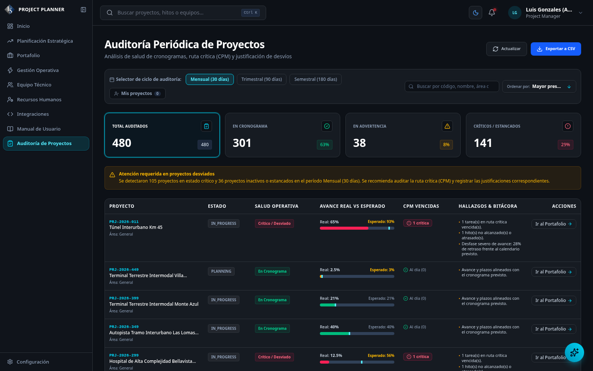

# 9. Periodic Project Audit (Deviations and Health)

[← Back to Index](./README.md)

---

## Screen Spaces and Audit Components

The **Periodic Project Audit** view evaluates overall portfolio health and facilitates schedule deviation tracking:

- **1. Audit Cycle Selector:**
  - **Monthly (30 days):** Evaluates works with activity, milestones, or deliverables scheduled in the last month (ideal for weekly PMO committees).
  - **Quarterly (90 days):** Evaluates physical progress across a quarterly management window.
  - **Semiannual (180 days):** Expands the evaluation to 6 months (useful for identifying stalled or inactive works).
  - **“My projects” Filter:** Instantly isolates only the projects where you are assigned as technical lead.

- **2. Health Diagnostic KPI Cards:**
  - **TOTAL AUDITED:** Number of projects falling within the active evaluation window.
  - **ON SCHEDULE (Green):** Works progressing on time with zero overdue critical tasks.
  - **WARNING (Yellow):** Works with moderate delay (between 10% and 25% deviation).
  - **CRITICAL / STALLED (Red):** Works with severe delay (>25% deviation) or prolonged inactivity.

- **3. Attention Required Banner:**
  - Notification summary detailing the count of projects in critical state detected in the active cycle.

- **4. Search Bar and Sort Options (`Sort by`):**
  - *Highest budget / Lowest budget:* Sorting by financial investment size.
  - *Most delayed / Lowest progress:* Sorting by greatest schedule slippage or lowest completion rate.
  - *Most overdue CPM:* Ranks first those projects accumulating the highest number of overdue critical path tasks.

- **5. Detailed Audit Table:**
  - Columns for Project, Status, Operational Health, Current vs Expected Progress, Overdue CPM, Findings & Audit Trail, and the **[Go to Portfolio →]** action button.

*Figure 9.1: Periodic Project Audit view featuring cycle selector, health cards, and direct portfolio access.*

---

## 9.1 Consult Periodic Audit and Change Timeframe

**Available for:** all roles.

1. In the sidebar, select **“Project Audit”** (`Shift + 9`).
2. In the top bar, choose the timeframe to evaluate (**Monthly (30 days)**, **Quarterly (90 days)**, or **Semiannual (180 days)**).
3. Check the **My projects** box if you only wish to review your assigned works.
4. Review the diagnostic cards to see total works audited and how many are on schedule versus flagged.

**Expected result:** the table and metrics recalculate immediately according to the selected cycle.

---

## 9.2 Filter and Sort Audited Works

**Available for:** all roles.

1. Type in the search box to locate a project by code or title.
2. In the **Sort by** dropdown, choose the sorting criteria:
   - Select **Highest budget** to review largest investments first.
   - Select **Most delayed** to prioritize works with the widest schedule gap.
   - Select **Most overdue CPM** to rank projects with overdue critical tasks at the top.
3. Click **[Reset filters]** to restore the default view.

**Expected result:** the table reorganizes rows immediately according to the chosen option.

---

## 9.3 Access the Project Directly in the Portfolio

**Available for:** all roles.

1. On the row of an audited project requiring supervision, click the **[Go to Portfolio →]** button.

**Expected result:** the system opens the **Portfolio** module and displays the selected project card directly on screen, ready for editing dates, assigning personnel, or opening drive documents.

**If it doesn't work:** ensure the project is still active and has not been deleted by an administrator.

---

## 9.4 Export Official Audit Report as CSV

**Available for:** all roles.

1. Configure your desired cycle and search filters in the table.
2. In the upper right corner, click the blue **[Export to CSV]** button.
3. The browser automatically downloads `auditoria-proyectos-<ciclo>-<fecha>.csv` containing the full breakdown of planned progress, actual progress, critical tasks, and recorded rationales.
