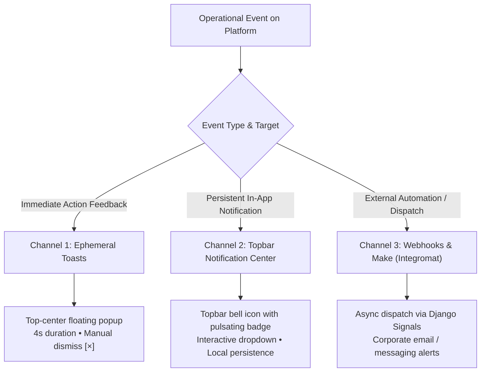
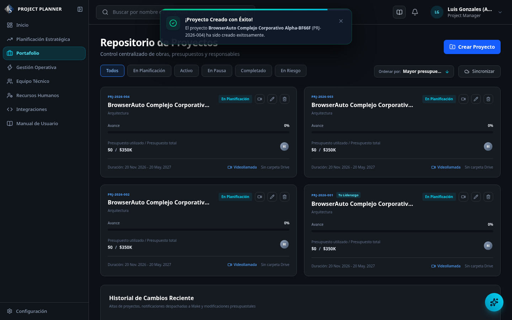
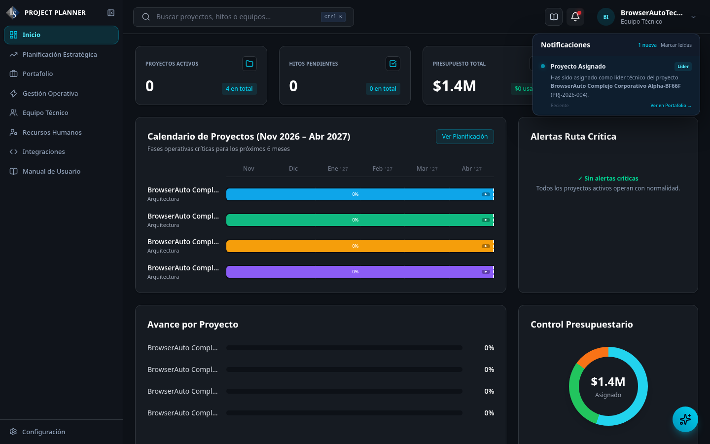
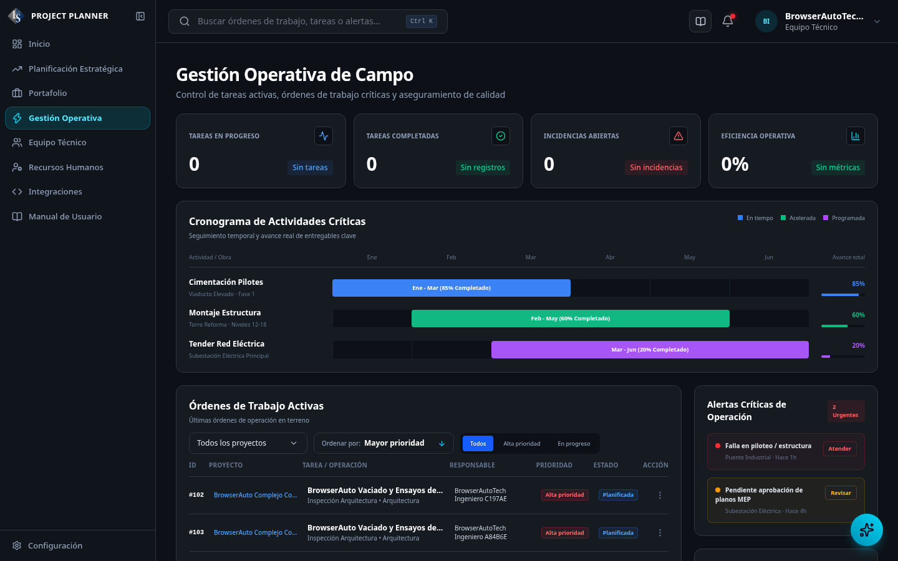

# 10. Notification Control & Alerts Center

[← Back to Table of Contents](./README.md)

> [!IMPORTANT]
> **Availability and Scope:**  
> The Project Planner notification system operates as a coordinated ecosystem between the in-browser user experience and external delivery channels. All roles (Technical Team, Sub-administrators, and Administrators) have access to the Notification Center and ephemeral Toast popups, viewing only events pertinent to their authorization level and project assignments.

---

## 10.1 Multi-Channel Alert Architecture

Project Planner implements a three-tier communication model to ensure that no critical operational milestone is missed while preserving an uncluttered, focus-oriented interface:

1. **Channel 1: Ephemeral Popups (Toasts):** Reactive temporary messages confirming the outcome of a direct screen action (creation, update, deletion, or validation warning).
2. **Channel 2: Topbar Notification Center (In-App Drawer):** Permanent dropdown tray accessible via the bell icon, where users inspect work order assignments, project leadership designations, and invitations.
3. **Channel 3: Outbound Automations (Webhooks / Make):** Asynchronous event bus for communications outside the platform (corporate emails or messaging channels).  
   *(For details on the Django Signals architecture and scenario triggers, see [Chapter 9: Automations and Webhooks with Make](./09-configuracion-make.md)).*

---

## 10.2 Channel 1: Ephemeral Popups (Toasts)

### 10.2.1 Purpose & Behavior
Toasts provide instant visual feedback without interrupting user workflows or requiring mandatory confirmation.

*Figure 10.1: Floating Toast notification confirming successful project registration.*

### 10.2.2 Visual and Functional Anatomy
- **Top-Center Placement:** Positioned at the top center of the viewport (`top-6`) to ensure immediate visibility without covering active form inputs.
- **Status Identifiers:**
  - **Success (Cyan / Green):** Successfully completed actions (technician added, project created, work order emitted).
  - **Warning / Error (Red / Amber):** Input validation failures, password mismatch, or unauthorized access attempts.
- **Countdown Progress Bar:** A thin illuminated bar at the bottom diminishes continuously over 4 seconds before auto-dismissing.
- **Manual Dismissal:** Users can click **[×]** at any time to dismiss the popup immediately.
- **Accessibility (a11y):** Formatted with `role="status"` / `role="alert"` and live regions (`aria-live="polite"`), enabling screen readers to announce confirmations in real time.

---

## 10.3 Channel 2: Topbar Notification Center (In-App Drawer)

### 10.3.1 Pending Alerts Indicator (Pulsating Badge)
Located at the top right of the application header, adjacent to the language toggle and profile avatar, is the interactive **Notifications** bell button.

*Figure 10.2: In-app notification drawer opened from the topbar bell showing project leadership assignment.*

When unread notifications exist:
1. A glowing red badge (`animate-pulse`) is displayed over the bell icon.
2. The frontend polls for updates every 15 seconds in the background without reloading the page.
3. Users can toggle the drawer by clicking the bell or navigating to it via keyboard (`Tab` + `Enter`).

### 10.3.2 Dropdown Notification Drawer
Clicking the bell opens a structured notification card:

- **Drawer Header:**
  - Header title **“Notifications”**.
  - Unread count indicator (e.g., *“1 new”*).
  - Quick link **[Mark as read]**: Marks all active notifications as read in a single action without purging historical records.
- **Notification Cards:**
  - **Unread Indicator:** Bright cyan pulsating dot for items awaiting user review.
  - **Title & Badge:** Displays event type with contextual tags, such as the cyan **[Leader]** badge when assigned as Project Manager.
  - **Assignment Details:** Formatted string highlighting the official project/task name and identifier code (e.g., `PRJ-2026-004`).
  - **Quick Navigation Link:** Contextual jump link **[View in Portfolio →]** or **[View in Operations →]** that directs the user directly to the relevant record.

### 10.3.3 Read State Management & Persistence
- **Individual Dismissal:** Clicking any notification card marks that specific item as read and navigates to the target resource.
- **Local Storage Persistence:** Read identifiers are preserved in browser storage (`localStorage: project_planner_read_notifs`), ensuring reviewed notifications remain marked as read across page refreshes and browser restarts.
- **Quick Dismissal:** The drawer closes automatically upon pressing `Escape`, clicking outside the panel (*click-outside*), or navigating to another view.

---

## 10.4 Channel 3: Operational Impact on the Technician Session

The notification cycle extends directly into the technician's everyday workspaces.

*Figure 10.3: Operations view displaying work orders assigned to the technical specialist.*

### 10.4.1 Work Order Assignments in Field Operations
When an Administrator issues a new Work Order (WO) assigning the specialist:
1. The technician receives an in-app alert in the Notification Center.
2. Navigating to **Operations** (`Shift + 4`) displays the order under **Active Work Orders**, specifying:
   - Task title (e.g., *“Pouring & Concrete Strength Testing Level 3”*).
   - Priority level (*High priority*).
   - Initial status (*Scheduled*).
   - Linked project code and technical specialization.

### 10.4.2 Project Leadership in Portfolio
When the specialist is assigned as technical lead of an initiative:
1. In the **Portfolio** view (`Shift + 3`), the project card features the distinct **“Your Leadership”** badge.
2. The technician is granted direct access to inspect technical milestones, progress metrics, and change logs.

---

## 10.5 Anti-Spam Governance & Duplicate Suppression

To protect field teams from alert fatigue, the event dispatch engine enforces strict deduplication policies:

> [!NOTE]
> **Initial Leader Signal Suppression (`_skip_leader_assigned_signal`):**  
> When an Administrator creates a project and designates its Technical Leader within the creation form, a single master event (`project.created`) is broadcast, containing complete leader metadata.  
> The secondary signal `project.leader_assigned` is automatically suppressed during project inception. This prevents technical leaders from receiving two identical email notifications within seconds of each other.

### Event & Alert Dispatch Matrix

| Platform Action | Toast (Actor) | In-App Alert (Recipient) | Make Webhook (External) |
|---|---|---|---|
| **Add Technician** | Yes (*“Technician added”*) | N/A (New user) | `member.created` (Welcome / Credentials) |
| **New Project with Leader** | Yes (*“Project Created Successfully!”*) | Yes (*“Project Assigned”* [Leader]) | `project.created` (Includes leader data) |
| **Subsequent Leader Update** | Yes (*“Leader updated”*) | Yes (*“New Project Assigned”*) | `project.leader_assigned` (Update notice) |
| **Emit Work Order** | Yes (*“Work order emitted”*) | Yes (*“New Task Assigned”*) | `task.assigned` (Operational alert) |
| **Videoconference / Meeting** | Yes (*“Meeting created”*) | Yes (*“New Video Call”*) | `meeting.created` (Jitsi link & agenda) |
| **Permission Denied / Error** | Yes (*“Access denied”*) | N/A | Not emitted |

---

## 10.6 Troubleshooting & FAQs

| Symptom | Probable Cause | Step-by-Step Resolution |
|---|---|---|
| Bell shows a red badge, but the drawer appears empty. | Local client filter or network polling latency. | Click **[Mark as read]** or refresh the page (`F5`). Automatic polling will re-synchronize immediately. |
| Technician does not see an assignment notification. | Technician was logged in before the Administrator confirmed the assignment. | Wait up to 15 seconds for the next polling cycle or navigate to **Portfolio** (`Shift + 3`) to refresh state. |
| Toast dismisses before reading the full text. | Default auto-dismiss timeout is 4 seconds. | All events are permanently recorded in the module change history and the in-app notification drawer. |
| Previously read notifications appear unread after switching computers. | Read status is stored locally (`localStorage`). | Expected behavior of client-side cache designed for maximum UI responsiveness without backend overhead. |

