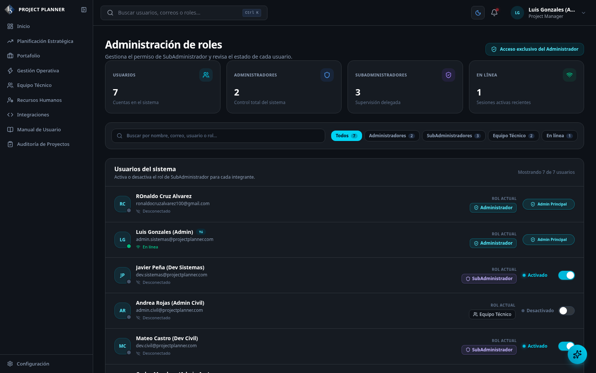

# 10. Role-Based Access Control (RBAC)

[← Back to Index](./README.md)

---

## Screen Spaces and Permission Matrix

The **Role Management** module oversees user authorization levels and platform access security:

- **1. Official Permission Matrix:**  
  Defines capabilities assigned to each role:

| System Capability | Administrator (`admin`) | Subadministrator (`subadmin`) | Technical User (`user`) |
| :--- | :---: | :---: | :---: |
| **View Dashboard & Portfolio** | ✔ Full | ✔ Full | ✔ Full |
| **Create and Edit Projects** | ✔ Yes | ✔ Yes | ✖ No |
| **Delete Projects** | ✔ Yes | ✖ No | ✖ No |
| **Adjust Gantt Schedule** | ✔ Yes | ✔ Yes | ✖ View only |
| **Issue Work Orders** | ✔ Yes | ✔ Yes | ✖ Status update only |
| **Add and Reassign Specialists** | ✔ Yes | ✔ Yes | ✖ No |
| **Deactivate Specialists** | ✔ Yes | ✖ No | ✖ No |
| **Export HR Matrix / Payroll** | ✔ Yes | ✔ Yes | ✖ No |
| **Configure Make & Webhooks** | ✔ Yes | ✖ No | ✖ No |
| **Manage Other User Roles** | ✔ Yes | ✖ No | ✖ No |
| **Download System Backups** | ✔ Yes | ✖ No | ✖ No |

- **2. Accounts Directory:**  
  Displays the roster of registered collaborators with their institutional email and active role selector.

*Figure 10.1: User account and RBAC administration dashboard.*

---

## 10.1 Consult Permissions and Registered Accounts

**Available for:** Administrator only.

1. In the upper right user menu, click your profile and select **“Role Management”**.
2. Review the list of collaborators to inspect their active roles.
3. Use the search box to quickly locate a user by name or email.

---

## 10.2 Promote a User to Subadministrator

**Available for:** Administrator only.

1. In the user table, locate the collaborator requiring management permissions.
2. In the **Current Role** column, open the dropdown and select **Subadministrator**.
3. Click the **[Save Permissions]** button.

**Expected result:** the user profile updates immediately and the action is logged in the system security audit trail.

---

## 10.3 Revoke Administrative Privileges

**Available for:** Administrator only.

1. Locate the user account in the table.
2. Change their role in the dropdown from *Subadministrator* to **Standard User**.
3. Click **[Save Permissions]**.

**Expected result:** on their next action, the system restricts access to administrative panels for that account.
