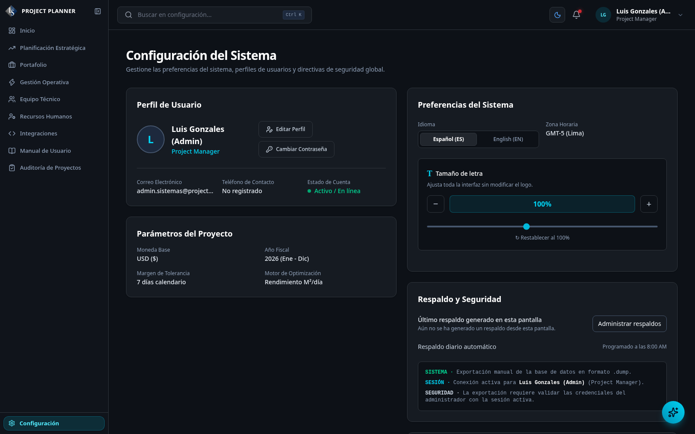
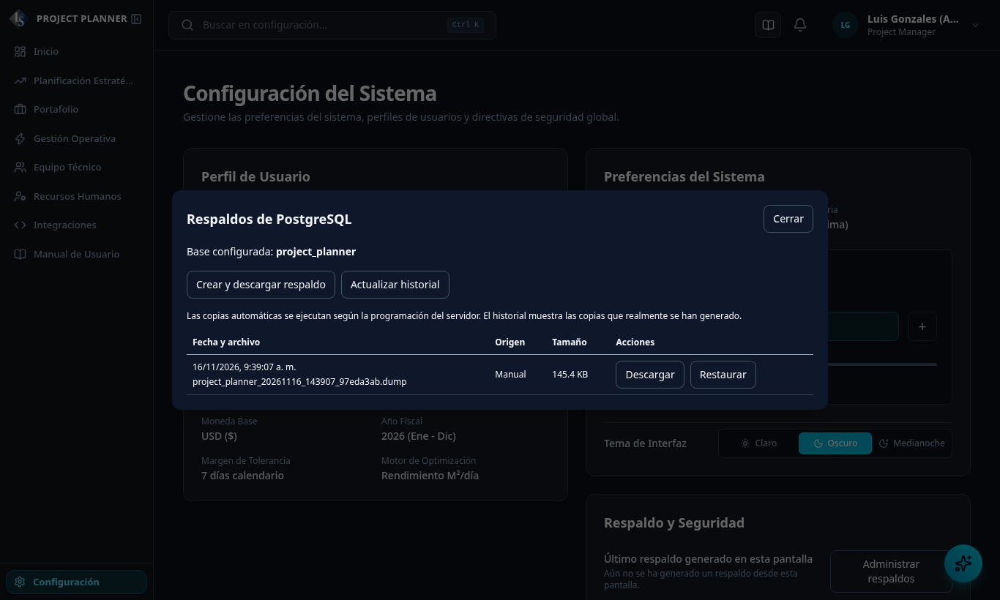

# 11. Settings, User Profile, 2FA Security, and Backups

[← Back to Index](./README.md)

---

## Settings View Components

The **Settings** view centralizes personal preferences, user digital identity, security controls, and general system backups:

- **1. User Profile Card:**
  - Displays full name, institutional email, contact phone, and active avatar.
  - Allows editing personal details with international phone number validation.

- **2. Visual Preferences and Accessibility Card:**
  - **Interface Themes:** Choice of 3 persistent visual modes:
    - *Light:* Clear daytime white background.
    - *Dark:* Low-glare graphite background.
    - *Midnight:* Deep operations-room blue with high-contrast cyan accents.
  - **Adaptive Font Size:** Slider adjusting font size between **85% and 120%** for different screen resolutions.
  - **System Language:** Instant switcher between **Español** and **English** without page reloads.

- **3. Security and Two-Factor Authentication (2FA / TOTP) Card:**
  - Setup assistant to bind Google Authenticator or Microsoft Authenticator via QR code.
  - Secret key display and downloadable single-use emergency backup codes.

- **4. System Backups Card (Administrator Only):**
  - Generator for complete downloadable database backups with **SHA-256** cryptographic hash certification for forensic integrity.

*Figure 11.1: Settings panel with profile card, visual preferences, 2FA security, and backups.*

---

## 11.1 Update Profile Details and Phone Number

**Available for:** all users.

1. In the top user menu or at the base of the sidebar, select **“Settings”** (`Shift + 9`).
2. On the profile card, click the **[Edit Profile]** button.
3. Update your display name and contact phone with country code.
4. Click **[Save Changes]**.

**Expected result:** the card reflects updated contact information immediately.

---

## 11.2 Change Password

**Available for:** all users.

1. On the profile card, click the **[Change Password]** button.
2. Enter your **Current Password**.
3. Enter your **New Password** (minimum 6 characters) and confirm it in the lower field.
4. Click **[Update Password]**.

**Expected result:** your password updates and the system automatically invalidates any open sessions on other devices or browsers for security.

---

## 11.3 Personalize Theme and Font Size

**Available for:** all users.

1. On the **Preferences** card, choose your preferred visual theme (*Light*, *Dark*, or *Midnight*).
2. Adjust the **Font Scale** slider to enlarge or reduce text size.
3. To switch system language, click the corresponding button (**Español** / **English**).

**Expected result:** the interface adapts its colors, typography, and language instantly.

---

## 11.4 Activate and Configure Two-Factor Authentication (2FA)

**Available for:** all users (mandatory for administrators).

1. On the **Security** card, click **[Enable 2FA]**.
2. Open Google Authenticator or Microsoft Authenticator on your mobile phone and scan the displayed QR code.
3. Enter the 6-digit temporary code generated by the app and click **[Validate and Enable]**.
4. Download and securely store your emergency backup codes.

**Expected result:** the system confirms that two-factor authentication has been enabled successfully.

---

## 11.5 Generate and Download a System Backup

**Available for:** Administrator only.

1. Scroll to the **Database Backups** card.
2. Click the **[Generate New Backup]** button.
3. Enter your administrator password to confirm the operation.
4. The system compiles the backup, calculates the SHA-256 checksum, and enables the download link.
5. Click **[Download Backup]** to save the file to your computer.

*Figure 11.2: System backup management panel with SHA-256 verification.*
