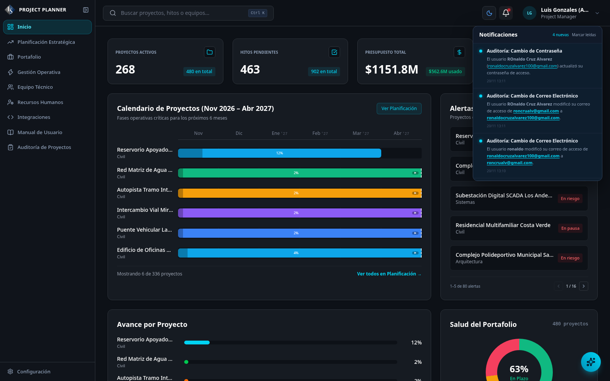
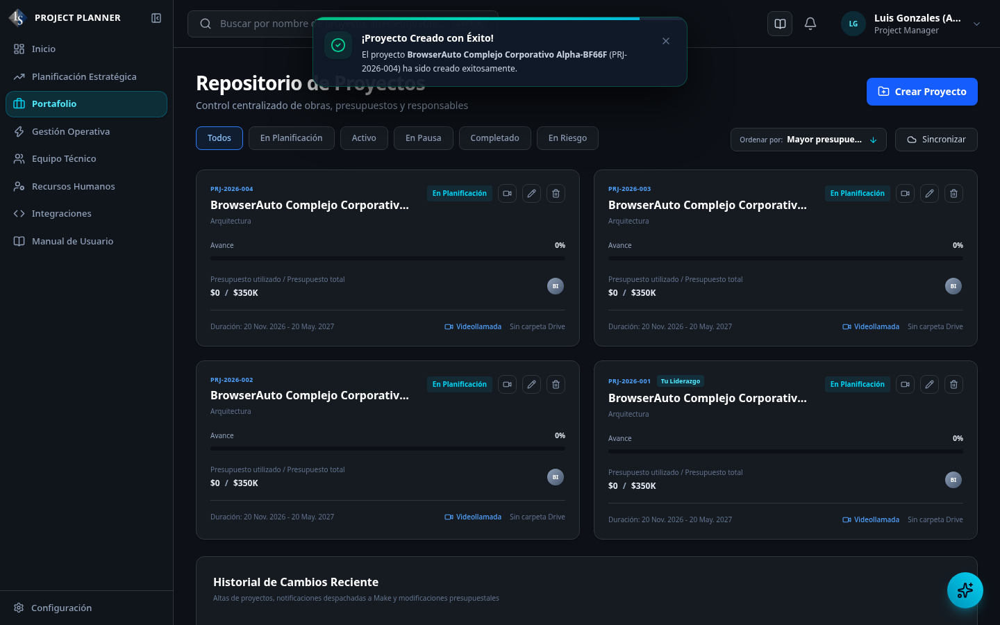

# 12. Notification Center and Alert Control

[← Back to Index](./README.md)

---

## Screen Spaces and Alert Channels

Project Planner incorporates a multichannel notification system designed to keep team members informed of critical project lifecycle events:

- **1. Topbar Notification Drawer (Bell Icon):**
  - Displays a red badge counter when unread alerts are pending.
  - Clicking the bell opens a chronological list of notices with timestamp and details (e.g., *"You have been assigned as technical leader for project PRJ-2026-045"* or *"New work order issued on your project"*).
  - Includes quick filter tabs between **All** and **Unread**, alongside the **[Mark all as read]** button.

- **2. Popup Alerts (Toasts):**
  - Brief visual alerts appearing in the upper corner after key actions:
    - **Green (Success):** Action successfully executed and saved.
    - **Blue (Info):** State update or synchronization completed.
    - **Yellow (Warning):** Approaching deadlines or reduced schedule float.
    - **Red (Error):** Operation rejected or missing mandatory fields.

- **3. External Alerts by Email (Integration with Make):**
  - In addition to in-app visual alerts, the platform integrates with **Make** to automatically dispatch email notifications directly to the corporate inboxes of engineers and site leaders when they are assigned to a project, when a new work order is issued, or when a project crosses the $100k budget governance threshold.

*Figure 12.1: In-app notification drawer accessed from the topbar bell icon.*

---

## 12.1 Consult Pending Alerts from the Bell Icon

**Available for:** all roles.

1. In the top bar, check whether the bell icon displays a red counter badge.
2. Click the bell to open the drawer.
3. Review messages listed from newest to oldest.
4. To see only unread notices, click the **Unread** tab.

---

## 12.2 Navigate to a Project or Task from an Alert

**Available for:** all roles.

1. Inside the notification drawer, locate the relevant message.
2. Click directly on the notification card.
3. The platform redirects you to the referenced project or work order.

---

## 12.3 Mark Notices as Read

**Available for:** all roles.

- **Mark individually:** Click the circular checkmark icon next to the notice you have reviewed.
- **Mark all at once:** At the top of the drawer, click the **[Mark all as read]** button.

**Expected result:** the red counter turns off and notices are archived as read.

---

## 12.4 Close the Notification Drawer

To hide the drawer, press the `Escape` key on your keyboard or click anywhere outside the drawer panel.

*Figure 12.2: Popup toast alert confirming successful execution of an action.*
