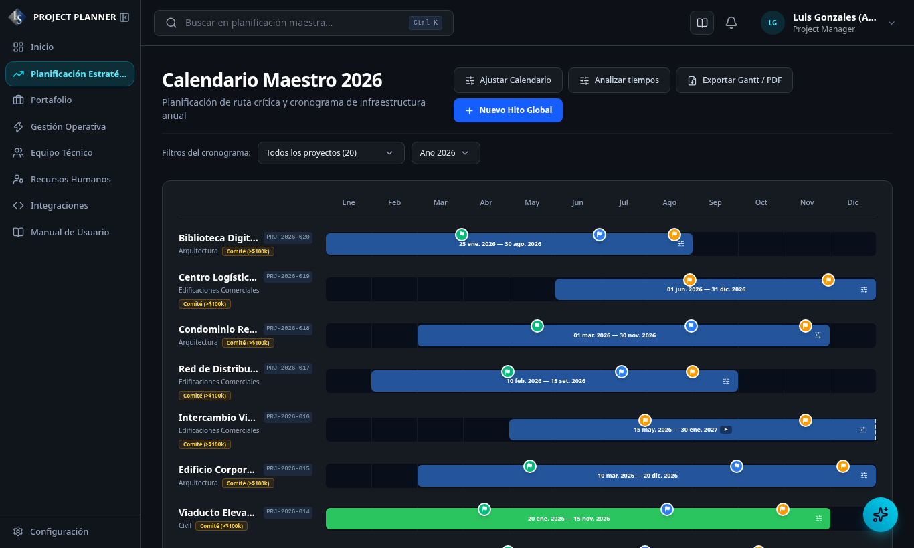
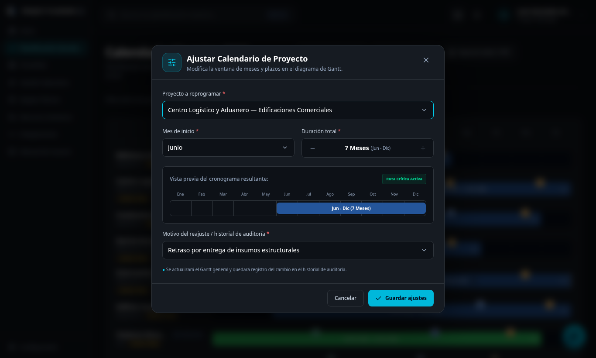

# 2. Dashboard y Planificación Estratégica

[← Volver al índice](./README.md)

## 2.1 Consultar el Dashboard

**Disponible para:** todos los roles.

1. Presione **“Inicio”** en el menú lateral.
2. Revise las tarjetas de indicadores: proyectos activos, hitos pendientes, presupuesto y optimización.
3. Consulte el calendario resumido de proyectos.
4. Revise alertas, progreso y distribución presupuestaria cuando existan datos.
5. Utilice el buscador superior para localizar un proyecto o hito.

**Resultado esperado:** los indicadores se calculan con la información disponible del portafolio.

Si el Dashboard aparece vacío, abra **Portafolio** y confirme que existan proyectos registrados. También puede deberse a que el backend todavía está cargando.

*Figura 2.1: Panel de Control (Dashboard) con tarjetas de KPIs ejecutivos y Mini-Gantt semestral.*

## 2.2 Consultar el Calendario Maestro

**Disponible para:** todos los roles. Las cuentas técnicas tienen acceso principalmente de consulta.

1. Presione **“Planificación Estratégica”**.
2. En **“Filtrar por proyecto”**, seleccione un proyecto o deje la opción general.
3. Seleccione el año que desea consultar.
4. Lea las barras del Gantt para identificar inicio, duración y continuidad.
5. Revise **Hitos Globales**, estados y fechas.
6. Consulte el historial de reajustes cuando esté disponible.

**Resultado esperado:** el cronograma muestra únicamente los proyectos que coinciden con los filtros.

## 2.3 Ajustar el calendario de un proyecto

**Disponible para:** Administrador y Subadministrador.

1. Presione **“Ajustar Calendario”**.
2. Seleccione el proyecto que será reprogramado.
3. Seleccione el mes de inicio.
4. Ajuste la duración total.
5. Seleccione o escriba el motivo del reajuste.
6. Revise la vista previa.
7. Presione **“Guardar ajustes”**.

**Resultado esperado:** la barra del proyecto cambia y el movimiento queda registrado en el historial de reajustes.

**Si no funciona:** confirme que el proyecto exista en la base de datos, que la duración sea válida y que la cuenta tenga permisos de gestión.

*Figura 2.2: Modal de Ajuste de Calendario con selección de proyecto, duración y motivo de auditoría obligatorio.*

## 2.4 Motor de optimización y análisis de tiempos

**Disponible para:** Administrador y Subadministrador.

### Procedimiento operativo
1. En la parte superior de la Planificación, presione **“Analizar tiempos”**.
2. Seleccione el proyecto que desea evaluar.
3. El sistema carga las tareas, dependencias predecesoras y personal técnico asignado.
4. Presione **“Calcular propuesta”**.
5. Revise la tabla comparativa con los resultados del análisis algorítmico:
   - **Plazo guardado:** duración original del proyecto en días calendario.
   - **Plazo propuesto:** nueva duración calculada considerando ruta crítica y disponibilidad real.
   - **Margen frente al plazo guardado (días ganados):** tiempo neto que se puede comprimir el proyecto.
   - **Exceso sobre el plazo guardado:** días de retraso en caso de cuellos de botella por sobreasignación de técnicos.
   - **Mínimo por dependencias:** cota teórica mínima sin conflictos de personal.
   - **Holgura por dependencias:** margen de días que una tarea puede retrasarse sin aplazar la entrega final.
   - **Espera adicional por recurso:** días de atraso generados porque el especialista atiende múltiples tareas simultáneas.

### Cálculos internos y lógica matemática del motor
Project Planner implementa un motor algorítmico determinístico basado en tres estándares de ingeniería de proyectos:

1. **Método de la Ruta Crítica (CPM - Critical Path Method):**
   - Construye un Grafo Dirigido Acíclico (DAG) y ejecuta un ordenamiento topológico para garantizar la ausencia de dependencias circulares.
   - Realiza un pase hacia adelante (*Forward Pass*) para obtener el inicio y fin más tempranos (*Early Start / Early Finish*) y un pase hacia atrás (*Backward Pass*) para calcular los plazos más tardíos (*Late Start / Late Finish*).
   - Calcula la **holgura total**:
     $$\text{Holgura (Slack)} = \text{Inicio Tardío} - \text{Inicio Temprano}$$
   - Las tareas con $\text{Holgura} = 0$ forman la **Ruta Crítica** (`is_critical_path = True`). Solo acelerando estas tareas se reduce el plazo de entrega del proyecto.

2. **Ponderación por Disponibilidad Real de Personal:**
   - La duración teórica de cada labor se ajusta según la dedicación efectiva del técnico asignado (80%, 60%, etc.):
     $$\text{Duración Efectiva (días)} = \left\lceil \text{Duración Base} \times \frac{100}{\text{Disponibilidad (\%)}}\right\rceil$$

3. **Nivelación y Resolución de Conflictos de Recursos (RCPSP):**
   - Si un mismo especialista es asignado a varias tareas críticas en fechas coincidentes, el motor programa intervalos secuenciales y cuantifica la **Espera Adicional por Recurso** (`resource_delay_days`).

4. **Compresión y Margen de Seguridad de 7 Días:**
   - Para labores constructivas con rendimientos específicos ($m^2/\text{día}$, cuadrillas reforzadas), el factor de aceleración calcula:
     $$\text{Días Ahorrados} = \text{round}\left(\frac{\text{Duración Original}}{5}\right)$$
   - El sistema preserva siempre un **piso de seguridad de 7 días de holgura técnica** para absorber contingencias climáticas, inspecciones o demoras de proveedores.

5. **Regla de Gobernanza Presupuestal ($100.000 USD):**
   - Si el costo del proyecto optimizado es **$\le \$100.000$ USD**, la aprobación recae en el Líder Técnico.
   - Si el presupuesto supera los **$\$100.000$ USD**, el sistema activa obligatoriamente la regla de gobernanza: requiere visto bueno del **Comité Directivo** y despacha un webhook automático a Make para alertar en el canal de Discord y por correo institucional.

## 2.5 Crear un Hito Global

**Disponible para:** Administrador y Subadministrador.

1. Presione **“Nuevo Hito Global”**.
2. Seleccione el proyecto asociado.
3. Seleccione el estado inicial.
4. Escriba el nombre del hito o entrega crítica.
5. Indique la fecha límite.
6. Seleccione el responsable de validación si el formulario lo solicita.
7. Escriba la descripción o entregables.
8. Presione **“Registrar Hito Global”**.

**Resultado esperado:** el hito aparece en la sección Hitos Globales.

## 2.6 Cambiar o eliminar un hito

1. Localice el hito.
2. Para cambiarlo, abra el selector de estado y elija la nueva condición.
3. Para consultar información, presione el botón de detalle.
4. Para eliminarlo, presione el icono de eliminación y confirme solo si está seguro.

La eliminación no está disponible para cuentas técnicas.

## 2.7 Exportar el Gantt

1. Aplique primero los filtros de proyecto y año.
2. Presione **“Exportar Gantt / PDF”**.
3. En la ventana de impresión, seleccione **Guardar como PDF**.
4. Revise orientación, márgenes y vista previa.
5. Guarde el archivo.

> **Capturas recomendadas:** cabecera con las cuatro acciones administrativas, Gantt filtrado, alta de hito y selector de estado.

