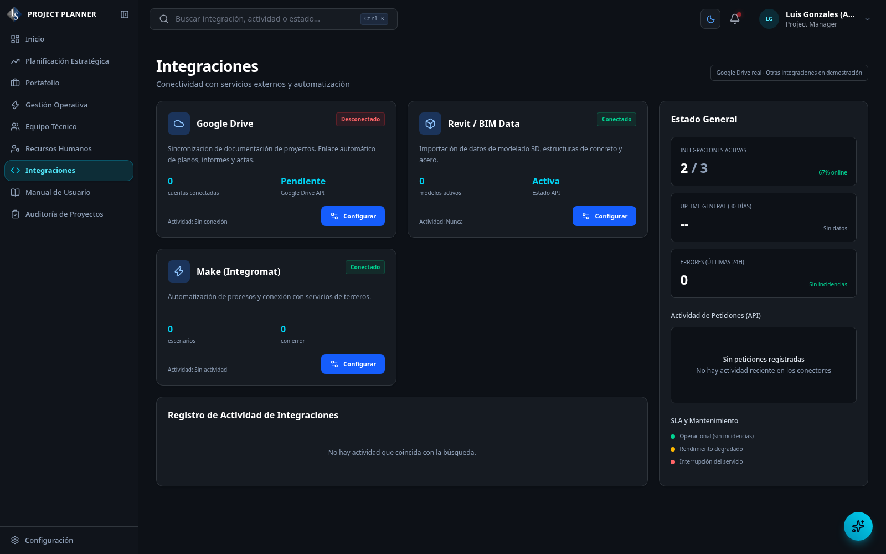

# 5. Integraciones

[← Volver al índice](./README.md)

La pantalla **Integraciones** es visible para todos los roles, pero algunas operaciones requieren permisos administrativos y credenciales externas configuradas en el servidor.

## 5.1 Revisar el estado general

1. Presione **“Integraciones”**.
2. Revise las tarjetas de Google Drive, Revit/APS y Make.
3. Consulte el panel de estado, actividad reciente y errores.
4. Presione **“Configurar”** en la integración que desea revisar.

## 5.2 Conectar Google Drive

1. En Google Drive, presione **“Configurar”**.
2. Presione **“Conectar Google Drive”** o **“Reautorizar Google Drive”**.
3. Complete personalmente la autorización de Google en la pestaña abierta.
4. Regrese a Project Planner.
5. Presione **“Probar conexión”**.

**Resultado esperado:** la integración cambia a **Conectado**.

No comparta ni capture la pantalla de autorización, tokens o cuentas personales.

## 5.3 Administrar archivos de Drive

Cuando Drive esté conectado:

1. Abra el gestor de archivos.
2. Presione una carpeta para entrar.
3. Use **Atrás** para regresar.
4. Use actualizar para recargar la ubicación.
5. Escriba un nombre y presione **“Crear”** para generar una carpeta.
6. Seleccione un archivo y presione **“Subir”**.
7. Use los iconos para abrir en Drive, cambiar nombre o eliminar.

Antes de eliminar, compruebe que el archivo no sea requerido por otro proyecto.

## 5.4 Configurar Make

1. En **Make (Integromat)**, presione **“Configurar”**.
2. Revise los escenarios disponibles.
3. Ingrese una URL válida que comience por `http://` o `https://`.
4. Presione **“Probar Webhook”**.
5. Si la prueba responde correctamente, presione **“Guardar escenarios”**.

> [!NOTE] Diagnóstico de Webhooks: La función **“Probar Webhook”** despacha un payload de diagnóstico al escenario configurado en Make para verificar la disponibilidad del servicio y la recepción oportuna de alertas en Discord y correo corporativo.

## 5.5 Administrar modelos Revit / APS

1. En **Revit / BIM Data**, presione **“Configurar”**.
2. Presione **“Conectar con Autodesk APS”**.
3. Para agregar un modelo, seleccione un archivo `.rvt` y use la opción de carga.
4. Espere el procesamiento.
5. Revise **Modelos Compartidos**.
6. Use las acciones para renombrar, descargar, visualizar en 3D o eliminar.

**Errores frecuentes:** credenciales APS ausentes, traducción pendiente, formato inválido, token rechazado o permisos insuficientes.

## 5.6 Si una integración falla

1. Lea el mensaje completo.
2. Presione actualizar o probar conexión.
3. Confirme que el backend se encuentre disponible.
4. Compruebe que la cuenta tenga permisos.
5. No introduzca nuevamente secretos en formularios no previstos.
6. Envíe al responsable técnico el nombre de la integración, hora del error y mensaje mostrado, sin adjuntar claves.

*Figura 5.1: Panel central de integraciones de servicios externos (Autodesk Platform Services BIM 3D, Google Drive y Make).*

