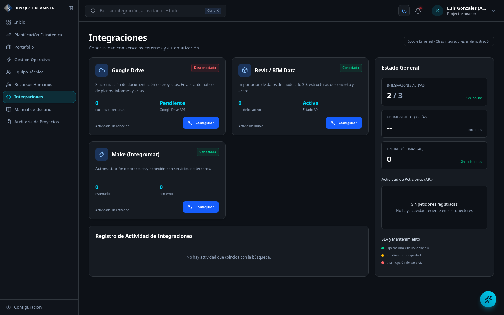

# 8. Integraciones y Servicios Cloud

[← Volver al índice](./README.md)

---

## Panorama General de Conectores

El módulo de **Integraciones** (`Shift + 8`) centraliza la comunicación con los tres servicios externos que amplían la capacidad operativa, documental y de automatización de Project Planner:

1. **Google Drive:** repositorio documental institucional mediante OAuth.
2. **Autodesk APS / Revit:** visor 3D BIM interactivo y bóveda de modelos en la nube.
3. **Make y Webhooks de Automatización:** bus agnóstico HTTP POST para despacho de eventos en tiempo real, monitoreo opcional de créditos y trazabilidad de seguridad.

*Figura 8.1: Panel de integraciones activas mostrando el estado de Google Drive, Autodesk Revit y Make.*

---

## 8.1 Comprobar el estado general de integraciones

**Disponible para:** Administrador y Subadministrador (la configuración de Make es exclusiva del Administrador).

1. En el menú lateral, seleccione **“Integraciones”** (`Shift + 8`).
2. Revise las tarjetas de cada conector para verificar su estado actual: **Conectado** (verde), **Parcial** (ámbar, en Make) o **Desconectado** (gris).
3. Consulte los contadores en tiempo real y la fecha de la última actividad reportada en cada tarjeta.

---

## 8.2 Conector 1: Google Drive (Repositorio Documental)

**Disponible para:** Administrador y Subadministrador.

La tarjeta de **Google Drive** permite vincular una cuenta institucional de Google para sincronizar documentación, carpetas de proyectos y planos en la nube.

### Herramientas y estados
- **Indicador de estado:** muestra **Conectado** junto al nombre y correo electrónico autorizado de Google, o **Desconectado** cuando no existe credencial activa.
- **Botón [Conectar Google Drive]:** abre una pestaña segura para completar el flujo de autorización OAuth institucional con Google.
- **Botón [Probar Conexión]:** valida en tiempo real que el token OAuth siga vigente y actualiza los contadores de archivos y proyectos vinculados.

### Pasos para vincular Google Drive
1. En la tarjeta de **Google Drive**, presione **[Conectar Google Drive]**.
2. En la pestaña emergente, inicie sesión con su cuenta institucional de Google y autorice los permisos solicitados.
3. Regrese a Project Planner y presione **[Probar Conexión]**.

**Resultado esperado y auditoría:** la tarjeta cambia a **Conectado**, exhibe la dirección de correo autorizada y registra automáticamente el evento de vinculación en **`SecurityAuditLog`**.

---

## 8.3 Conector 2: Autodesk APS / Revit (Visor Interactivo 3D BIM)

**Disponible para:** todos los roles (la subida, renombrado y eliminación de modelos se registra en auditoría).

El conector de **Autodesk Platform Services (APS) / Revit** integra una bóveda colaborativa y un visor 3D embebido en el navegador para revisar planos y modelos de arquitectura, estructuras e instalaciones en formato IFC y Revit (`.rvt`) sin instalar software CAD de escritorio.

### Herramientas del Visor 3D
- **Órbita y rotación interactiva:** rote, desplace y acerque la estructura en 3D directamente con el ratón.
- **Herramienta de corte transversal (sección):** inspeccione losas, columnas y vigas interiores mediante planos de corte.
- **Filtro de capas y navegador de modelo:** aísle o oculte disciplinas específicas (muros, estructura metálica o ductos electromecánicos).

### Gestión auditada de modelos en la bóveda
- **Subida y traducción automática:** al cargar un archivo desde el módulo APS/BIM, el sistema lo transfiere al bucket de Autodesk OSS, codifica su URN, inicia la traducción en la nube y lo registra en la bóveda local (`BIMModel`).
- **Renombrado, descarga y eliminación:** los usuarios autorizados pueden renombrar un modelo, obtener una URL firmada para descarga o eliminarlo de la bóveda.

### Pasos para explorar un modelo 3D
1. Ingrese a la vista **Integraciones** (`Shift + 8`) o a la ficha del proyecto con modelo BIM vinculado.
2. Seleccione un modelo de la bóveda y presione el botón del **Visor 3D**.
3. Use el ratón para orbitar y hacer zoom, y active la herramienta de sección o capas según requiera.

**Auditoría:** toda subida, renombrado o eliminación de un modelo BIM genera automáticamente un registro en **`SecurityAuditLog`**.

---

## 8.4 Conector 3: Make y Webhooks de Automatización

**Disponible para:** gestión y configuración exclusiva del Administrador; visibilidad de estado y bitácora de actividad para el Equipo Técnico.

### Arquitectura Desacoplada HTTP POST: Sustitución y Rotación entre Cuentas de Make

Project Planner despacha notificaciones y eventos automáticos en tiempo real mediante un **bus de webhooks estándar HTTP POST**. Esta arquitectura desacoplada por tarea no depende de una única conexión fija ni de credenciales globales compartidas, lo que permite administrar cada escenario de **Make** de forma independiente.

Si una cuenta de Make agota su cuota mensual de operaciones, o si distintas áreas de la organización operan con cuentas separadas de Make (por ejemplo, una cuenta dedicada para autenticación 2FA y otra cuenta independiente para notificaciones operativas o gobernanza financiera), el Administrador puede **sustituir o rotar en cualquier momento la URL del webhook y el token API opcional** en cada recuadro de tarea, sin tocar el código fuente ni reiniciar servicios.

#### Alcance según su rol en la plataforma
- **Para el Administrador:** Gestión técnica exclusiva: activación o desactivación de tareas, configuración y rotación de URLs de Make, asignación y rotación de tokens API opcionales para monitoreo de operaciones, pruebas individuales de diagnóstico y verificación de auditoría en `SecurityAuditLog`.
- **Para el Equipo Técnico:** Visibilidad de consulta y monitoreo operativo: comprobar el estado de conectividad de los servicios, supervisar que los eventos de sus proyectos se envíen correctamente y revisar la bitácora de actividad reciente, sin permisos para modificar credenciales ni endpoints.

El sistema emite cargas JSON estándar ante los siguientes eventos operativos:

1. **Autenticación de 2 Factores (`auth.two_factor`):**  
   Envío de códigos OTP temporales por correo o SMS durante el inicio de sesión seguro.
2. **Notificaciones y Asignaciones (`project.created`, `project.leader_assigned`, `task.assigned` / `project.assignment`):**  
   Alertas en tiempo real al registrar una obra, asignar o cambiar al líder técnico, o emitir una orden de trabajo.
3. **Gobernanza Presupuestaria ($100k) (`governance.budget_alert`):**  
   Alerta preventiva obligatoria que se activa cuando una obra iguala o supera los $100.000 USD de presupuesto para revisión del Comité Directivo.

### Configuración por Tarea y Botones de Prueba

El modal **Configuración Multitarea de Make** permite gestionar de forma independiente cada uno de los tres escenarios (**2FA**, **Notificaciones y Asignaciones** y **Gobernanza Presupuestaria ($100k)**). Cada recuadro incluye:

- **Interruptor independiente (*Activo / Inactivo*):** habilita o pausa el envío de eventos de esa tarea sin afectar a las demás.
- **Endpoint individual:** campo para ingresar la URL específica del webhook receptor (`https://...`).
- **Botón [Probar Webhook]:** envía una señal de diagnóstico individual a ese enlace para validar conectividad y respuesta en el acto.

#### Pasos de configuración
1. En **Integraciones** (`Shift + 8`), ubique la tarjeta de **Make** y presione **[Configurar]**.
2. En cada tarea que desee habilitar, active su interruptor (*Activo*) y pegue la URL del webhook generada en el escenario correspondiente de Make.
3. Presione **[Probar Webhook]** en cada recuadro configurado para validar su respuesta.
4. Presione **[Guardar escenarios]**.

### Estados Dinámicos Reales y Métricas de la Tarjeta

El indicador superior del modal y de la tarjeta en **Integraciones** refleja el estado real de las tareas habilitadas:

- **Desconectado:** no existen URLs configuradas o todas las tareas están apagadas (*Inactivo*).
- **Parcial:** existen tareas activas con su webhook configurado, pero otras tareas activas aún tienen su endpoint vacío o pendiente.
- **Conectado:** todas las tareas activas cuentan con una dirección webhook válida configurada.

La tarjeta resumen exhibe dos contadores en tiempo real:
- **`escenarios`:** número de tareas activas que tienen un endpoint webhook configurado.
- **`con error`:** número de tareas configuradas con incidencias detectadas (por ejemplo, cuenta pausada al 0% de créditos o rechazo de cola `Queue is full`).

### Monitoreo Opcional de Créditos vía API Token (Botón `···`)

La integración de webhooks funciona **100% sin necesidad de API Token**. De manera opcional, puede vincular un token de solo lectura por recuadro para monitorear el consumo mensual directamente desde Project Planner:

1. Inicie sesión en **Make.com** y acceda a **Perfil → API tokens** (*Profile → API tokens*).
2. Cree un token asignando únicamente los permisos de lectura:
   - `organizations:read`
   - `users:read`
3. Dentro del modal de **Make** en Project Planner, presione el botón discreto **`···`** a la derecha de **[Probar Webhook]** en la tarea deseada.
4. Pegue el valor en **Make API Token (Opcional)** y presione **[Guardar escenarios]**.

Al guardar o reabrir el panel:
- Project Planner consulta la API de Make y detecta automáticamente el plan y límite de la organización (por ejemplo, **Free 1.000 ops**, **Core 10.000 ops**, etc.).
- Muestra una **barra de progreso** con el porcentaje disponible y el saldo exacto (`disponibles / límite ops`).
- Si los créditos llegan al **0%**, la barra cambia a rojo mostrando la alerta **Cuenta pausada en Make por límite excedido**.

> **Soporte multi-cuenta y rotación:** el botón **`···`** es independiente por cada tarea. Puede vincular cuentas distintas de Make para 2FA, Notificaciones o Gobernanza, o rotar rápidamente a otra cuenta si una agota su cuota mensual. Para desvincular un token, abra **`···`** y seleccione **Eliminar token**.

### Conectar canales de destino en Make.com
1. En su cuenta de **Make.com**, abra el escenario vinculado al webhook de Project Planner.
2. Añada el módulo destino deseado (**Correo Electrónico** con Gmail/Microsoft 365, **Discord** o **Slack**).
3. Mapee los campos del payload JSON (código de obra, proyecto, especialista, código OTP o presupuesto).
4. Guarde y active el escenario en modo **ON**.

**Si una prueba falla:** verifique que la URL comience con `http://` o `https://`, que no tenga espacios adicionales, que el escenario en Make.com esté encendido (**ON**) y que la cola del webhook no devuelva `Queue is full`.

---

## 8.5 Registro de Actividad de Integraciones

En la parte inferior de la vista de **Integraciones** se muestra el **Registro de Actividad de Integraciones** con buscador integrado:

- **Paginación de 5 elementos:** la lista se pagina automáticamente en bloques de **5 registros por página** para facilitar la lectura.
- **Tope en memoria:** el historial operativo de la sesión conserva un máximo de **30 eventos recientes** (descartando los más antiguos conforme se ejecutan nuevas pruebas o guardados).

---

## 8.6 Auditoría de Seguridad Global (`SecurityAuditLog`)

Todas las modificaciones administrativas críticas sobre los tres conectores quedan registradas automáticamente en la bitácora inmutable **`SecurityAuditLog`** bajo la acción **`integration_update`**, garantizando trazabilidad multi-administrador:

| Servicio | Eventos auditados | Datos registrados |
| :--- | :--- | :--- |
| **Google Drive** | Vinculación y autorización OAuth exitosa | Actor, descripción, `old_value="desconectado"`, `new_value="conectado"`, fecha/hora e IP |
| **Autodesk APS / Revit** | Subida, renombrado y eliminación de modelos BIM | Actor, nombre anterior/nuevo del modelo (`old_value` / `new_value`), fecha/hora e IP |
| **Make y Webhooks** | Activación/desactivación de tareas, cambios de URLs y alta/eliminación de API tokens | Actor, detalle de cambios por tarea, URL anterior y nueva (`old_value` / `new_value`), fecha/hora e IP (sin exponer tokens en texto plano) |
