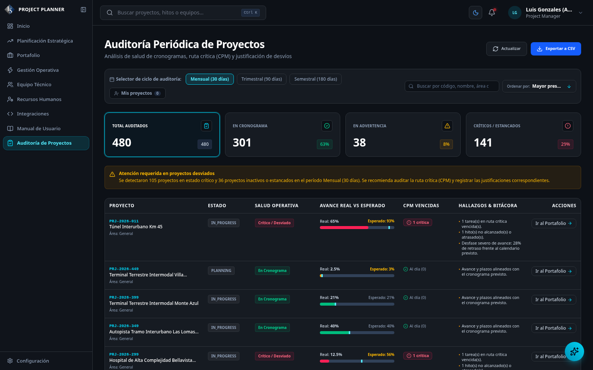

# 9. Auditoría Periódica de Proyectos (Desviaciones y Salud)

[← Volver al índice](./README.md)

---

## Espacios y Componentes de Auditoría

La vista de **Auditoría Periódica de Proyectos** evalúa de forma preventiva el estado de salud de toda la cartera y facilita el seguimiento de desviaciones de plazos:

- **1. Selector de Ciclo de Auditoría:**
  - **Monthly (30 días):** Evalúa obras con actividad, hitos o entregables en el último mes (ideal para comités operativos semanales).
  - **Quarterly (90 días):** Evalúa el avance físico en el trimestre de gestión.
  - **Semiannual (180 días):** Amplía la revisión a 6 meses (útil para detectar obras estancadas o sin movimiento técnico reciente).
  - **Filtro “My projects”:** Aísla de inmediato únicamente las obras donde usted figura como líder técnico asignado.

- **2. Tarjetas de Diagnóstico de Salud:**
  - **TOTAL AUDITED:** Conteo de proyectos que caen dentro del ciclo seleccionado.
  - **ON SCHEDULE (Verde):** Obras con avance normal y sin tareas críticas atrasadas.
  - **WARNING (Amarillo):** Obras con retraso moderado (entre 10% y 25%).
  - **CRITICAL / STALLED (Rojo):** Obras con desvío severo (mayor al 25%) o prolongada inactividad.

- **3. Caja de Alerta (Attention Required):**
  - Notificación resumen que detalla la cantidad de proyectos en estado crítico detectados en el ciclo seleccionado.

- **4. Buscador y Criterios de Ordenación (`Sort by`):**
  - *Highest budget / Lowest budget:* Clasificación por monto de presupuesto.
  - *Most delayed / Lowest progress:* Clasificación por mayor retraso temporal o menor avance porcentual.
  - *Most overdue CPM:* Clasifica en los primeros lugares a los proyectos que acumulan mayor cantidad de tareas en ruta crítica vencidas.

- **5. Tabla Detallada de Auditoría:**
  - Columnas de Proyecto, Estado, Salud Operativa, Avance Actual vs. Previsto, CPM Vencidas, Hallazgos y botón interactivo de acción **[Go to Portfolio →]**.

*Figura 9.1: Vista oficial de Auditoría Periódica con selector de ciclos, tarjetas de salud y acceso directo al portafolio.*

---

## 9.1 Consultar la auditoría periódica y cambiar el ciclo

**Disponible para:** Administrador y Subadministrador.

1. En el menú lateral, seleccione **“Auditoría de Proyectos”** (`Shift + 7`).
2. En la franja superior, elija el periodo que desea evaluar (**Monthly (30 days)**, **Quarterly (90 days)** o **Semiannual (180 days)**).
3. Si desea ver únicamente sus proyectos asignados, active la casilla **My projects**.
4. Revise las tarjetas de diagnóstico para conocer el total de obras evaluadas y cuántas se encuentran en cronograma o en alerta.

**Resultado esperado:** la tabla y las métricas se recalculan instantáneamente según el ciclo elegido.

---

## 9.2 Filtrar y ordenar la lista de obras

**Disponible para:** Administrador y Subadministrador.

1. Escriba en la caja de búsqueda para localizar un proyecto por código o nombre.
2. En el desplegable **Sort by**, seleccione el criterio de ordenamiento que requiera:
   - Elija **Highest budget** para revisar primero las obras con mayor inversión.
   - Elija **Most delayed** para priorizar las obras con mayor desfase de tiempo.
   - Elija **Most overdue CPM** para listar al inicio aquellas obras que presentan mayor número de tareas críticas atrasadas.
3. Para restablecer la lista, presione **[Reset filters]**.

**Resultado esperado:** la tabla reorganiza las filas de inmediato según la opción elegida.

---

## 9.3 Acceder directamente al proyecto en el Portafolio

**Disponible para:** Administrador y Subadministrador.

1. En la fila del proyecto auditado que requiera supervisión, presione el botón **[Go to Portfolio →]**.

**Resultado esperado:** el sistema abre automáticamente el módulo de **Portafolio** y muestra directamente el proyecto seleccionado en pantalla, listo para editar datos, asignar personal o revisar documentos.

**Si no funciona:** compruebe que el proyecto siga activo en la plataforma y no haya sido eliminado por un administrador.

---

## 9.4 Exportar el informe oficial de auditoría en CSV

**Disponible para:** Administrador y Subadministrador.

1. Defina los filtros de ciclo y búsqueda deseados en la tabla.
2. En la esquina superior derecha, presione el botón azul **[Export to CSV]**.
3. El navegador descargará automáticamente el archivo estructurado `auditoria-proyectos-<ciclo>-<fecha>.csv` con el desglose de avance previsto, real, tareas críticas y hallazgos.
