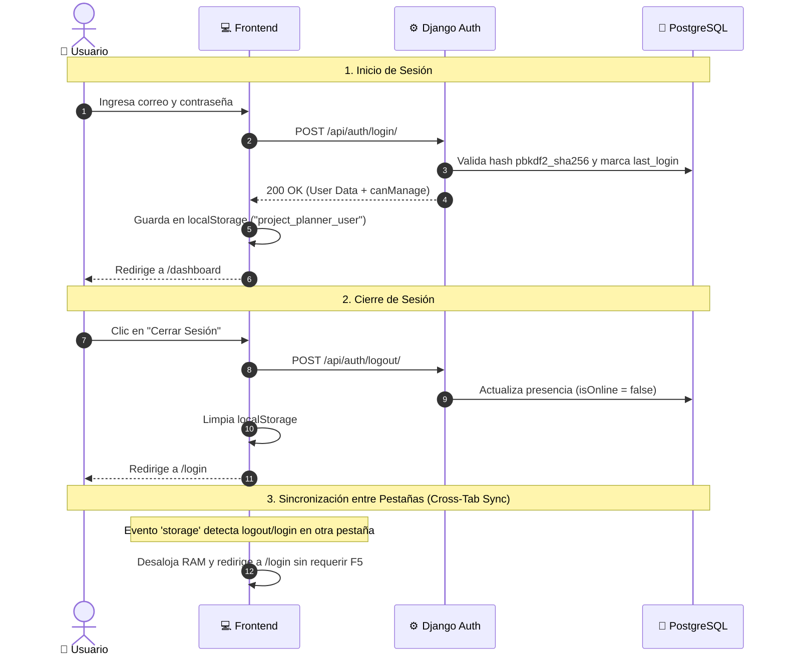

# 🔐 Módulo 01: Autenticación, Seguridad y Roles (RBAC)

> **Rutas en la aplicación:** `/login`, `/roles`, `/configuracion`  
> **Componentes principales:** `LoginScreen.jsx`, `RolesManagement.jsx`, `Configuration.jsx`, `ProfileControls.jsx`  
> **Controlador y Guards:** `useAppController.jsx`, `navigation.config.js`  
> **Historias de Usuario:** HU-01 (Autenticación y Presencia) y HU-02 (RBAC y Permisos)  
> **Estado:** 🟢 100% Funcional y persistido en PostgreSQL  

---

## 1. 🎯 Propósito y Alcance

Garantiza la seguridad y confidencialidad del sistema gestionando el acceso mediante credenciales encriptadas, determinando los permisos de cada usuario según su rol y monitoreando en tiempo real el estado de presencia (*En línea* / *Desconectado*).

---

## 2. 👥 Matriz de Roles y Niveles de Acceso (RBAC)

El sistema define dos perfiles base con posibilidad de delegación dinámica:

| Rol del Usuario | Nivel Técnico | Vistas Permitidas | Acciones Clave |
| :--- | :---: | :--- | :--- |
| **Project Manager** (`ADMIN`) | Administrador | Todas las rutas (`/dashboard`, `/planning`, `/portfolio`, `/operations`, `/team`, `/human-resources`, `/integrations`, `/roles`, `/configuracion`) | Acceso total, reajuste de cronogramas, aprobación de hitos, alta de proyectos y gestión confidencial de usuarios. |
| **Especialista Técnico** (`USER`) | Operativo | Acceso de consulta y operación (`/dashboard`, `/planning*`, `/portfolio`, `/operations`, `/team`, `/human-resources`, `/integrations`) | Registro de avances y tareas de campo. En `/planning` accede en modo **Solo Lectura** (`canManage = false`). |
| **SubAdministrador** | Delegado | Mismas vistas operativas + permisos de edición en proyectos y cronogramas. | Activado dinámicamente por un Administrador desde `/roles` mediante `canManage = true`. |

---

## 3. 🛡️ Políticas de Navegación y Guards (`navigation.config.js`)

Cada cambio de URL o clic en la barra de navegación es evaluado por funciones de guardia centralizadas:

* **`hasViewAccess(viewId, user)`:** Verifica si el rol del usuario autenticado tiene autorización para la vista destino. Si un usuario no autorizado intenta forzar la URL `/roles`, es interceptado y redirigido al `/dashboard`.
* **`getAllowedSidebarItems(user)`:** Filtra los elementos visibles en el menú lateral. Las opciones administrativas confidenciales quedan completamente ocultas para los usuarios técnicos.

---

## 4. 🔄 Ciclo de Vida de la Sesión y Presencia

### 4.1. ⚡ Sincronización de Sesión en Tiempo Real (Cross-Tab Sync)
Para evitar que una pestaña conserve datos obsoletos en memoria (RAM) o permisos desfasados al cerrar sesión o cambiar de cuenta en otra pestaña del mismo navegador, el controlador central [`useAppController.jsx`](frontend/src/controllers/useAppController.jsx) implementa un escucha del evento nativo `window.addEventListener('storage', ...)`:
* **Cierre de sesión remoto:** Si cualquier pestaña invoca `handleLogout`, las demás pestañas detectan el borrado de `project_planner_user`, desalojan inmediatamente sus estados en memoria y son redirigidas a `/login` sin requerir recargar con F5.
* **Cambio de cuenta remoto:** Si se inicia sesión con otro perfil en una pestaña diferente, todas las pestañas sincronizan el usuario activo y reevalúan los guards RBAC al instante.

---

## 5. 🔌 Endpoints y Modelos Asociados

| Método | Endpoint | Acción / Descripción | Códigos HTTP |
| :---: | :--- | :--- | :---: |
| `POST` | `/api/auth/login/` | Autentica usuario y verifica concordancia de rol. Retorna datos de sesión, foto y teléfono. | `200 OK`, `401 Unauthorized` |
| `POST` | `/api/auth/logout/` | Desconecta al usuario y actualiza presencia en base de datos. | `200 OK` |
| `POST` | `/api/auth/change-password/` | Cambia la contraseña validando la clave actual y aplicando hash en BD. | `200 OK`, `400 Bad Request`, `404 Not Found` |
| `GET` | `/api/auth/profile/` | Obtiene la foto de perfil (avatar), correo electrónico, teléfono y datos personales del usuario desde la BD. | `200 OK`, `404 Not Found` |
| `PATCH`| `/api/auth/profile/` | Actualiza foto de perfil, correo electrónico (Gmail, Outlook, etc.), teléfono y nombre en BD con validación de unicidad y auditoría. | `200 OK`, `400 Bad Request`, `404 Not Found` |
| `GET` | `/api/auth/audit-logs/` | Bitácora de auditoría de seguridad para el Administrador (historial de cambios de correo, claves y accesos). | `200 OK` |
| `GET` | `/api/auth/users-status/` | Lista usuarios técnicos registrados con su estado real de conexión (`isOnline`). | `200 OK` |
| `PATCH`| `/api/auth/users-status/` | Activa o desactiva la condición de SubAdministrador (`isSubAdmin`). | `200 OK`, `400 Bad Request` |

### 5.1. Modelos de Base de Datos
* **`auth_user`:** Entidad principal de credenciales, nombres, correo y permisos nativos (`is_superuser`, `is_staff`).
* **`core_userprofile` (`UserProfile`):** Extensión 1 a 1 (`OneToOneField`) vinculada a cada usuario, garantizando la persistencia en PostgreSQL del avatar en Base64 (`avatar`) y teléfono de contacto (`phone`).
* **`core_securityauditlog` (`SecurityAuditLog`):** Registro inmutable de eventos críticos de seguridad (cambios de correo electrónico, cambios de contraseña y credenciales) con IP, valores anterior y nuevo, y marcas temporales para supervisión del Administrador.

---

## 6. 🧪 Pruebas Automatizadas

* **Backend (`core/tests.py`):**
  * `test_login_success`: Valida autenticación con credenciales correctas y actualización de sesión.
  * `test_login_invalid_credentials`: Rechazo con HTTP 401 ante contraseñas inválidas.
  * `ChangePasswordTests`: Valida cambio exitoso de contraseña, rechazo de clave actual incorrecta, contraseñas idénticas o no coincidentes, longitud mínima y login subsiguiente con la nueva credencial.
  * `UserProfileAPITests`: Valida actualización y persistencia de avatar Base64, teléfono y correo electrónico en PostgreSQL, rechazo de correos inválidos o duplicados, registro automático en `SecurityAuditLog`, retorno de foto en login subsiguiente y remoción segura de foto restaurando iniciales.
* **Frontend (`tests/navigation.test.mjs`, `tests/configurationAndLogin.test.mjs`):**
  * Valida que `hasViewAccess('roles', userTecnico)` retorne `false`.
  * Valida persistencia y limpieza de `localStorage` en `handleLogout`.
  * Valida botones interactivos de recuperación y soporte técnico en `LoginScreen.jsx`.
  * Valida modales de cambio de contraseña, edición de perfil y avatar interactivo estilo Discord en `Configuration.jsx`.
  * Valida visualización de la Bitácora de Auditoría para usuarios administradores.
  * Valida botones con icono de ojo para alternar visibilidad de contraseñas en todos los formularios (`LoginScreen`, `Configuration`, `TechnicalTeam`).
